AMBER
========

AMBER 由 AmberTools 开源工具集与商业模拟引擎组成，依托专用力场，完成生物大分子‑小分子体系建模、动力学模拟、自由能计算，用于分子模拟与计算机辅助药物研究。

版本：24

安装路径：/opt/app/amber/24

操作步骤：
1、进入 AMBER 安装目录，确认目录存在。

.. code-block:: text
         :linenos:
         :emphasize-lines: 1

         cd /opt/app/amber/24 && pwd

证明：命令返回 /opt/app/amber/24，说明 AMBER 安装目录存在。

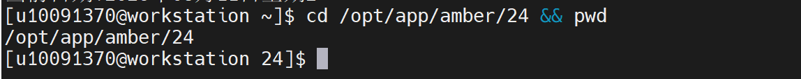

2、加载 AMBER 运行所需基础环境。

.. code-block:: text
         :linenos:
         :emphasize-lines: 1

         source /opt/app/base_lib/base_lib.sh
         source /opt/app/gcc/9.5.0_gcc4.8.5/gcc_9.5.0.sh
         source /opt/intel/oneapi/setvars.sh
         source /opt/app/amber/24/amber.sh

证明：环境加载过程中 oneAPI 输出 oneAPI environment initialized，说明基础运行环境已加载完成。

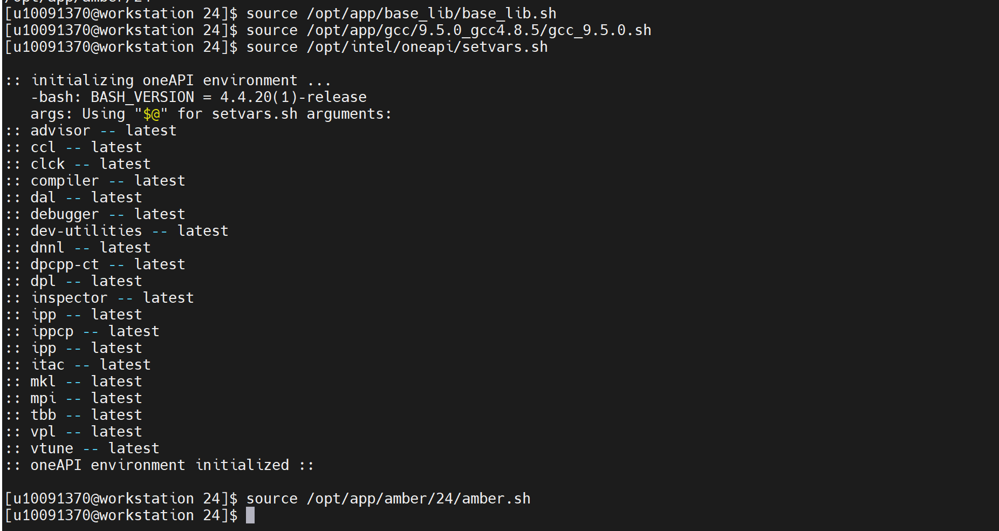

3、补充 AMBER 运行所需动态库路径，解决相关依赖库加载问题。

.. code-block:: text
         :linenos:
         :emphasize-lines: 1

         export LD_LIBRARY_PATH=/opt/app/base_lib/lib64:/opt/app/base_lib/lib:/opt/app/anaconda3/pkgs/mkl-2023.1.0-h213fc3f_46344/lib:$LD_LIBRARY_PATH

证明：动态库路径配置完成，为后续 sander、pmemd 等程序运行提供依赖环境。

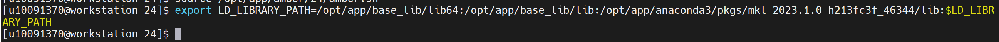

4、确认 sander 主程序是否已加入环境变量。

.. code-block:: text
         :linenos:
         :emphasize-lines: 1

         which sander

证明：返回 /opt/app/amber/24/bin/sander，说明 sander 主程序可识别。

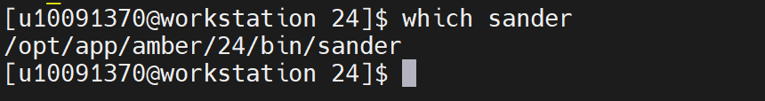

5、确认 pmemd 主程序是否存在。

.. code-block:: text
         :linenos:
         :emphasize-lines: 1

         which pmemd

证明：返回 /opt/app/amber/24/bin/pmemd，说明 pmemd 主程序可识别。

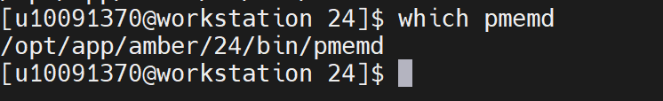

6、启动 sander 并查看用法信息，验证程序能否正常启动，不执行正式计算。

.. code-block:: text
         :linenos:
         :emphasize-lines: 1

         sander -h 2>&1 | head -30

证明：返回 mdfil: Error unknown flag: -h 以及 usage 等用法信息，说明 sander 主程序已被调用，并能输出命令用法信息。该提示表示 sander 不支持 -h 参数，但程序本身可正常启动。

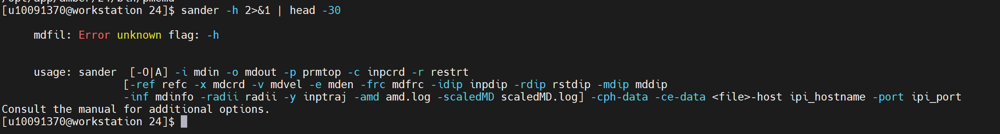

7、切换到用户家目录，避免在安装目录下产生只读目录写入问题。

.. code-block:: text
         :linenos:
         :emphasize-lines: 1

         cd ~

证明：已进入用户目录，后续验证文件和计算结果均在用户目录下生成，不影响安装目录。

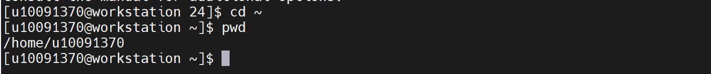

8、启动 pmemd，验证 pmemd 主程序是否能够正常启动。

.. code-block:: text
         :linenos:
         :emphasize-lines: 1

         pmemd -O 2>&1 | head -20

证明：程序能够启动并提示 Unit 115 Error on OPEN: mdin，是因为未提供 mdin 输入文件导致的正常提示，说明 pmemd 主程序已被成功调用；该步骤仅用于主程序打开验证，不代表正式计算失败。

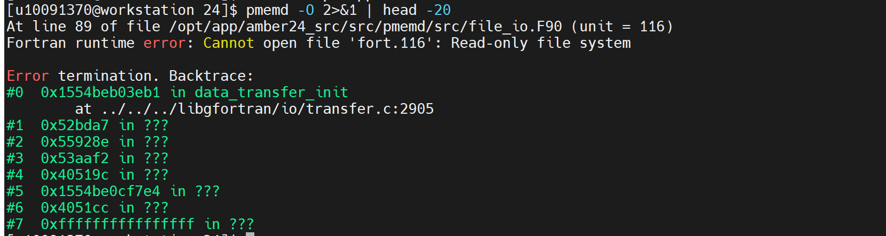

验证步骤：
9、确认 AMBER 分子动力学验证算例压缩包是否存在。

.. code-block:: text
         :linenos:
         :emphasize-lines: 1

         ls -lh "/home/share/验证示例文件/1734396102-622540-amber-demo.zip"

证明：返回 /home/share/验证示例文件/1734396102-622540-amber-demo.zip，文件大小约 108K，说明验证算例文件存在。

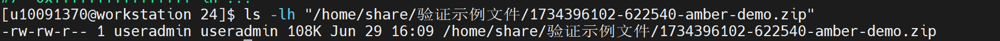

10、解压 AMBER 分子动力学验证算例到用户目录。

.. code-block:: text
         :linenos:
         :emphasize-lines: 1

         cd ~
         rm -rf ~/amber_validation
         mkdir -p ~/amber_validation
         unzip "/home/share/验证示例文件/1734396102-622540-amber-demo.zip" -d ~/amber_validation
         ls -lah ~/amber_validation

证明：解压后生成 /home/useradmin/amber_validation/amber_demo 目录，说明验证算例已准备完成。

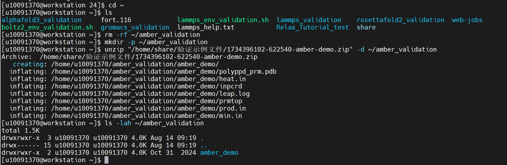

11、进入 AMBER 验证算例目录，并查看输入文件。

.. code-block:: text
         :linenos:
         :emphasize-lines: 1

         cd ~/amber_validation/amber_demo
         ls -lah
         pwd

证明：pwd 返回 /home/useradmin/amber_validation/amber_demo；目录中存在 min.in、heat.in、prod.in、prmtop、inpcrd、polyppd_prm.pdb 等文件，说明 AMBER 计算输入文件完整。

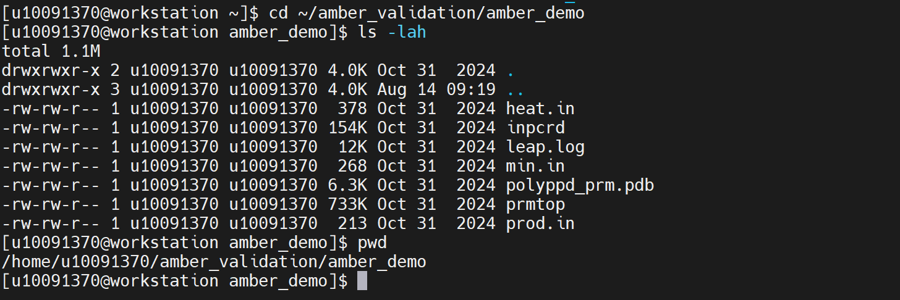

12、查看原始最小化输入文件参数。

.. code-block:: text
         :linenos:
         :emphasize-lines: 1

         cat min.in

证明：min.in 中包含 imin=1、maxcyc=2000、ntpr=100、cut=8.0 等参数，说明该文件为 AMBER 能量最小化输入文件。

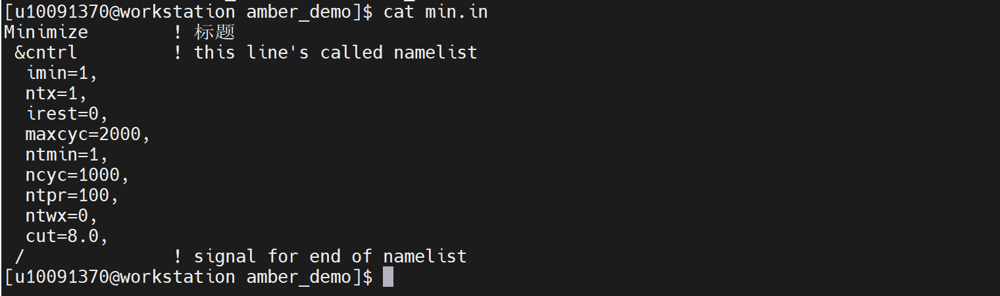

13、运行 AMBER 原始最小化算例，验证程序能否读取输入文件并执行计算。

.. code-block:: text
         :linenos:
         :emphasize-lines: 1

         sander -O -i min.in -o min.out -p prmtop -c inpcrd -r min.rst | tee amber_min.log

证明：运行后生成 min.out 和 min.rst 文件，说明 sander 能够读取 min.in、prmtop、inpcrd 输入文件并执行能量最小化计算。

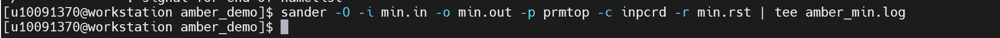

14、查看原始最小化计算结果文件。

.. code-block:: text
         :linenos:
         :emphasize-lines: 1

         ls -lh min.out min.rst amber_min.log
         tail -40 min.out

证明：返回结果中出现 min.out 和 min.rst；min.out 中出现 NSTEP、ENERGY、RMS、GMAX、BOND、ANGLE、DIHED、VDWAALS、EEL 等计算信息，说明 AMBER 已实际执行能量最小化计算。

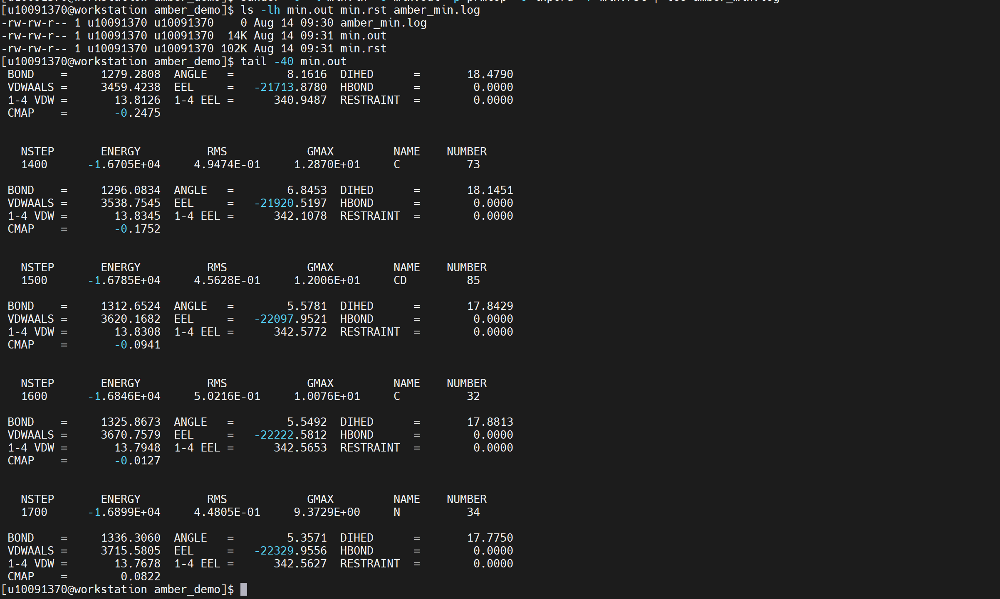

15、创建短周期最小化验证输入文件，用于快速完成验证。

.. code-block:: text
         :linenos:
         :emphasize-lines: 1

         cat > min_validate.in <<'EOF'
         AMBER minimization validation
         &cntrl
         imin=1,
         ntx=1,
         irest=0,
         maxcyc=100,
         ntmin=1,
         ncyc=50,
         ntpr=10,
         ntwx=0,
         cut=8.0,
         /
         EOF

证明：生成 min_validate.in 文件，设置 maxcyc=100，用于 AMBER 短周期能量最小化验证。

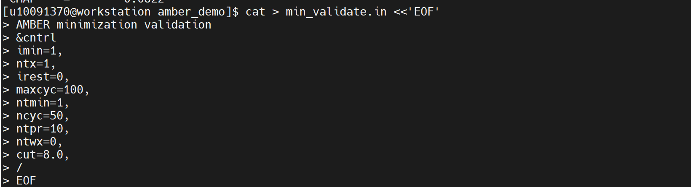

16、运行 AMBER 短周期能量最小化验证。

.. code-block:: text
         :linenos:
         :emphasize-lines: 1

         sander -O -i min_validate.in -o min_validate.out -p prmtop -c inpcrd -r min_validate.rst > amber_min_validate.log 2>&1

证明：程序执行完成后生成 min_validate.out 和 min_validate.rst，说明 AMBER 能够正常完成短周期能量最小化计算。

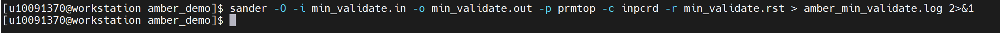

17、查看短周期验证结果文件。

.. code-block:: text
         :linenos:
         :emphasize-lines: 1

         ls -lh min_validate.in min_validate.out min_validate.rst amber_min_validate.log
         tail -80 min_validate.out

证明：返回结果中出现 min_validate.out 和 min_validate.rst；min_validate.out 中出现 NSTEP 100、ENERGY、RMS、GMAX 等计算结果，说明最小化计算执行到设定步数。

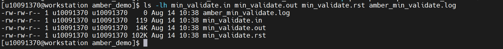

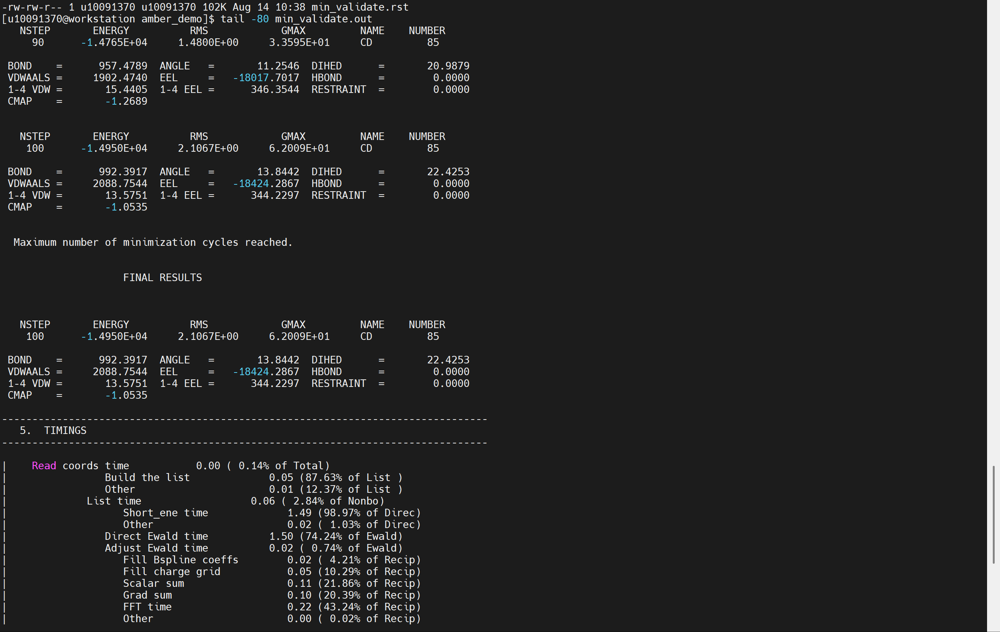

18、检查最终结果和异常信息。

.. code-block:: text
         :linenos:
         :emphasize-lines: 1

         grep -Eni "FINAL RESULTS|TIMINGS|Total time|wallclock|Run[[:space:]]+done" min_validate.out
         grep -Eni "fatal|terminated|segmentation|abort|error" min_validate.out amber_min_validate.log | grep -vi "relative error" || echo "未发现异常报错"

证明：第一条命令能够检索到 FINAL RESULTS、TIMINGS、Total time、Run done、wallclock 等信息，说明 AMBER 短周期能量最小化任务正常完成；第二条命令排除了 TESTING RELATIVE ERROR 这类正常精度测试信息后，未发现 fatal、terminated、segmentation、abort 等异常报错，说明验证过程中未发现运行异常。

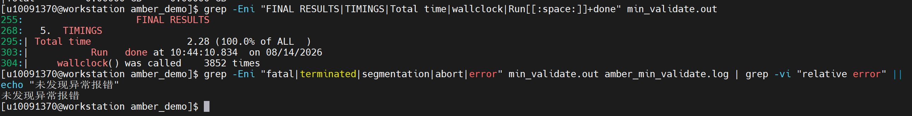
