Boltz2bou次图
==============

Boltz‑2 为 MIT 开源生物大分子 AI 共折叠模型，支持蛋白、核酸、小分子配体复合物三维结构预测，同步输出蛋白‑配体结合亲和力，用于药物研发中复合物建模与候选分子亲和力快速评估。

安装路径：/opt/app/anaconda3/envs/boltz

操作步骤：

1、激活 Boltz2 所在 Conda 环境。

.. code-block:: text
         :linenos:
         :emphasize-lines: 1

         source /opt/app/anaconda3/bin/activate boltz

证明：命令执行后终端前缀显示 (boltz)，说明 Boltz2 运行环境已激活。

2、确认当前 Python 路径和版本。

.. code-block:: text
         :linenos:
         :emphasize-lines: 1

         which python && python --version

证明：返回 /opt/app/anaconda3/envs/boltz/bin/python，Python 版本返回 Python 3.11.13，说明当前使用的是 Boltz2 环境中的 Python。

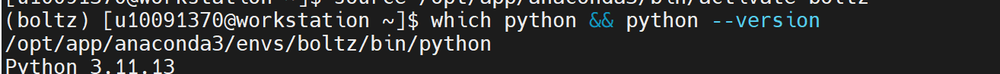

3、设置线程环境变量，避免基础数学库占用过多线程。

.. code-block:: text
         :linenos:
         :emphasize-lines: 1

         export OPENBLAS_NUM_THREADS=1
         export OMP_NUM_THREADS=1
         export MKL_NUM_THREADS=1

证明：命令执行无报错，说明线程环境变量设置完成。

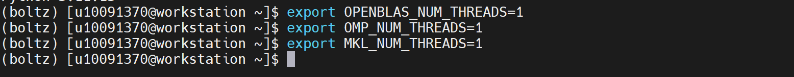

4、查看 Boltz 主命令是否可正常调用。

.. code-block:: text
         :linenos:
         :emphasize-lines: 1

         boltz --help

证明：命令返回 Usage: boltz [OPTIONS] COMMAND [ARGS]...，并显示 predict  Run predictions with Boltz.，说明 Boltz 主命令可正常识别。

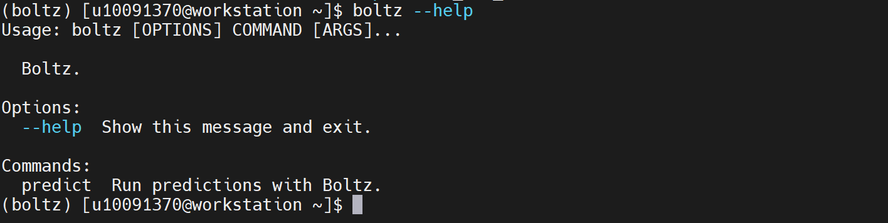

5、查看 Boltz 预测子命令是否可正常调用。

.. code-block:: text
         :linenos:
         :emphasize-lines: 1

         boltz predict --help

证明：命令返回 Usage: boltz predict [OPTIONS] DATA，并显示 Run predictions with Boltz. 以及 --out_dir、--cache、--checkpoint、--devices、--accelerator、--recycling_steps、--sampling_steps、--diffusion_samples 等预测参数，说明 Boltz 预测入口可正常调用。

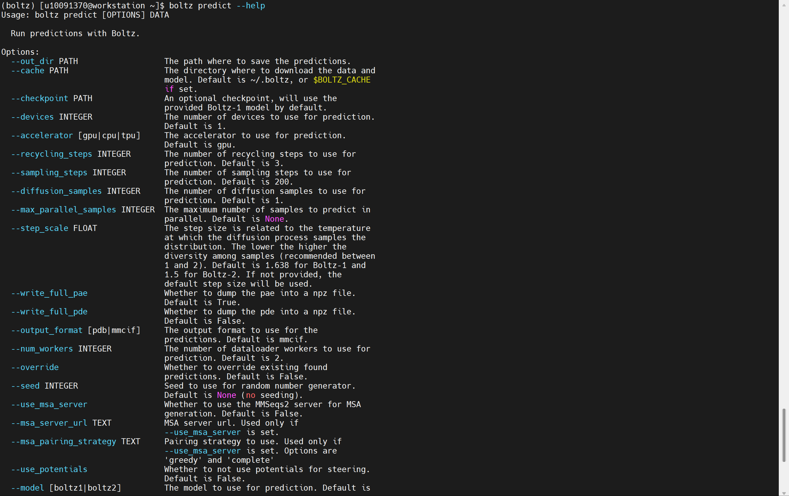

6、确认 Boltz2 YAML 验证输入文件存在。

.. code-block:: text
         :linenos:
         :emphasize-lines: 1

         ls -lh /home/share/验证示例文件/boltz_validation.yaml

证明：返回 /home/share/验证示例文件/boltz_validation.yaml 文件信息，说明 YAML 验证输入文件已创建成功。

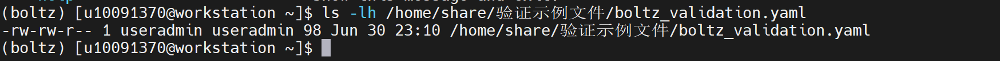

7、查看 Boltz2 YAML 验证输入文件内容。

.. code-block:: text
         :linenos:
         :emphasize-lines: 1

         cat /home/share/验证示例文件/boltz_validation.yaml

证明：文件内容包含 version: 1、sequences、protein、id: A、sequence: MKTFFVLLLCTFTVVSS、msa: empty，说明该 YAML 文件可作为 Boltz2 蛋白结构预测验证输入文件。

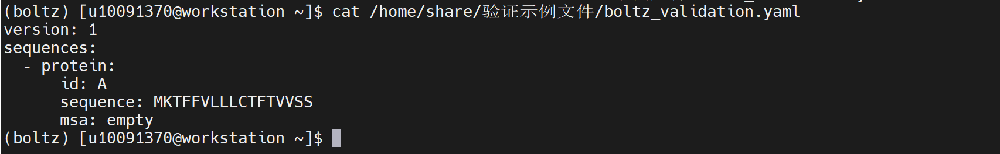

8、确认 Boltz2 FASTA 验证输入文件存在。

.. code-block:: text
         :linenos:
         :emphasize-lines: 1

         ls -lh /home/share/验证示例文件/boltz_validation.fasta

证明：返回 /home/share/验证示例文件/boltz_validation.fasta 文件信息，说明 FASTA 验证输入文件已创建成功。

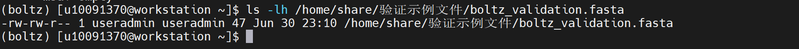

9、查看 Boltz2 FASTA 验证输入文件内容。

.. code-block:: text
         :linenos:
         :emphasize-lines: 1

         cat /home/share/验证示例文件/boltz_validation.fasta

证明：文件内容包含 Boltz2_validation_protein_A 蛋白序列，序列为 MKTFFVLLLCTFTVVSS，说明 FASTA 文件可正常读取。

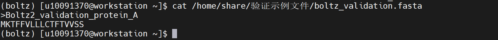

10、创建 Boltz2 环境汇总验证脚本

.. code-block:: text
         :linenos:
         :emphasize-lines: 1

         cd ~

.. code-block:: text
         :linenos:
         :emphasize-lines: 1

         cat > boltz2_env_validation.sh <<'EOF'
         #!/bin/bash

         echo "=================================================="
         echo "Boltz2 Environment Validation"
         echo "=================================================="

         echo "[1] Python executable:"
         which python

         echo
         echo "[2] Python version:"
         python --version

         echo
         echo "[3] Boltz command:"
         which boltz

         echo
         echo "[4] Boltz main help:"
         boltz --help > /tmp/boltz_help.txt
         head -20 /tmp/boltz_help.txt

         echo
         echo "[5] Boltz predict help:"
         boltz predict --help > /tmp/boltz_predict_help.txt
         head -40 /tmp/boltz_predict_help.txt

         echo
         echo "[6] Check validation YAML:"
         ls -lh /home/share/验证示例文件/boltz_validation.yaml
         cat /home/share/验证示例文件/boltz_validation.yaml

         echo
         echo "[7] Check validation FASTA:"
         ls -lh /home/share/验证示例文件/boltz_validation.fasta
         cat /home/share/验证示例文件/boltz_validation.fasta

         echo
         echo "[8] Python summary validation:"
         python - <<'PY'
         import sys
         import shutil
         from pathlib import Path

         yaml_file = Path("/home/share/验证示例文件/boltz_validation.yaml")
         fasta_file = Path("/home/share/验证示例文件/boltz_validation.fasta")
         boltz_cmd = shutil.which("boltz")

         print("Python executable:", sys.executable)
         print("Python version:", sys.version.split()[0])
         print("Boltz command:", boltz_cmd)
         print("Validation YAML exists:", yaml_file.exists())
         print("Validation FASTA exists:", fasta_file.exists())

         if not boltz_cmd:
             raise SystemExit("Validation: FAIL - boltz command not found")

         if not yaml_file.exists():
             raise SystemExit("Validation: FAIL - YAML file not found")

         if not fasta_file.exists():
             raise SystemExit("Validation: FAIL - FASTA file not found")

         print("Validation: PASS")
         PY

         echo
         echo "=================================================="
         echo "Boltz2 Environment Validation Finished"
         echo "=================================================="

         EOF

.. code-block:: text
         :linenos:
         :emphasize-lines: 1

         chmod +x boltz2_env_validation.sh

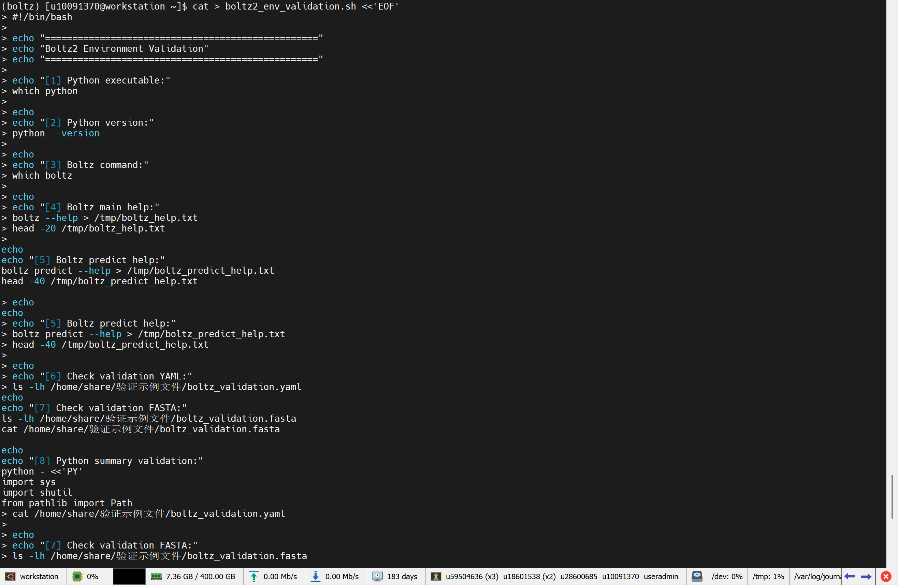

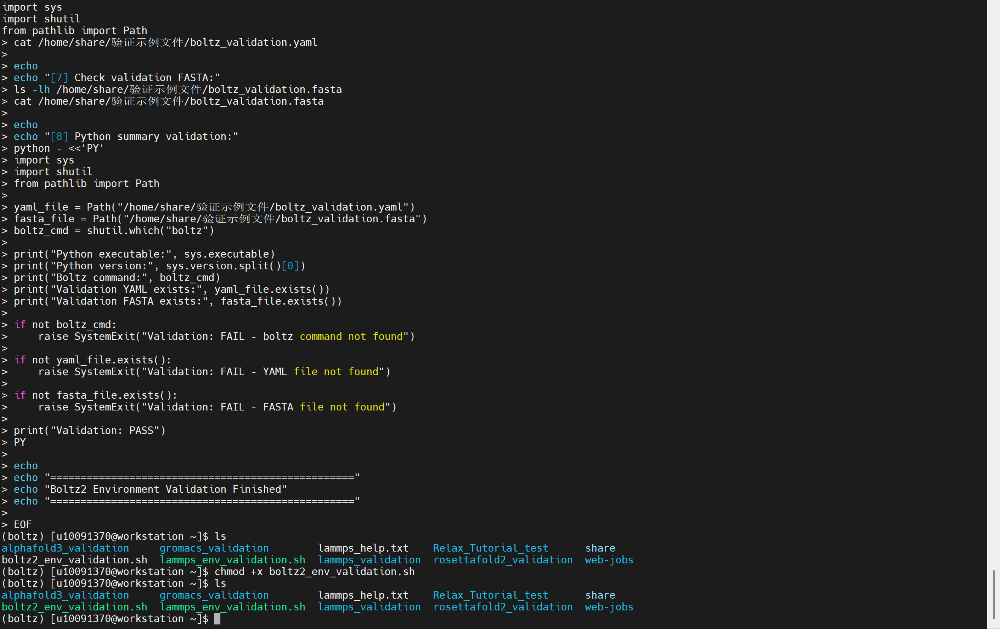

11、执行 Boltz2 环境汇总验证脚本。

.. code-block:: text
         :linenos:
         :emphasize-lines: 1

         bash ~/boltz2_env_validation.sh

证明：脚本返回 Python executable: /opt/app/anaconda3/envs/boltz/bin/python、Python version: 3.11.13、Boltz command: /opt/app/anaconda3/envs/boltz/bin/boltz、Validation YAML exists: True、Validation FASTA exists: True 以及 Validation: PASS，说明 Boltz2 基础运行环境、命令行入口、预测子命令和验证输入文件均验证通过。

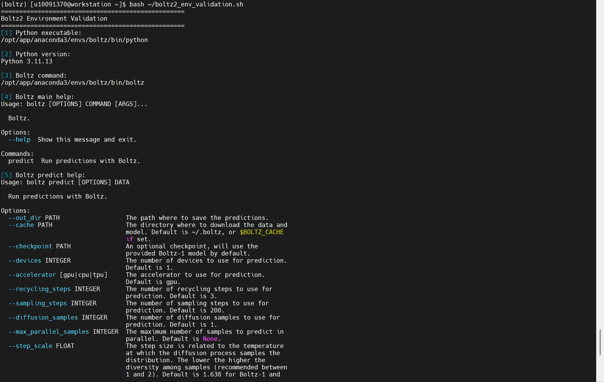

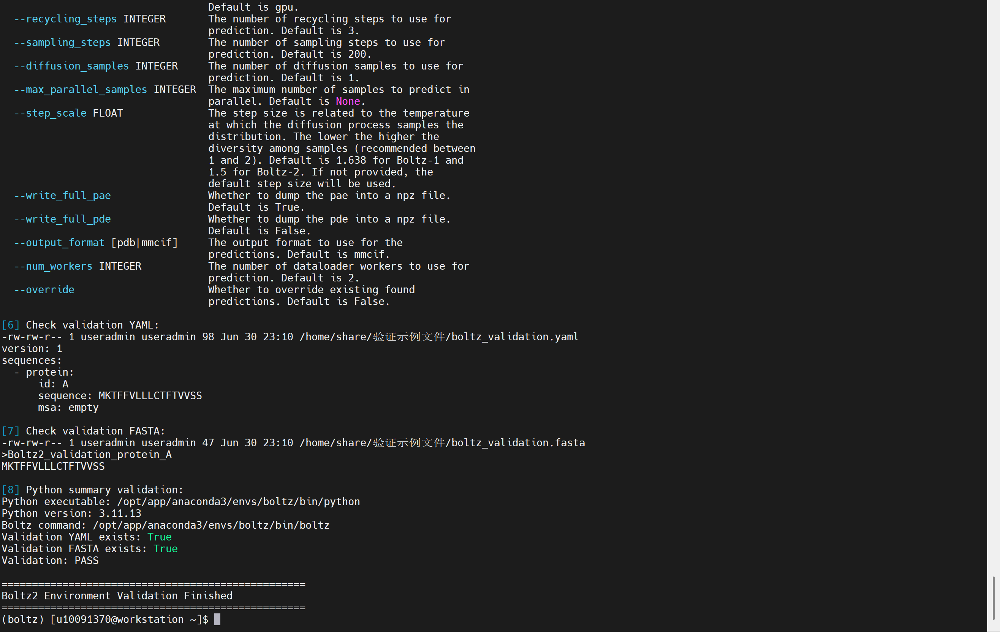
