CP2K
======

CP2K 为开源第一性原理原子模拟软件，支持 DFT、半经验、经典力场及 QM/MM 多尺度计算，完成材料、分子、生物体系的结构优化、第一性原理分子动力学、过渡态与光谱模拟，用于催化、材料及酶反应机理研究。

版本：2024.3 GPU 版

安装路径：/opt/app/sif/cp2k_gpu_2024.3.sif

操作步骤：
1、申请一个 GPU 节点。

.. code-block:: text
         :linenos:
         :emphasize-lines: 1

         salloc -p gpu -c 2 --mem=8G --gres=gpu:1
         
证明：返回 job allocation 信息，并提示 Nodes gpu1 或 gpu2 are ready for job，说明 GPU 节点资源申请成功。实际进入哪个 GPU 节点，以系统返回的节点名称为准。

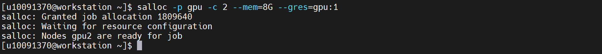

2、进入已分配的 GPU 节点。

.. code-block:: text
         :linenos:
         :emphasize-lines: 1

         ssh gpu2

证明：终端提示符切换为 gpu2，说明已进入分配的 GPU 节点。
说明：如果实际分配的是 gpu1，则执行 ssh gpu1；如果实际分配的是 gpu2，则执行 ssh gpu2。

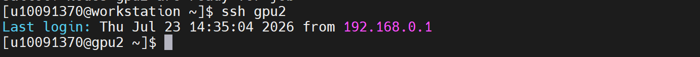

3、把 Apptainer 加入当前环境变量。

.. code-block:: text
         :linenos:
         :emphasize-lines: 1

         export PATH=/opt/app/apptainer/bin:$PATH

证明：Apptainer 路径已加入当前环境变量，后续可直接调用 apptainer 命令运行 CP2K 容器。

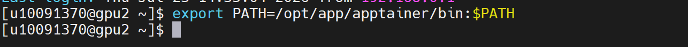

4、查看 NVIDIA GPU 状态。

.. code-block:: text
         :linenos:
         :emphasize-lines: 1

         nvidia-smi

证明：返回 NVIDIA-SMI 信息，显示 Driver Version 525.60.13、CUDA Version 12.0，GPU 显存约 24576MiB，说明 GPU 节点和 NVIDIA 驱动可正常识别。

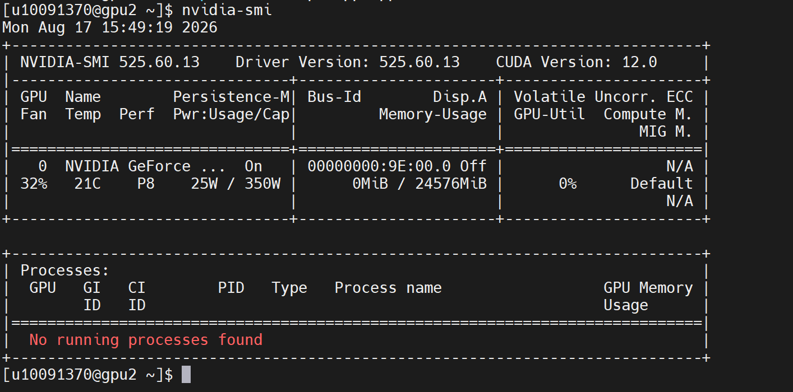

5、启动 CP2K GPU 容器并查看帮助信息，验证程序是否能够正常启动。

.. code-block:: text
         :linenos:
         :emphasize-lines: 1

         apptainer exec --bind /opt/app/nvidia/525.60.13/lib:/usr/local/nvidia/lib64 /opt/app/sif/cp2k_gpu_2024.3.sif bash -c 'export LD_LIBRARY_PATH=/usr/local/nvidia/lib64:$LD_LIBRARY_PATH; cp2k.popt -h'

证明：返回 cp2k.popt 的帮助信息，出现 cp2k.popt [-c|--check]、[-i] <input_file>、[-o] <output_file>、starts the CP2K program 等内容，说明 CP2K 主程序可正常启动。

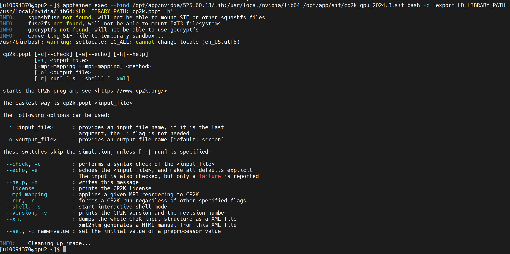

验证步骤：
6、确认 CP2K H2 快速验证压缩包已上传到公共目录。

.. code-block:: text
         :linenos:
         :emphasize-lines: 1

         ls -lh /home/share/验证示例文件/cp2k_h2_quick_validation.zip

证明：返回 /home/share/验证示例文件/cp2k_h2_quick_validation.zip，文件大小约 1.6K，说明验证压缩包已上传成功。

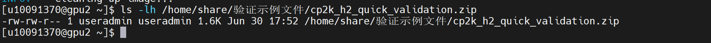

7、创建 CP2K H2 快速验证运行目录。

.. code-block:: text
         :linenos:
         :emphasize-lines: 1

         cd ~
         rm -rf ~/cp2k_h2_quick_validation
         mkdir -p ~/cp2k_h2_quick_validation
         cd ~/cp2k_h2_quick_validation

证明：进入 /home/useradmin/cp2k_h2_quick_validation，说明验证运行目录创建成功。

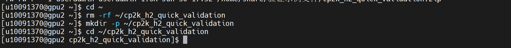

8、解压 CP2K H2 快速验证压缩包。

.. code-block:: text
         :linenos:
         :emphasize-lines: 1

         unzip -o /home/share/验证示例文件/cp2k_h2_quick_validation.zip
         ls -lh

证明：解压后生成 H2_quick.inp、README.txt、run_h2_quick.sh，说明 CP2K H2 快速验证文件准备完成。

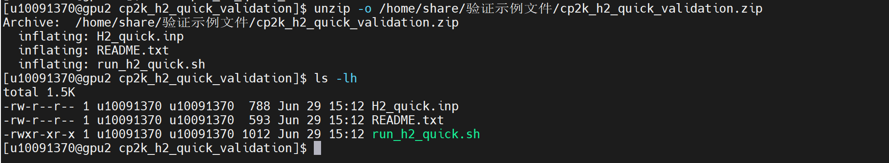

9、查看 H2_quick.inp 输入文件内容。

.. code-block:: text
         :linenos:
         :emphasize-lines: 1

         cat H2_quick.inp

证明：文件中包含 &GLOBAL、PROJECT H2_quick、RUN_TYPE ENERGY、&FORCE_EVAL、&DFT、&SUBSYS、&COORD、&KIND H 等配置，说明该文件为 CP2K H2 氢分子单点能计算验证输入文件。

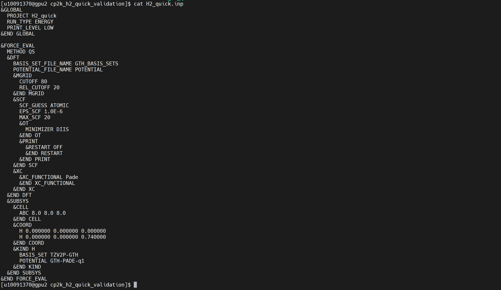

10、使用 CP2K 对 H2_quick.inp 输入文件进行语法检查。

.. code-block:: text
         :linenos:
         :emphasize-lines: 1

         cd ~/cp2k_h2_quick_validation

         apptainer exec --bind /opt/app/nvidia/525.60.13/lib:/usr/local/nvidia/lib64 /opt/app/sif/cp2k_gpu_2024.3.sif bash -c 'export LD_LIBRARY_PATH=/usr/local/nvidia/lib64:$LD_LIBRARY_PATH; cp2k.popt -c -i H2_quick.inp -o H2_quick_check.out'

         tail -50 H2_quick_check.out

证明：H2_quick_check.out 中出现 SUCCESS, the input could be parsed correctly，说明 H2_quick.inp 输入文件可以被 CP2K 正确解析。

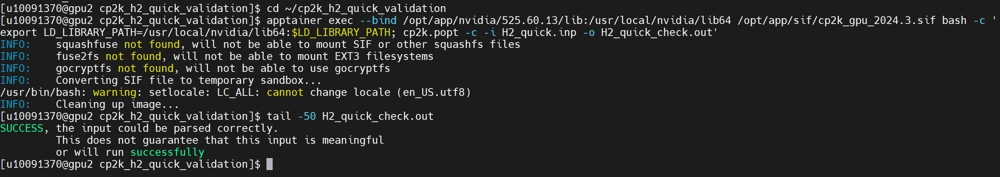

11、保存 CP2K H2 快速验证输入文件和检查日志到公共目录。

.. code-block:: text
         :linenos:
         :emphasize-lines: 1

         mkdir -p "/home/share/验证示例文件/CP2K量子化学验证算例"

         cp ~/cp2k_h2_quick_validation/H2_quick.inp "/home/share/验证示例文件/CP2K量子化学验证算例/"

         cp ~/cp2k_h2_quick_validation/README.txt "/home/share/验证示例文件/CP2K量子化学验证算例/"

         cp ~/cp2k_h2_quick_validation/run_h2_quick.sh "/home/share/验证示例文件/CP2K量子化学验证算例/"

         cp ~/cp2k_h2_quick_validation/H2_quick_check.out "/home/share/验证示例文件/CP2K量子化学验证算例/"

         ls -lh "/home/share/验证示例文件/CP2K量子化学验证算例/"

证明：公共目录中保存 H2_quick.inp、README.txt、run_h2_quick.sh、H2_quick_check.out 等文件，便于后续复测和验收查看。

12、退出 GPU 节点并释放资源。

.. code-block:: text
         :linenos:
         :emphasize-lines: 1

         exit
         squeue -u $USER

证明：退出 GPU 节点后回到登录节点，执行 squeue -u $USER 查看当前用户任务。如果不再显示当前 GPU 作业，说明 GPU 交互资源已释放；如果仍显示任务，可根据实际 job id 执行 scancel 释放资源。

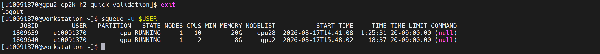
