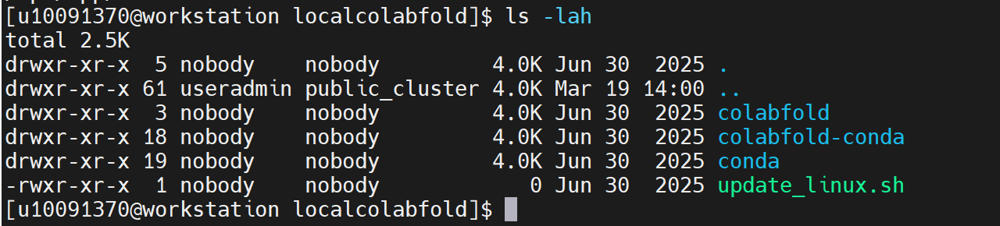
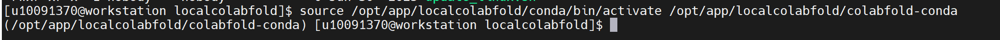
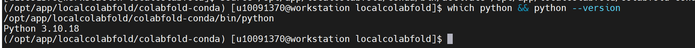
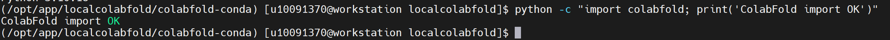
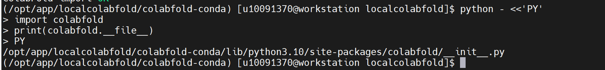
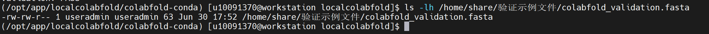
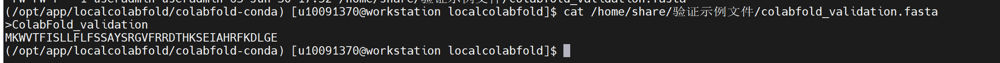
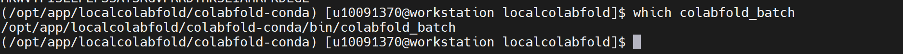
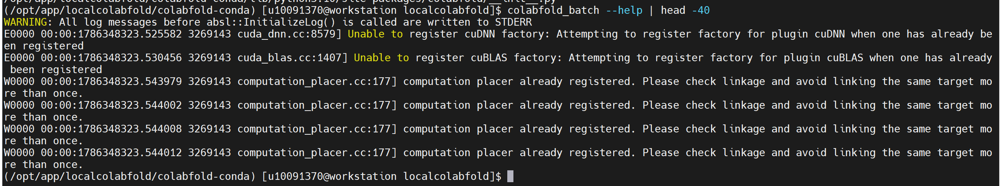
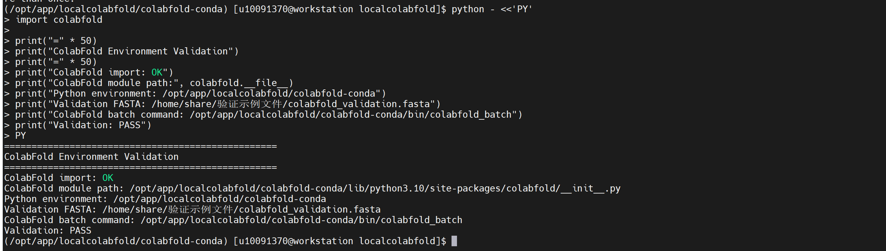

ColabFold
==========

版本：1.5.5
安装路径：/opt/app/localcolabfold

操作步骤：
1、进入 ColabFold 安装目录，确认目录存在。

.. code-block:: text
         :linenos:
         :emphasize-lines: 1

         cd /opt/app/localcolabfold && pwd

证明：命令返回 /opt/app/localcolabfold，说明 ColabFold 安装目录存在。

2、查看 ColabFold 安装目录内容，确认程序结构是否完整。

.. code-block:: text
         :linenos:
         :emphasize-lines: 1

         ls -lah

证明：返回结果中出现 colabfold、colabfold-conda、conda 等目录，说明 ColabFold 安装结构存在。

3、激活 ColabFold 自带的 Conda 环境。

.. code-block:: text
         :linenos:
         :emphasize-lines: 1

         source /opt/app/localcolabfold/conda/bin/activate /opt/app/localcolabfold/colabfold-conda

证明：命令执行后终端前缀显示 (/opt/app/localcolabfold/colabfold-conda)，说明 ColabFold 自带 Conda 环境已激活。

4、确认当前环境中的 Python 路径和版本。

.. code-block:: text
         :linenos:
         :emphasize-lines: 1

         which python && python --version

证明：which python 返回 /opt/app/localcolabfold/colabfold-conda/bin/python，Python 版本返回 Python 3.10.18，说明当前使用的是 ColabFold 环境中的 Python。

5、验证 ColabFold Python 模块是否可以正常导入。

.. code-block:: text
         :linenos:
         :emphasize-lines: 1

         python -c "import colabfold; print('ColabFold import OK')"

证明：返回 ColabFold import OK，说明 ColabFold Python 模块可以正常导入。

验证步骤：
6、查看 ColabFold Python 模块安装路径。

.. code-block:: text
         :linenos:
         :emphasize-lines: 1

         python - <<'PY'
         import colabfold
         print(colabfold.__file__)
         PY

证明：返回 /opt/app/localcolabfold/colabfold-conda/lib/python3.10/site-packages/colabfold/__init__.py，说明当前调用的是 ColabFold 自带环境中的模块。

7、确认 ColabFold FASTA 验证输入文件已上传。

.. code-block:: text
         :linenos:
         :emphasize-lines: 1

         ls -lh /home/share/验证示例文件/colabfold_validation.fasta

证明：返回 /home/share/验证示例文件/colabfold_validation.fasta，说明 ColabFold FASTA 验证输入文件已上传成功。

8、查看 FASTA 验证输入文件内容。

.. code-block:: text
         :linenos:
         :emphasize-lines: 1

         cat /home/share/验证示例文件/colabfold_validation.fasta

证明：文件中包含 ColabFold_validation 蛋白序列，可作为 ColabFold 蛋白结构预测输入文件。

9、检查 ColabFold 命令行入口是否存在。

.. code-block:: text
         :linenos:
         :emphasize-lines: 1

         which colabfold_batch

证明：返回 /opt/app/localcolabfold/colabfold-conda/bin/colabfold_batch，说明 ColabFold 命令行预测入口已正确配置。

10、启动 ColabFold 命令行帮助验证。

.. code-block:: text
         :linenos:
         :emphasize-lines: 1

         colabfold_batch --help | head -40

证明：执行后出现 JAX/CUDA 初始化日志，包括 cuDNN、cuBLAS、computation placer 等信息，说明 colabfold_batch 命令已进入 ColabFold 运行环境加载阶段。由于 JAX/CUDA 初始化过程较慢，本次安装验证以命令入口识别和环境加载启动为准。

11、执行 ColabFold 环境汇总验证。

.. code-block:: text
         :linenos:
         :emphasize-lines: 1

         python - <<'PY'
         import colabfold

         print("=" * 50)
         print("ColabFold Environment Validation")
         print("=" * 50)
         print("ColabFold import: OK")
         print("ColabFold module path:", colabfold.__file__)
         print("Python environment: /opt/app/localcolabfold/colabfold-conda")
         print("Validation FASTA: /home/share/验证示例文件/colabfold_validation.fasta")
         print("ColabFold batch command: /opt/app/localcolabfold/colabfold-conda/bin/colabfold_batch")
         print("Validation: PASS")
         PY

证明：返回 ColabFold import: OK、ColabFold module path、Python environment、Validation FASTA、ColabFold batch command 以及 Validation: PASS，说明 ColabFold 基础运行环境验证通过。

