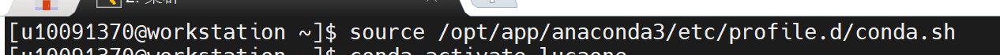
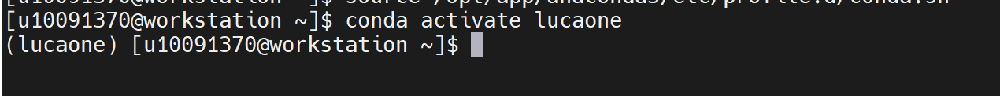
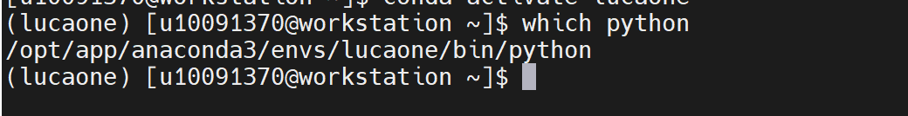
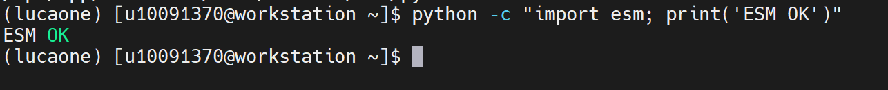
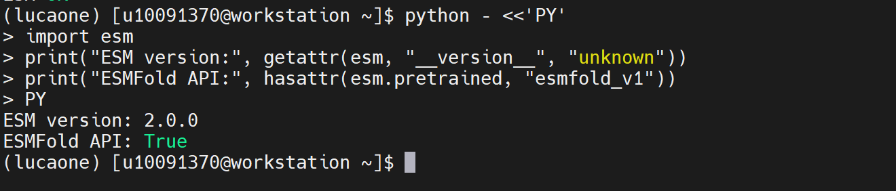
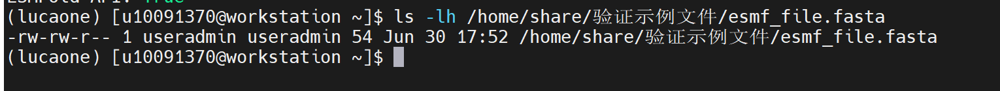
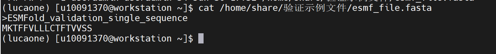
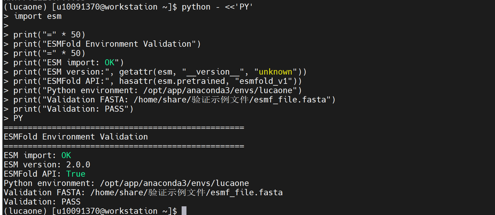

ESMFold
=============

ESMFold 为 Meta 开源 AI 蛋白结构预测模型，基于 ESM‑2 蛋白质大语言模型，无需多重序列比对，直接由氨基酸序列快速输出蛋白三维结构，输出置信度指标，用于高通量蛋白结构解析与蛋白工程研究。

单序列蛋白结构预测模型
安装路径：/opt/app/anaconda3/envs/lucaone

操作步骤：
1、加载 Conda 初始化脚本。

.. code-block:: text
         :linenos:
         :emphasize-lines: 1

         source /opt/app/anaconda3/etc/profile.d/conda.sh

证明：Conda 初始化脚本加载完成，后续可使用 conda activate 命令切换环境。

2、激活包含 ESM/ESMFold 的 lucaone 环境。

.. code-block:: text
         :linenos:
         :emphasize-lines: 1

         conda activate lucaone

证明：终端前缀出现 (lucaone)，说明 lucaone 环境已激活。

3、查看当前 Python 路径，确认使用的是 lucaone 环境。

.. code-block:: text
         :linenos:
         :emphasize-lines: 1

         which python

证明：which python 返回 /opt/app/anaconda3/envs/lucaone/bin/python，说明当前使用的是 lucaone 环境中的 Python。

4、验证 ESM Python 模块是否可以正常导入。

.. code-block:: text
         :linenos:
         :emphasize-lines: 1

         python -c "import esm; print('ESM OK')"

证明：返回 ESM OK，说明 ESM 软件包可以正常导入。

验证步骤：
5、查看 ESM 软件版本及 ESMFold 模型接口。

.. code-block:: text
         :linenos:
         :emphasize-lines: 1

         python - <<'PY'
         import esm
         print("ESM version:", getattr(esm, "__version__", "unknown"))
         print("ESMFold API:", hasattr(esm.pretrained, "esmfold_v1"))
         PY

证明：返回 ESM version: 2.0.0、ESMFold API: True，说明当前环境能够正确识别 ESMFold 模型接口。

6、确认 ESMFold FASTA 验证输入文件已上传。

.. code-block:: text
         :linenos:
         :emphasize-lines: 1

         ls -lh /home/share/验证示例文件/esmf_file.fasta

证明：返回 /home/share/验证示例文件/esmf_file.fasta，说明 ESMFold FASTA 验证输入文件已上传成功。

7、查看 FASTA 验证输入文件内容。

.. code-block:: text
         :linenos:
         :emphasize-lines: 1

         cat /home/share/验证示例文件/esmf_file.fasta

证明：文件中包含 ESMFold_validation 蛋白序列，可作为 ESMFold 单序列蛋白结构预测输入文件。

8、执行 ESMFold 环境汇总验证。

.. code-block:: text
         :linenos:
         :emphasize-lines: 1

         python - <<'PY'
         import esm

         print("=" * 50)
         print("ESMFold Environment Validation")
         print("=" * 50)
         print("ESM import: OK")
         print("ESM version:", getattr(esm, "__version__", "unknown"))
         print("ESMFold API:", hasattr(esm.pretrained, "esmfold_v1"))
         print("Python environment: /opt/app/anaconda3/envs/lucaone")
         print("Validation FASTA: /home/share/验证示例文件/esmf_file.fasta")
         print("Validation: PASS")
         PY

证明：返回 ESM import: OK、ESM version、ESMFold API、Python environment、Validation FASTA 以及 Validation: PASS，说明 ESMFold 基础运行环境验证通过。

