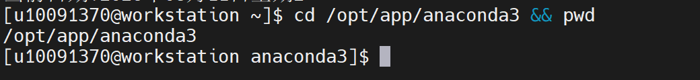
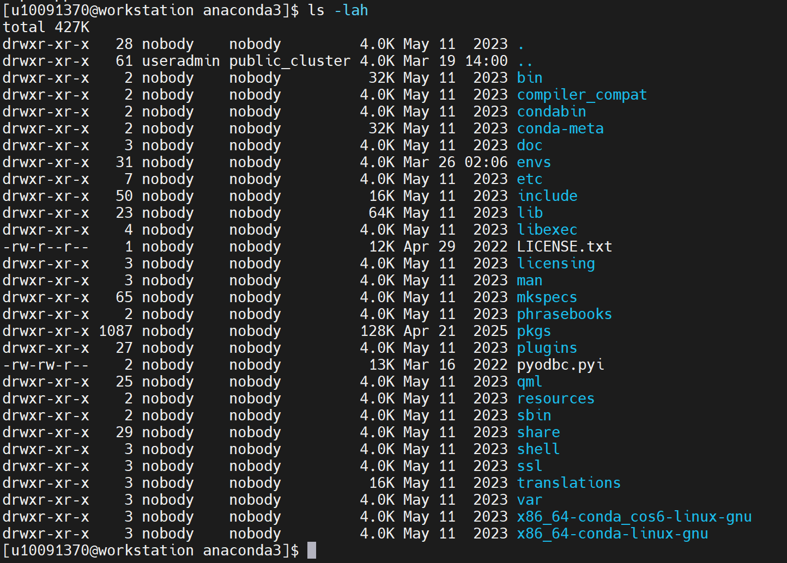
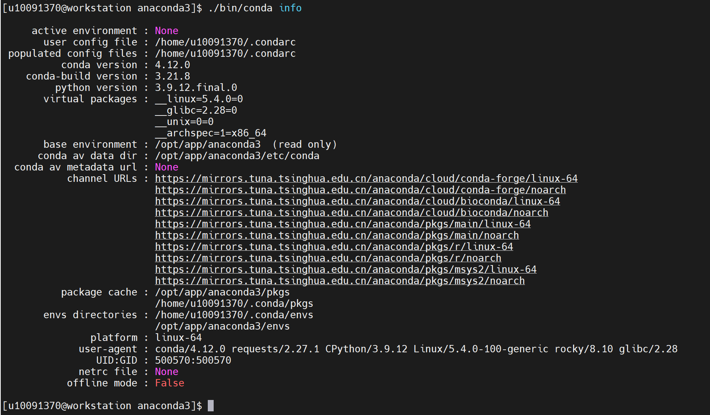
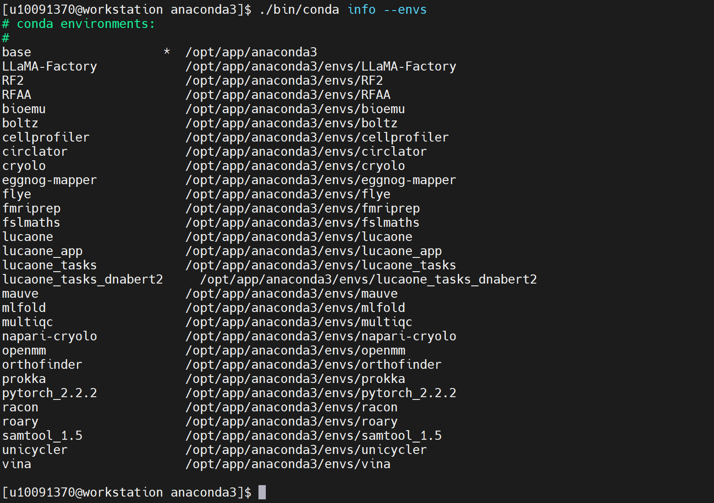
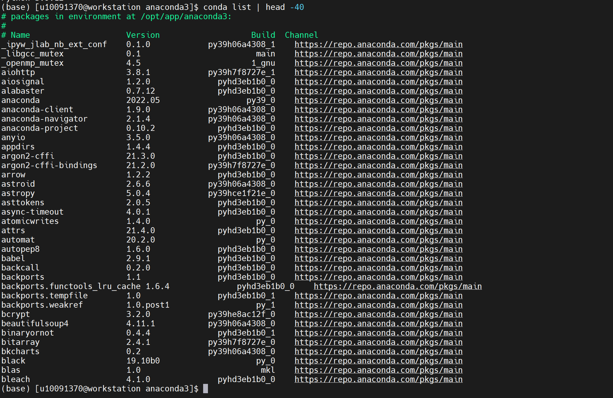
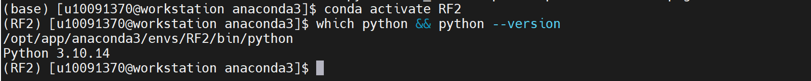
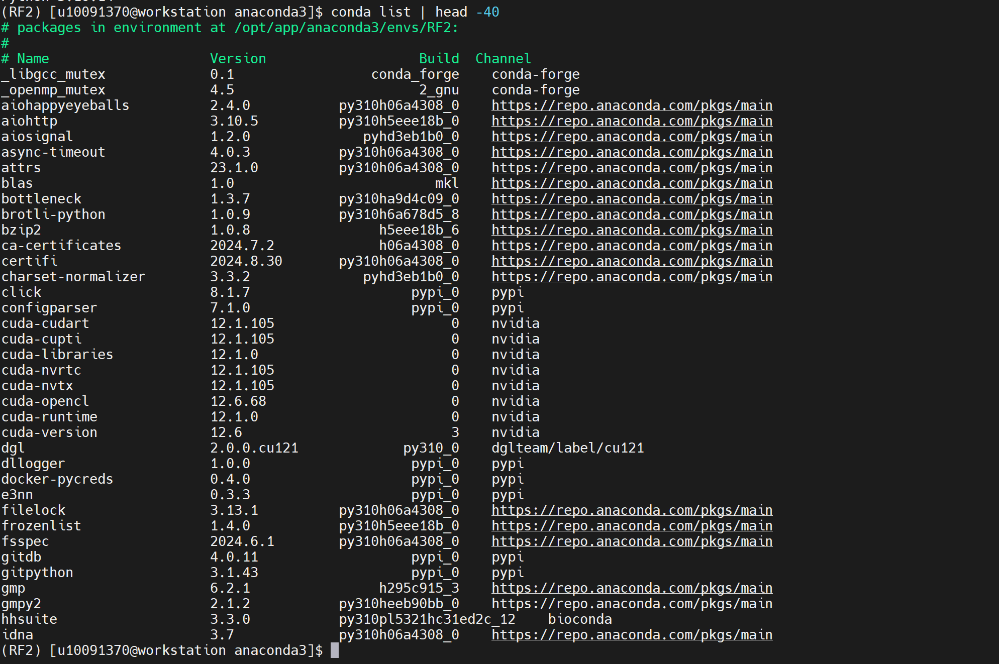

Miniconda
==============

Miniconda 是轻量级 conda 环境管理工具，自带 Python 与包管理能力，可按需创建隔离运行环境，安装、管理生物信息、计算化学各类科研软件包，用于科研软件环境部署与版本依赖管控。

安装路径：/opt/app/anaconda3

PS：这个软件不是“运算类软件”，不需要做计算文件。

操作步骤：
1、进入 Conda 安装目录，确认目录存在。

.. code-block:: text
         :linenos:
         :emphasize-lines: 1

         cd /opt/app/anaconda3 && pwd

证明：命令返回 /opt/app/anaconda3，说明 Conda 安装目录存在。

2、查看 Conda 安装目录内容，确认安装结构是否完整。

.. code-block:: text
         :linenos:
         :emphasize-lines: 1

         ls -lah

证明：返回结果中出现 bin、condabin、envs、pkgs、etc 等目录，说明 Conda 安装结构完整。

3、查看 Conda 版本，确认 Conda 能够正常启动。

.. code-block:: text
         :linenos:
         :emphasize-lines: 1

         ./bin/conda --version

证明：返回 conda 版本号，例如 conda 4.12.0，说明 Conda 主程序可以正常启动。

验证步骤：
4、查看 Conda 基本信息。

.. code-block:: text
         :linenos:
         :emphasize-lines: 1

         ./bin/conda info

证明：返回 active environment、base environment、platform、package cache、envs directories 等信息，说明 Conda 基础配置正常。

5、查看当前服务器中已有的 Conda 环境。

.. code-block:: text
         :linenos:
         :emphasize-lines: 1

         ./bin/conda info --envs

证明：返回 base、RF2、openmm、boltz、lucaone 等环境列表，说明 Conda 可以正常管理多个软件运行环境。

6、加载 Conda 初始化脚本，验证 conda activate 是否可用。

.. code-block:: text
         :linenos:
         :emphasize-lines: 1

         source /opt/app/anaconda3/etc/profile.d/conda.sh

证明：命令执行后，可以正常使用 conda activate 命令切换环境。

7、激活 base 环境。

.. code-block:: text
         :linenos:
         :emphasize-lines: 1

         conda activate base

证明：终端前缀出现 (base)，说明 Conda 环境激活功能正常。

8、确认当前 Python 路径和版本。

.. code-block:: text
         :linenos:
         :emphasize-lines: 1

         which python && python --version

证明：which python 返回 /opt/app/anaconda3/bin/python，Python 版本正常输出，说明 base 环境中的 Python 可以正常调用。

9、查看 base 环境中的已安装软件包。

.. code-block:: text
         :linenos:
         :emphasize-lines: 1

         conda list | head -40

证明：返回 python、pip、setuptools、conda 等软件包列表，说明 Conda 可以正常读取和管理软件包信息。

10、切换到一个已存在的业务环境，验证环境切换功能。

.. code-block:: text
         :linenos:
         :emphasize-lines: 1

         conda activate RF2
         which python && python --version

证明：终端前缀切换为 (RF2)，which python 返回 /opt/app/anaconda3/envs/RF2/bin/python，说明 Conda 可以正常切换到指定环境。

11、查看 RF2 环境中的软件包信息。

.. code-block:: text
         :linenos:
         :emphasize-lines: 1

         conda list | head -40

证明：返回 RF2 环境中的软件包列表，说明 Conda 可以正常读取不同环境中的包信息。

12、退出当前 Conda 环境。

.. code-block:: text
         :linenos:
         :emphasize-lines: 1

         conda deactivate

证明：终端前缀中的环境名称消失或返回上一级环境，说明 Conda 环境退出功能正常。

