NAMD
=====

NAMD 为开源并行分子动力学模拟软件，兼容 AMBER、CHARMM 等主流力场，实现蛋白、核酸、膜体系的大规模分子动力学模拟，可结合 VMD 完成建模与轨迹分析，多用于生物大分子动态行为模拟研究。

版本：2.14b1

安装路径：/opt/app/NAMD/2.14b1

操作步骤：
1、进入 NAMD 安装目录，确认目录存在。

.. code-block:: text
         :linenos:
         :emphasize-lines: 1

         cd /opt/app/NAMD/2.14b1 && pwd

证明：命令返回 /opt/app/NAMD/2.14b1，说明 NAMD 安装目录存在。

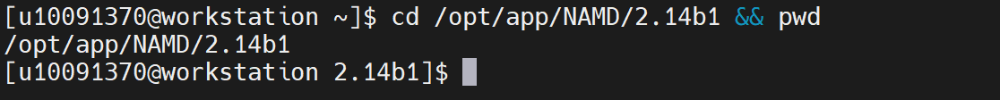

2、查看 NAMD 安装目录内容，确认程序结构是否完整。

.. code-block:: text
         :linenos:
         :emphasize-lines: 1

         ls -lah

证明：返回结果中出现 namd2、charmrun、psfgen 等文件，说明 NAMD 安装结构存在。

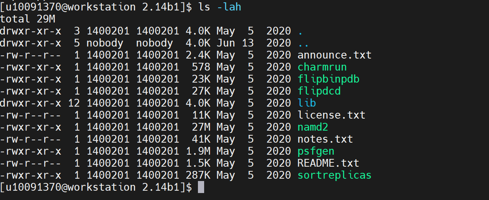

3、查看 NAMD 主程序。

.. code-block:: text
         :linenos:
         :emphasize-lines: 1

         ls -l /opt/app/NAMD/2.14b1/namd2

证明：返回 namd2 文件信息，且具有可执行权限，说明 NAMD 主程序存在。

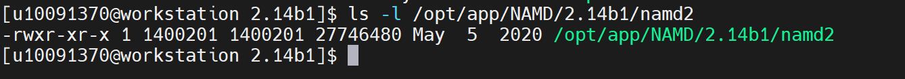

4、查看 NAMD 启动信息，验证主程序能够正常调用。

.. code-block:: text
         :linenos:
         :emphasize-lines: 1

         /opt/app/NAMD/2.14b1/namd2 +idlepoll

证明：返回 NAMD 2.14b1 for Linux-x86_64-multicore 等启动信息和版本信息；如未指定配置文件后提示 No simulation config file specified，属于正常现象，说明 namd2 主程序可以被成功调用。

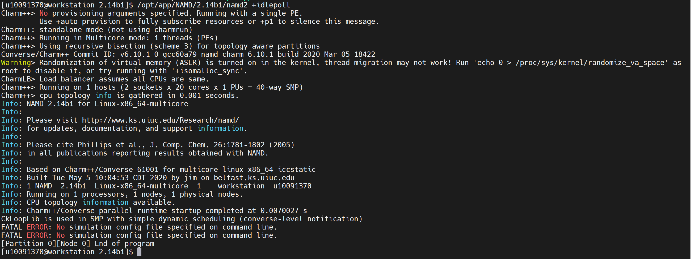

验证步骤：
5、创建 NAMD 验证目录和公共归档目录。

.. code-block:: text
         :linenos:
         :emphasize-lines: 1

         SHARE="/home/share/验证示例文件"
         WORK="$HOME/namd_validation_case"
         rm -rf "$WORK"
         mkdir -p "$WORK" "$SHARE"

证明：创建 /home/useradmin/namd_validation_case 作为本次 NAMD 验证运行目录，并确认 /home/share/验证示例文件 公共目录可用于保存验证文件。

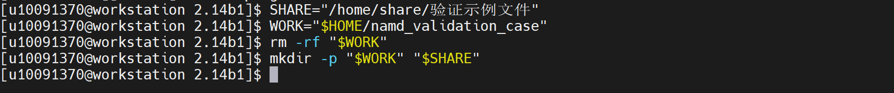

6、生成 NAMD 验证用 PDB 坐标文件。

.. code-block:: text
         :linenos:
         :emphasize-lines: 1

         cat > "$WORK/namd_validation.pdb" <<'EOF'
         ATOM      1  C   VAL X   1       0.000   0.000   0.000  1.00  0.00      VAL  C
         END
         EOF

证明：生成 namd_validation.pdb 文件，文件中包含 ATOM 原子坐标记录，可用于 NAMD 坐标输入验证。

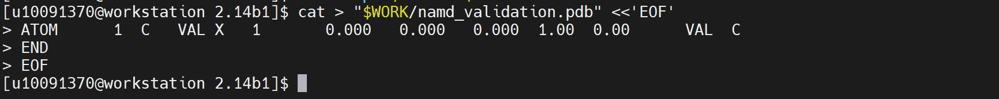

7、生成 NAMD 验证用 PSF 结构拓扑文件。

.. code-block:: text
         :linenos:
         :emphasize-lines: 1

         cat > "$WORK/namd_validation.psf" <<'EOF'
         PSF
         
            1 !NTITLE
         
         REMARKS NAMD minimal validation PSF
         
            1 !NATOM
            1 VAL      1 VAL  C    C     0.000000       12.0110           0
         
            0 !NBOND: bonds
         
            0 !NTHETA: angles
         
            0 !NPHI: dihedrals
         
            0 !NIMPHI: impropers
         
            0 !NDON: donors
         
            0 !NACC: acceptors
         
            0 !NNB
         
            0       0 !NGRP
         
         EOF

证明：生成 namd_validation.psf 文件，文件中包含 NTITLE、NATOM、NBOND、NTHETA、NPHI 等结构拓扑信息，可用于 NAMD 结构输入验证。

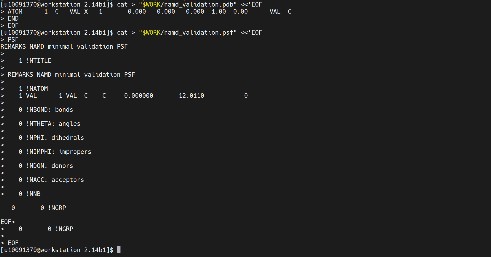

8、生成 NAMD 验证用参数文件。

.. code-block:: text
         :linenos:
         :emphasize-lines: 1

         cat > "$WORK/namd_validation.par" <<'EOF'
                  
                  * NAMD minimal validation parameter file
                  *
                  
                  BONDS
                  
                  ANGLES
                  
                  DIHEDRALS
                  
                  IMPROPER
                  
                  NONBONDED nbxmod  5 atom cdiel shift vatom vdistance vswitch -
                  cutnb 12.0 ctofnb 10.0 ctonnb 8.0 eps 1.0 e14fac 1.0 wmin 1.5
                  C     0.000000  -0.100000  2.000000
                  
                  END
                  EOF

证明：生成 namd_validation.par 参数文件，文件中包含 BONDS、ANGLES、DIHEDRALS、IMPROPER、NONBONDED 等参数段，说明 NAMD 参数文件准备完成。

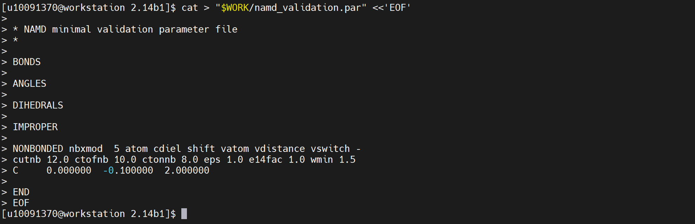

9、生成 NAMD 验证用配置文件。

.. code-block:: text
         :linenos:
         :emphasize-lines: 1

         cat > "$WORK/namd_validation.conf" <<'EOF'
         structure          namd_validation.psf
         coordinates        namd_validation.pdb
         parameters         namd_validation.par
         paraTypeCharmm     on
         
         outputName         namd_validation_output
         binaryoutput       no
         
         temperature        300
         exclude            none
         1-4scaling         1.0
         switching          off
         cutoff             12.0
         pairlistdist       14.0
         
         timestep           1.0
         rigidBonds         none
         fullElectFrequency 1
         stepspercycle      1
         
         outputEnergies     1
         outputTiming       1
         
         minimize           5
         run                5
         EOF

证明：生成 namd_validation.conf 配置文件，文件中包含 structure、coordinates、parameters、temperature、minimize、run 等关键配置项，说明 NAMD 分子动力学验证配置文件准备完成。

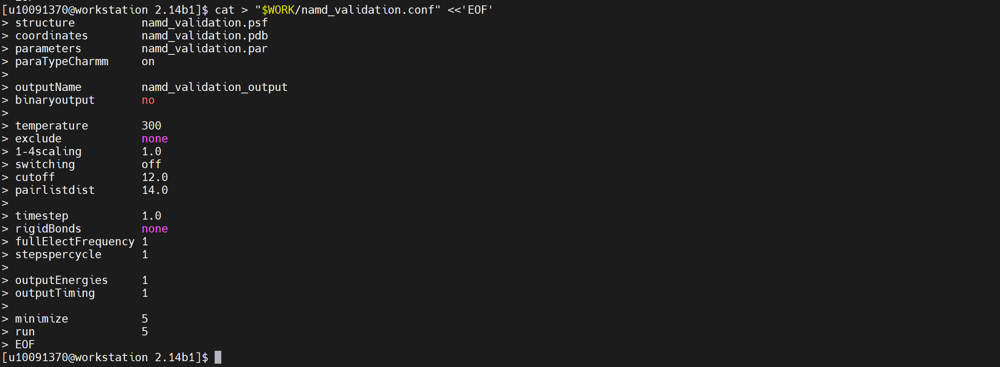

10、检查 NAMD 验证文件是否生成。

.. code-block:: text
         :linenos:
         :emphasize-lines: 1

         ls -lh "$WORK/namd_validation.pdb"
         ls -lh "$WORK/namd_validation.psf"
         ls -lh "$WORK/namd_validation.par"
         ls -lh "$WORK/namd_validation.conf"

证明：返回结果中能够看到 namd_validation.pdb、namd_validation.psf、namd_validation.par、namd_validation.conf 文件，说明 NAMD 验证输入文件已准备完成。

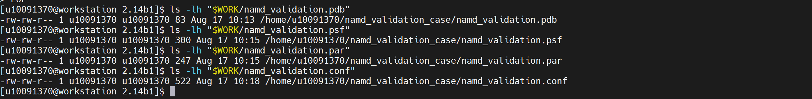

11、检查 PSF 文件是否包含异常 Markdown 符号。

.. code-block:: text
         :linenos:
         :emphasize-lines: 1

         grep -n $'\x60\x60\x60' "$WORK/namd_validation.psf" || echo "PSF 文件无 Markdown 符号"

证明：返回 PSF 文件无 Markdown 符号，说明 PSF 文件内容干净，没有混入多余的文档格式符号。

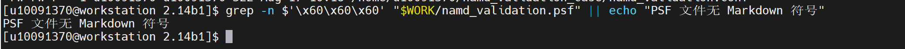

12、查看 NAMD PDB 坐标输入文件。

.. code-block:: text
         :linenos:
         :emphasize-lines: 1

         head -20 "$WORK/namd_validation.pdb"

证明：文件中包含 ATOM 原子坐标记录，说明 PDB 坐标输入文件可正常读取。

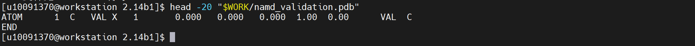

13、查看 NAMD PSF 结构拓扑文件。

.. code-block:: text
         :linenos:
         :emphasize-lines: 1

         head -40 "$WORK/namd_validation.psf"

证明：文件中包含 NTITLE、NATOM、NBOND、NTHETA、NPHI 等结构拓扑信息，说明 PSF 输入文件可正常读取。

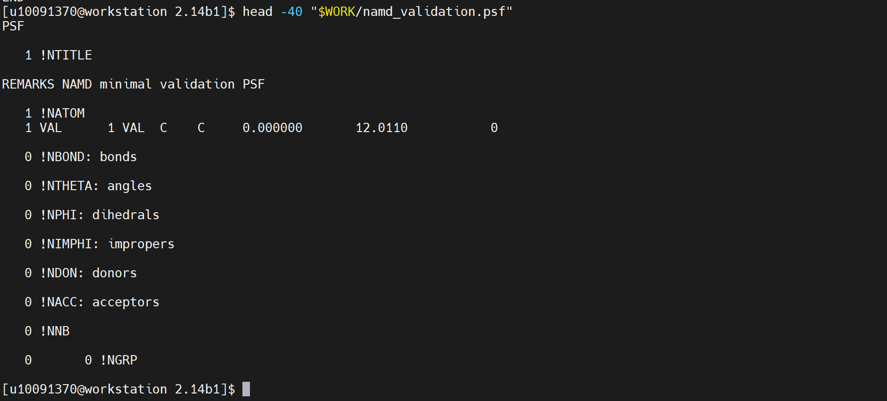

14、查看 NAMD 参数文件。

.. code-block:: text
         :linenos:
         :emphasize-lines: 1

         head -60 "$WORK/namd_validation.par"

证明：文件中包含 BONDS、ANGLES、DIHEDRALS、IMPROPER、NONBONDED 等参数段，说明 NAMD 参数文件可正常读取。

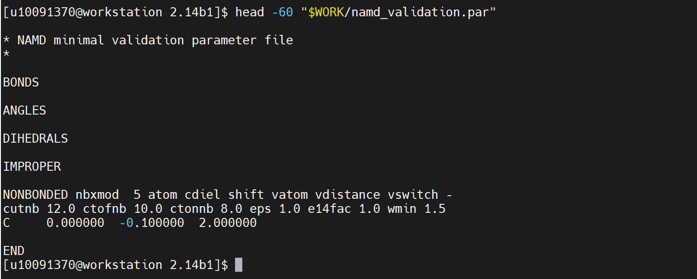

15、查看 NAMD 配置文件。

.. code-block:: text
         :linenos:
         :emphasize-lines: 1

         cat "$WORK/namd_validation.conf"

证明：配置文件中包含 structure、coordinates、parameters、temperature、minimize、run 等配置，说明 NAMD 分子动力学验证配置文件准备完成。

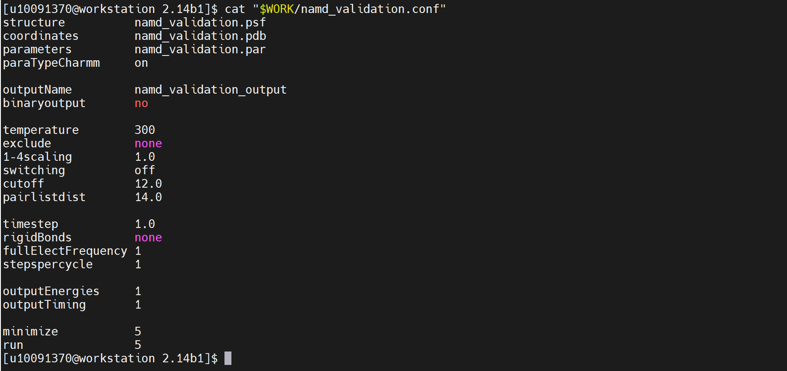

16、检查配置文件中引用的输入文件路径。

.. code-block:: text
         :linenos:
         :emphasize-lines: 1

         grep -E "structure|coordinates|parameters|temperature|1-4scaling|switching|cutoff|pairlistdist|fullElectFrequency|minimize|run" "$WORK/namd_validation.conf"

证明：返回 structure、coordinates、parameters、temperature、minimize、run 等关键配置项，说明 NAMD 输入文件路径和基础计算参数已配置。

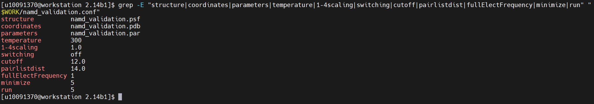

17、执行 NAMD 分子动力学最小验证计算。

.. code-block:: text
         :linenos:
         :emphasize-lines: 1

         cd "$WORK"
         /opt/app/NAMD/2.14b1/namd2 +idlepoll namd_validation.conf 2>&1 | tee namd_validation_run.log

证明：NAMD 能够读取 namd_validation.conf 配置文件，并加载 namd_validation.pdb、namd_validation.psf 和 namd_validation.par 文件后执行 minimize 和 run 计算流程，说明 NAMD 主程序可执行实际动力学模拟验证任务。

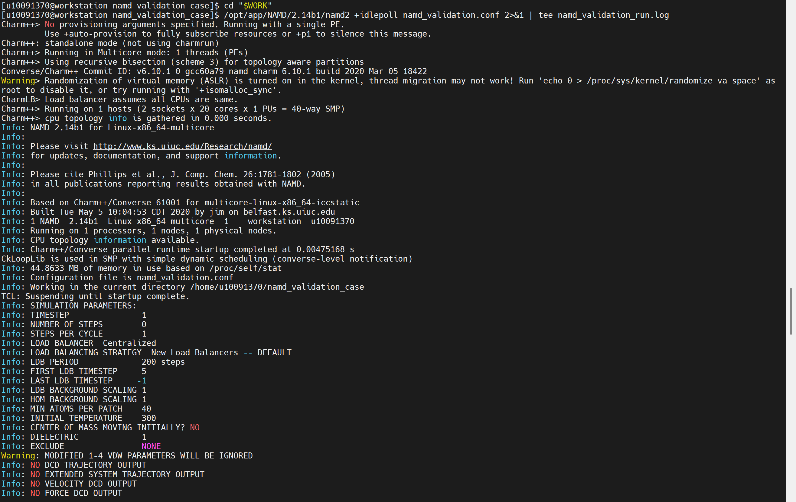

18、查看 NAMD 运行日志最后内容，确认任务是否正常结束。

.. code-block:: text
         :linenos:
         :emphasize-lines: 1

         tail -80 "$WORK/namd_validation_run.log"

证明：日志中出现 ENERGY 能量输出、WRITING EXTENDED SYSTEM、WRITING COORDINATES、WRITING VELOCITIES 和 End of program，说明 NAMD 验证计算正常完成。

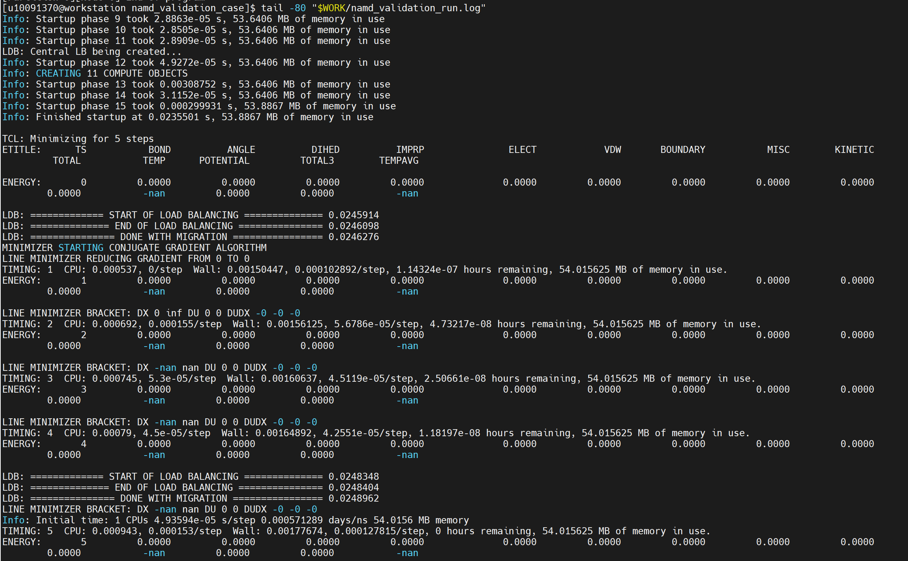

19、检查 NAMD 输出结果文件。

.. code-block:: text
         :linenos:
         :emphasize-lines: 1

         ls -lh "$WORK"/namd_validation_output*

证明：返回结果中出现 namd_validation_output.coor、namd_validation_output.vel、namd_validation_output.xsc 等结果文件，说明 NAMD 已生成计算输出文件。

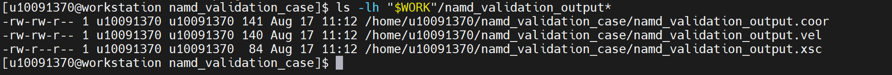

20、提取 NAMD 验证关键结果。

.. code-block:: text
         :linenos:
         :emphasize-lines: 1

         grep -En "Info: NAMD|Info: Configuration file|Info: COORDINATE PDB|Info: STRUCTURE FILE|Info: PARAMETERS|ENERGY:|WRITING COORDINATES|WRITING VELOCITIES|WRITING EXTENDED SYSTEM|End of program|FATAL ERROR|ERROR:" "$WORK/namd_validation_run.log"

证明：返回结果中包含 NAMD 启动信息、配置文件读取信息、坐标文件、结构文件和参数文件读取信息、ENERGY 能量输出信息、结果文件写出信息和 End of program，且未出现 FATAL ERROR，说明 NAMD 主程序完成了实际计算验证。

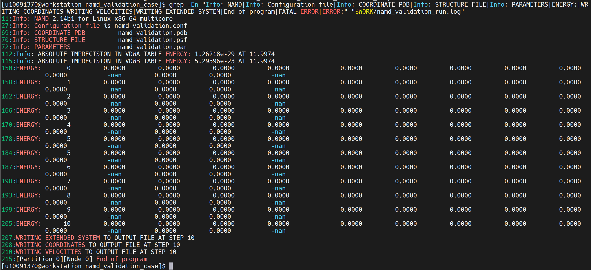

21、归档 NAMD 验证文件和结果文件到公共目录。(需要管理员权限，操作可不执行步骤仅参考)

.. code-block:: text
         :linenos:
         :emphasize-lines: 1

         cp "$WORK/namd_validation.pdb" "$SHARE/"
         cp "$WORK/namd_validation.psf" "$SHARE/"
         cp "$WORK/namd_validation.par" "$SHARE/"
         cp "$WORK/namd_validation.conf" "$SHARE/"
         cp "$WORK/namd_validation_run.log" "$SHARE/"
         cp "$WORK"/namd_validation_output* "$SHARE/"

证明：NAMD 验证输入文件、配置文件、运行日志和输出结果文件已保存到 /home/share/验证示例文件 目录，便于后续复测和验收查看。

22、查看公共目录中的 NAMD 验证结果文件。

.. code-block:: text
         :linenos:
         :emphasize-lines: 1

         ls -lh "$SHARE"/namd_validation*

证明：公共目录中存在 namd_validation.pdb、namd_validation.psf、namd_validation.par、namd_validation.conf、namd_validation_run.log 以及 namd_validation_output.coor、namd_validation_output.vel、namd_validation_output.xsc 等结果文件，说明 NAMD 验证算例及结果已完成归档。

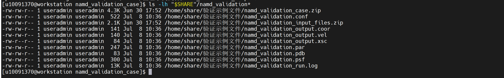

