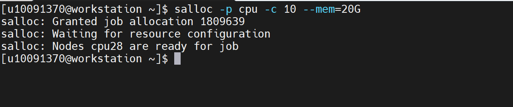
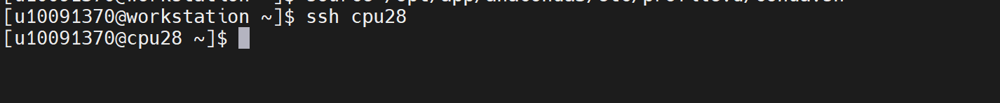
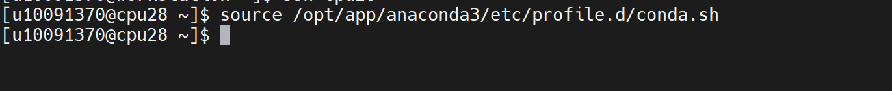
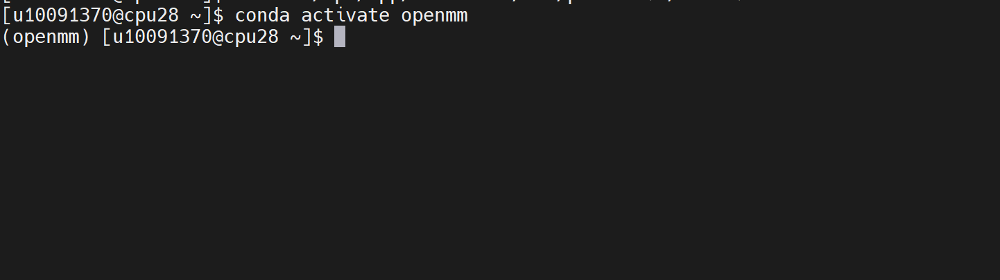
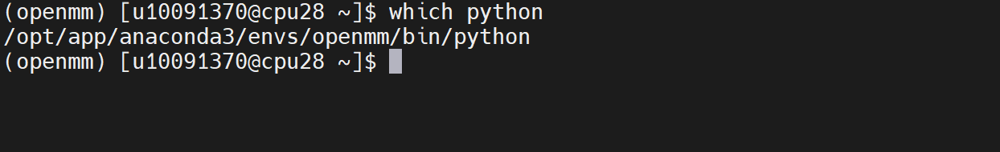
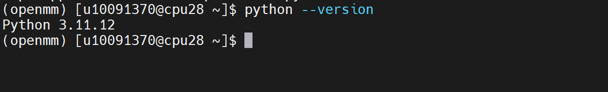
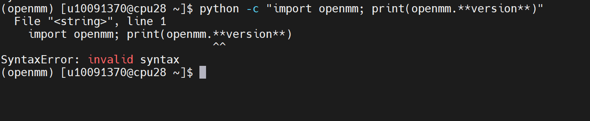
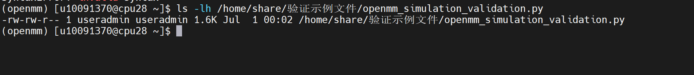
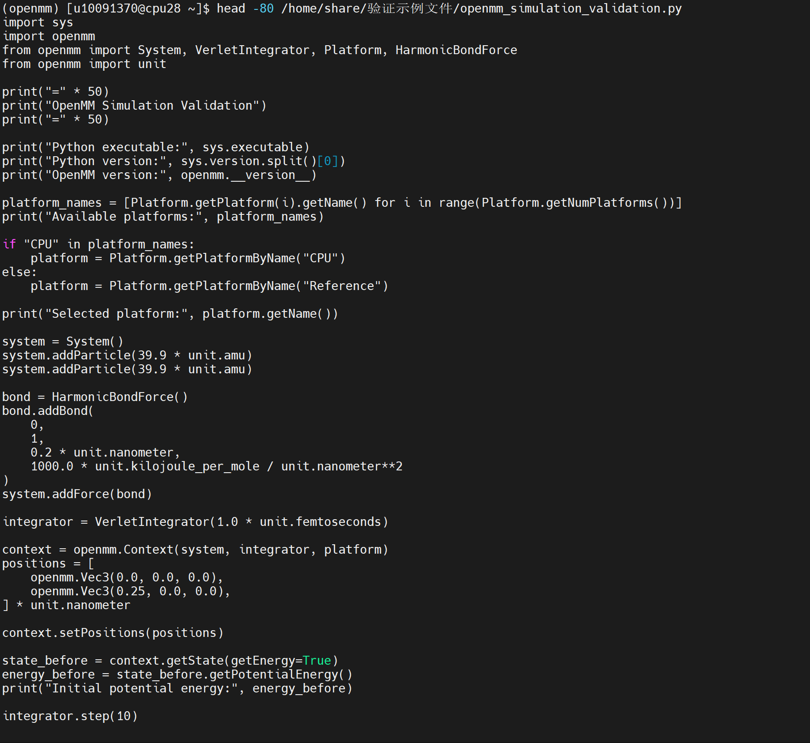
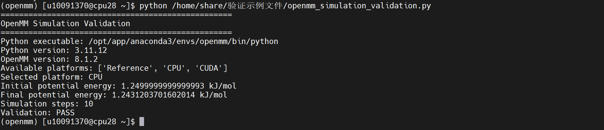

OpenMM
==========

OpenMM 是开源高性能分子模拟 Python 库，支持 GPU/CPU 加速，兼容 AMBER、CHARMM 等多种力场，可实现分子动力学模拟、能量计算，便于快速开发自定义模拟流程，用于生物分子模拟与算法开发研究。

版本：8.1.2

安装路径：/opt/app/anaconda3/envs/openmm

操作步骤：

1、申请 CPU 计算资源。

.. code-block:: text
         :linenos:
         :emphasize-lines: 1

         salloc -p cpu -c 10 --mem=20G

证明：返回 Granted job allocation，并显示 Nodes cpu28 are ready for job，说明 CPU 计算资源申请成功。

2、登录计算节点。

.. code-block:: text
         :linenos:
         :emphasize-lines: 1

         ssh cpu28

证明：成功进入 CPU 计算节点。

3、加载 Conda 初始化脚本。

.. code-block:: text
         :linenos:
         :emphasize-lines: 1

         source /opt/app/anaconda3/etc/profile.d/conda.sh

证明：命令执行无报错，说明 Conda 初始化完成。

4、激活 OpenMM 环境。

.. code-block:: text
         :linenos:
         :emphasize-lines: 1

         conda activate openmm

证明：终端前缀显示 (openmm)，说明 OpenMM 环境已激活。

5、查看当前 Python 路径。

.. code-block:: text
         :linenos:
         :emphasize-lines: 1

         which python

证明：返回 /opt/app/anaconda3/envs/openmm/bin/python，说明当前使用 OpenMM 环境中的 Python。

6、查看 Python 版本。

.. code-block:: text
         :linenos:
         :emphasize-lines: 1

         python --version

证明：返回 Python 3.11.12，说明 Python 环境正常。

7、验证 OpenMM 模块。

.. code-block:: text
         :linenos:
         :emphasize-lines: 1

         python -c "import openmm; print(openmm.**version**)"

证明：返回 8.1.2，说明 OpenMM 模块能够正常导入。

8、确认 OpenMM 验证脚本存在。

.. code-block:: text
         :linenos:
         :emphasize-lines: 1

         ls -lh /home/share/验证示例文件/openmm_simulation_validation.py

证明：返回 /home/share/验证示例文件/openmm_simulation_validation.py 文件信息，说明验证脚本已创建成功。

9、查看 OpenMM 验证脚本内容。

.. code-block:: text
         :linenos:
         :emphasize-lines: 1

         head -80 /home/share/验证示例文件/openmm_simulation_validation.py

证明：脚本内容包含 OpenMM 环境检测、平台检测、双粒子体系创建、HarmonicBondForce、VerletIntegrator、势能计算以及 Validation: PASS 等验证逻辑，说明脚本内容完整。

10、执行 OpenMM 模拟验证脚本。

.. code-block:: text
         :linenos:
         :emphasize-lines: 1

         python /home/share/验证示例文件/openmm_simulation_validation.py

证明：程序正常输出 OpenMM Simulation Validation、Python executable、Python version、OpenMM version、Available platforms、Selected platform、Initial potential energy、Final potential energy、Simulation steps: 10 和 Validation: PASS，说明 OpenMM 能够正常完成基础分子动力学模拟。

