QuantumESPRESSO
=================

Quantum ESPRESSO 是开源第一性原理计算套件，基于密度泛函理论 DFT，支持结构优化、从头算分子动力学、能带光谱计算，适用于材料、表面、催化体系，开展固体与分子电子结构模拟研究。

版本：7.4.1

安装路径：/opt/app/qe-7.4.1

操作步骤：

1、进入 Quantum ESPRESSO 安装目录，确认目录存在。

.. code-block:: text
         :linenos:
         :emphasize-lines: 1

         cd /opt/app/qe-7.4.1 && pwd

证明：命令返回 /opt/app/qe-7.4.1，说明 Quantum ESPRESSO 安装目录存在。

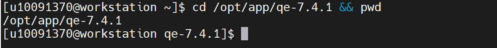

2、查找 Quantum ESPRESSO 主要程序文件。

.. code-block:: text
         :linenos:
         :emphasize-lines: 1

         find /opt/app/qe-7.4.1 -name "pw.x" -o -name "ph.x" -o -name "pp.x" 2>/dev/null

证明：返回 /opt/app/qe-7.4.1/bin/pw.x、/opt/app/qe-7.4.1/bin/ph.x、/opt/app/qe-7.4.1/bin/pp.x 等文件，说明 Quantum ESPRESSO 主要程序文件存在。

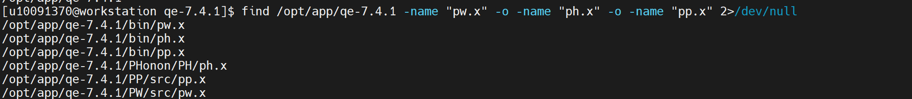

3、设置运行所需动态库路径。

.. code-block:: text
         :linenos:
         :emphasize-lines: 1

         export LD_LIBRARY_PATH=/opt/app/anaconda3/envs/RF2/lib:$LD_LIBRARY_PATH

证明：命令执行无报错，说明动态库环境变量设置完成。

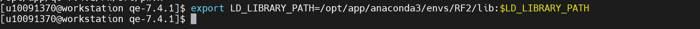

4、确认 pw.x 主程序文件。

.. code-block:: text
         :linenos:
         :emphasize-lines: 1

         ls -lh /opt/app/qe-7.4.1/bin/pw.x

证明：返回 /opt/app/qe-7.4.1/bin/pw.x 指向 ../PW/src/pw.x，说明 PWSCF 主程序入口存在。

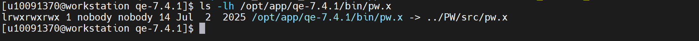

5、确认赝势文件存在。

.. code-block:: text
         :linenos:
         :emphasize-lines: 1

         ls -lh /opt/app/qe-7.4.1/pseudo/Si_r.upf

证明：返回 /opt/app/qe-7.4.1/pseudo/Si_r.upf 文件信息，说明硅元素赝势文件存在，可用于 SCF 计算验证。

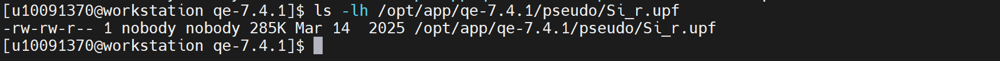

6、确认 Quantum ESPRESSO 验证输入文件存在。

.. code-block:: text
         :linenos:
         :emphasize-lines: 1

         ls -lh /home/share/验证示例文件/qe_validation_template.in

证明：返回 /home/share/验证示例文件/qe_validation_template.in 文件信息，说明验证输入文件已创建成功。

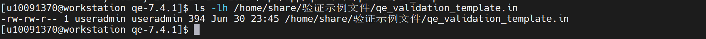

7、查看 Quantum ESPRESSO 验证输入文件内容。

.. code-block:: text
         :linenos:
         :emphasize-lines: 1

         cat /home/share/验证示例文件/qe_validation_template.in

证明：文件内容包含 CONTROL、SYSTEM、ELECTRONS、ATOMIC_SPECIES、ATOMIC_POSITIONS、K_POINTS 等模块，设置了 calculation = 'scf'、pseudo_dir、ecutwfc、Si 原子信息和 K 点参数，可作为 Quantum ESPRESSO SCF 计算验证输入文件。

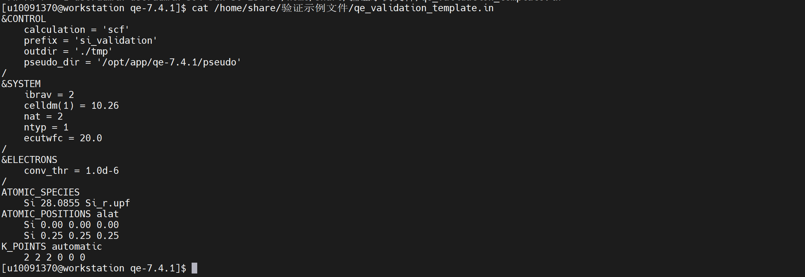

8、检查输入文件关键参数。

.. code-block:: text
         :linenos:
         :emphasize-lines: 1

         grep -E "CONTROL|SYSTEM|ELECTRONS|ATOMIC_SPECIES|ATOMIC_POSITIONS|K_POINTS|calculation|ecutwfc|pseudo_dir" /home/share/验证示例文件/qe_validation_template.in

证明：返回 calculation = 'scf'、pseudo_dir、ecutwfc、ATOMIC_SPECIES、ATOMIC_POSITIONS、K_POINTS 等关键参数，说明输入文件内容完整。

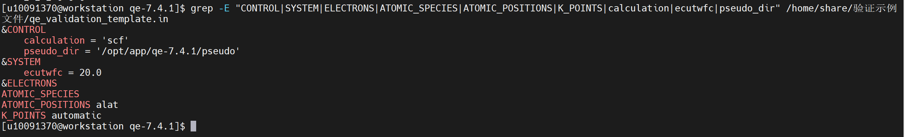

9、执行 Quantum ESPRESSO SCF 验证算例。

.. code-block:: text
         :linenos:
         :emphasize-lines: 1

         mkdir ~/qe_validation
         cd ~/qe_validation
         /opt/app/qe-7.4.1/bin/pw.x -in /home/share/验证示例文件/qe_validation_template.in > ~/qe_validation/qe_validation.out 2>&1

证明：程序正常启动并完成自洽场计算，输出 End of self-consistent calculation、total energy、convergence has been achieved in 5 iterations、PWSCF 运行时间及 JOB DONE，说明 Quantum ESPRESSO 可以正常读取输入文件并完成基础 SCF 计算。

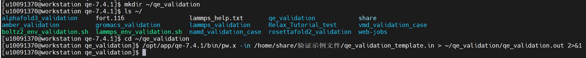

10、查看 Quantum ESPRESSO 输出文件。

.. code-block:: text
         :linenos:
         :emphasize-lines: 1

         ls -lh ~/qe_validation

证明：输出目录中生成 qe_validation.out 和 tmp 目录，说明 Quantum ESPRESSO 验证任务已产生计算结果和中间数据文件。

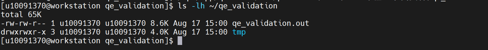

11、检查计算完成信息。

.. code-block:: text
         :linenos:
         :emphasize-lines: 1

         grep -E "JOB DONE|total energy|convergence has been achieved|PWSCF" ~/qe_validation/qe_validation.out

证明：返回 total energy = -16.73419226 Ry、convergence has been achieved in 5 iterations、PWSCF 运行时间以及 JOB DONE，说明 SCF 验证算例正常完成。

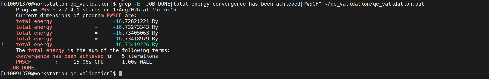

12、创建  Quantum ESPRESSO 环境汇总验证脚本。

.. code-block:: text
         :linenos:
         :emphasize-lines: 1

         cat > qe_env_validation.sh <<'EOF'
         #!/bin/bash

         set -e

         QE_HOME=/opt/app/qe-7.4.1
         QE_BIN=/opt/app/qe-7.4.1/bin/pw.x
         QE_INPUT=/home/share/验证示例文件/qe_validation_template.in
         QE_PSEUDO=/opt/app/qe-7.4.1/pseudo/Si_r.upf
         WORKDIR=$HOME/qe_validation
         
         mkdir -p "$WORKDIR"
         mkdir -p "$WORKDIR/tmp"
         
         export LD_LIBRARY_PATH=/opt/app/anaconda3/envs/RF2/lib:$LD_LIBRARY_PATH
         export OMP_NUM_THREADS=1
         
         echo "=================================================="
         echo "Quantum ESPRESSO Environment Validation"
         echo "=================================================="
         
         echo "[1] QE install path:"
         cd "$QE_HOME" && pwd
         
         echo
         echo "[2] QE executable files:"
         find "$QE_HOME" -name "pw.x" -o -name "ph.x" -o -name "pp.x" 2>/dev/null
         
         echo
         echo "[3] QE pw.x binary:"
         ls -lh "$QE_BIN"
         
         echo
         echo "[4] Check pseudo file:"
         ls -lh "$QE_PSEUDO"
         
         echo
         echo "[5] Validation input file:"
         ls -lh "$QE_INPUT"
         cat "$QE_INPUT"
         
         echo
         echo "[6] Check key QE commands in input:"
         grep -E "CONTROL|SYSTEM|ELECTRONS|ATOMIC_SPECIES|ATOMIC_POSITIONS|K_POINTS|calculation|ecutwfc|pseudo_dir" "$QE_INPUT"
         
         echo
         echo "[7] Run QE SCF validation case:"
         cd "$WORKDIR"
         "$QE_BIN" -in "$QE_INPUT" > "$WORKDIR/qe_validation.out" 2>&1
         
         echo
         echo "[8] Check QE output:"
         tail -80 "$WORKDIR/qe_validation.out"
         
         echo
         echo "[9] Check completion information:"
         grep -E "JOB DONE|total energy|convergence has been achieved|PWSCF" "$WORKDIR/qe_validation.out" || true
         
         echo
         echo "[10] Check output files:"
         ls -lh "$WORKDIR"
         
         echo
         echo "[11] Python summary validation:"
         python - <<'PY'
         from pathlib import Path
         
         qe_bin = Path("/opt/app/qe-7.4.1/bin/pw.x")
         input_file = Path("/home/share/验证示例文件/qe_validation_template.in")
         pseudo_file = Path("/opt/app/qe-7.4.1/pseudo/Si_r.upf")
         workdir = Path.home() / "qe_validation"
         output_file = workdir / "qe_validation.out"
         
         print("QE binary exists:", qe_bin.exists())
         print("Validation input exists:", input_file.exists())
         print("Pseudo file exists:", pseudo_file.exists())
         print("Validation output exists:", output_file.exists())
         
         if not qe_bin.exists():
             raise SystemExit("Validation: FAIL - QE pw.x binary not found")
         
         if not input_file.exists():
             raise SystemExit("Validation: FAIL - QE input file not found")
         
         if not pseudo_file.exists():
             raise SystemExit("Validation: FAIL - pseudo file not found")
         
         if not output_file.exists():
             raise SystemExit("Validation: FAIL - QE output file not generated")
         
         text = output_file.read_text(errors="ignore")
         
         if "JOB DONE" not in text:
             raise SystemExit("Validation: FAIL - QE job did not finish normally")
         
         print("QE install path: /opt/app/qe-7.4.1")
         print("QE pw.x binary: /opt/app/qe-7.4.1/bin/pw.x")
         print("Validation input: /home/share/验证示例文件/qe_validation_template.in")
         print("Validation output directory:", workdir)
         print("Validation: PASS")
         PY
         
         echo
         echo "=================================================="
         echo "Quantum ESPRESSO Environment Validation Finished"
         echo "=================================================="
         
         EOF

.. code-block:: text
         :linenos:
         :emphasize-lines: 1

         chmod +x qe_env_validation.sh

证明：ls可查看到创建在~目录的文件，并且已授权

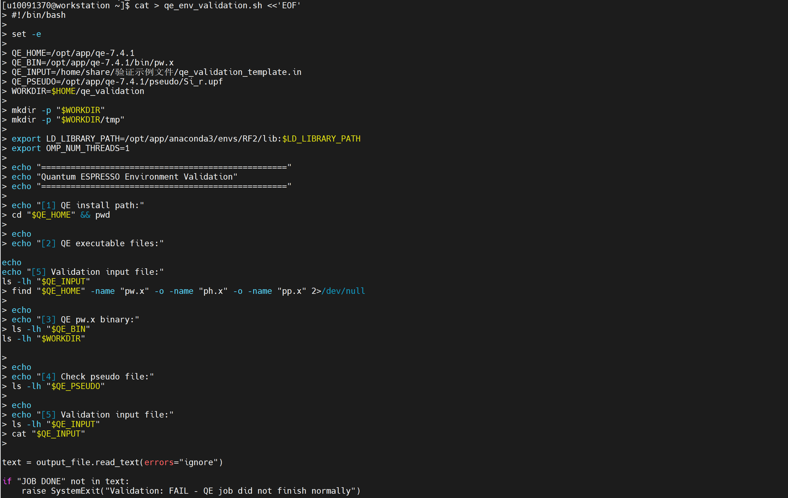

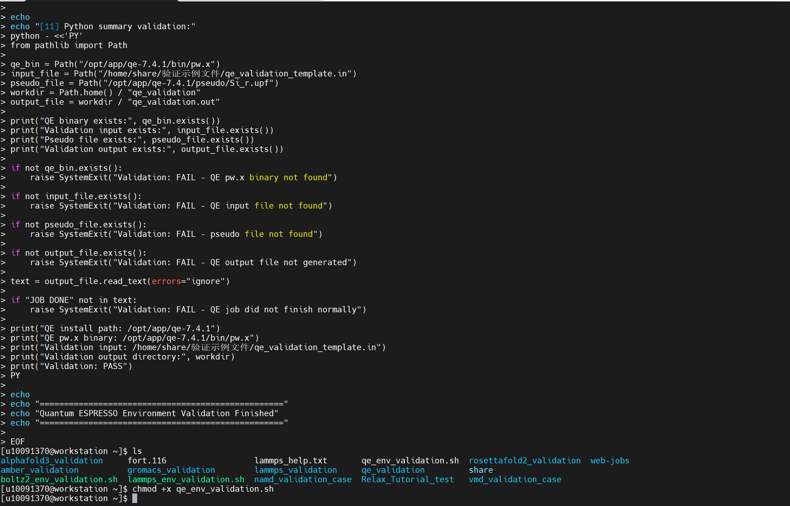

13、执行 Quantum ESPRESSO 环境汇总验证脚本。

.. code-block:: text
         :linenos:
         :emphasize-lines: 1

         bash ~/qe_env_validation.sh

证明：脚本返回 QE binary exists: True、Validation input exists: True、Pseudo file exists: True、Validation output exists: True 以及 Validation: PASS，说明 Quantum ESPRESSO 主程序、验证输入文件、赝势文件和计算输出文件均验证通过。

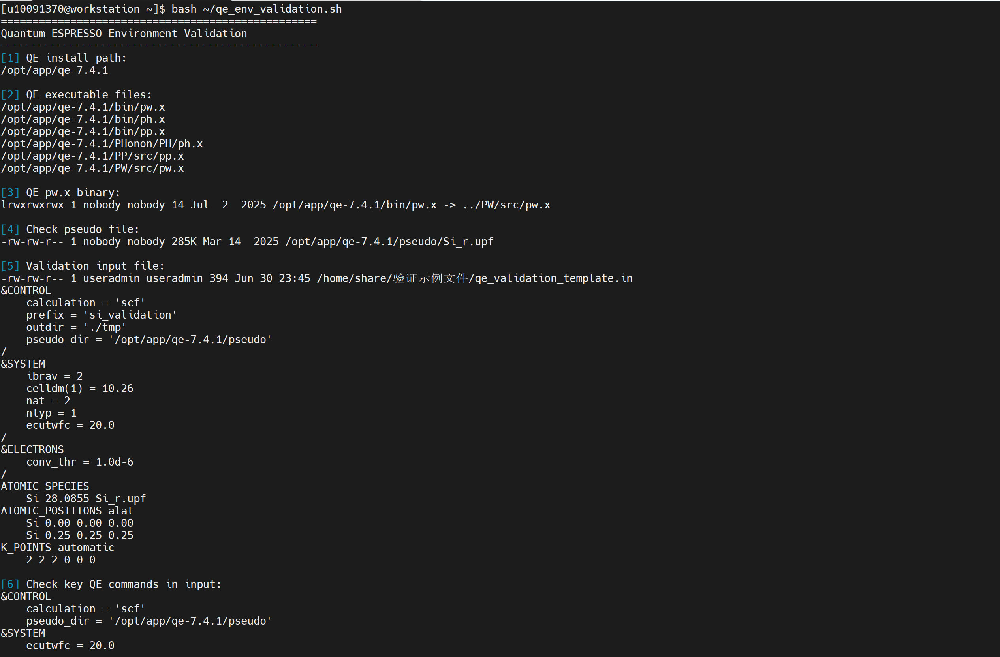

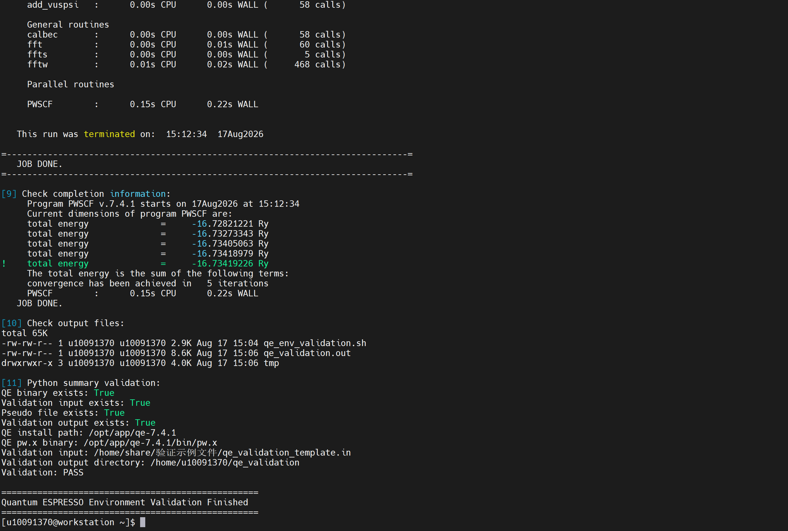
