Rosetta
=========

版本：3.14

安装路径：/opt/app/rosetta

操作步骤：
1、进入 Rosetta 安装目录，确认目录存在。

.. code-block:: text
         :linenos:
         :emphasize-lines: 1

         cd /opt/app/rosetta && pwd
         
证明：命令返回 /opt/app/rosetta，说明安装目录存在。

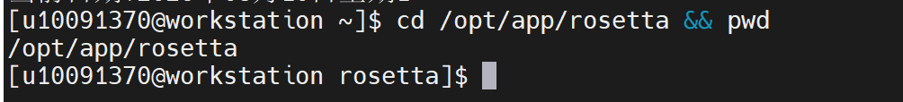

2、查看 Rosetta 安装目录的内容，确认安装结构是否完整。

.. code-block:: text
         :linenos:
         :emphasize-lines: 1

         ls -lah

证明：返回结果中出现 main 目录，说明 Rosetta 安装结构存在。

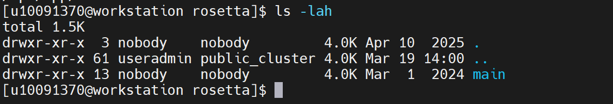

3、进入 Rosetta 可执行程序目录，并查看有哪些可执行文件。

.. code-block:: text
         :linenos:
         :emphasize-lines: 1

         cd /opt/app/rosetta/main/source/bin && ls -lah | head -20

证明：返回结果中出现多个 .static.linuxgccrelease 程序文件，说明可执行程序目录正常。

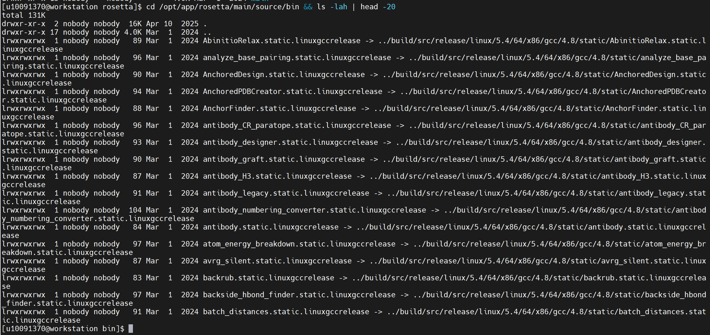

4、查看 rosetta_scripts 是否存在。

.. code-block:: text
         :linenos:
         :emphasize-lines: 1

         ls -l rosetta_scripts*.linuxgccrelease

证明：返回 rosetta_scripts.static.linuxgccrelease 和 rosetta_scripts_jd3.static.linuxgccrelease，说明主程序存在。

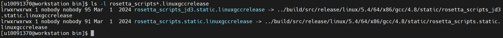

5、运行 Rosetta 代表性主程序的帮助命令，验证程序能否正常启动，不会执行正式计算。

.. code-block:: text
         :linenos:
         :emphasize-lines: 1

         ./rosetta_scripts.static.linuxgccrelease -help | head -40

证明：返回 Usage、Options 等帮助信息，说明主程序启动正常。

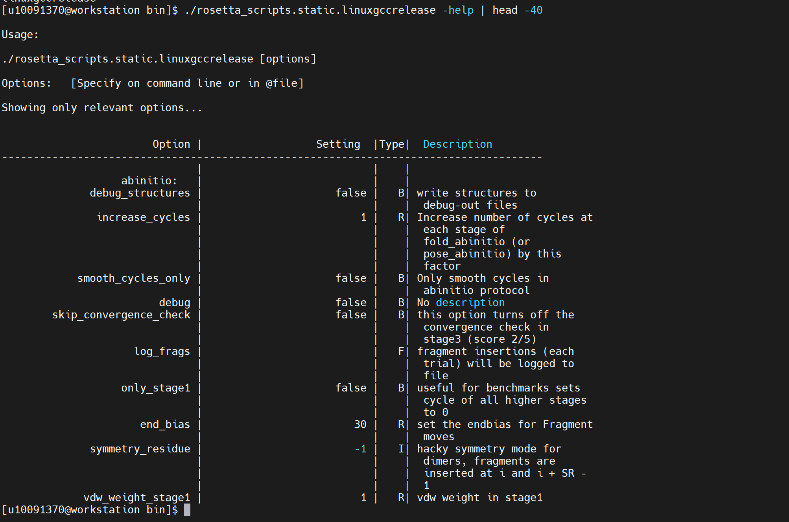

验证步骤：
6、加载 Rosetta 可执行程序路径，并确认 relax 主程序是否可识别。

.. code-block:: text
         :linenos:
         :emphasize-lines: 1

         export PATH=/opt/app/rosetta/main/source/bin:$PATH
         which relax.static.linuxgccrelease

证明：which relax.static.linuxgccrelease 返回 /opt/app/rosetta/main/source/bin/relax.static.linuxgccrelease，说明 relax 主程序可识别。

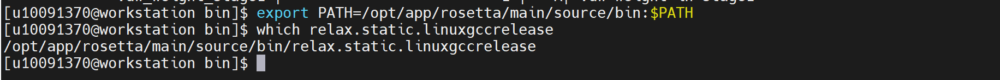

7、复制 Relax_Tutorial 示例到用户目录，避免在安装目录中直接运行。

.. code-block:: text
         :linenos:
         :emphasize-lines: 1

         cd ~
         rm -rf ~/Relax_Tutorial_test
         cp -r /opt/app/rosetta/main/demos/tutorials/Relax_Tutorial ~/Relax_Tutorial_test
         cd ~/Relax_Tutorial_test
         ls -lah

证明：进入 ~/Relax_Tutorial_test 后，能看到 1ubq.pdb、general_relax_flags.short、tutorial_output 等文件或目录。

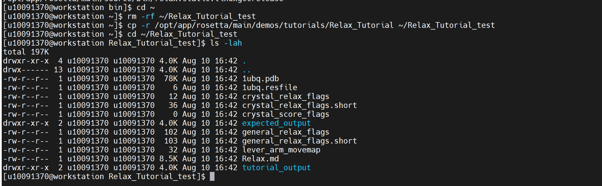

8、运行 Rosetta Relax 示例

.. code-block:: text
         :linenos:
         :emphasize-lines: 1

         relax.static.linuxgccrelease -s 1ubq.pdb -relax:constrain_relax_to_start_coords -relax:coord_constrain_sidechains -relax:ramp_constraints false -ex1 -ex2 -use_input_sc -flip_HNQ -no_optH false @general_relax_flags.short -overwrite | tee rosetta_relax_overwrite.log

证明：程序能够正常输出运行日志，并进入 FastRelax 流程。

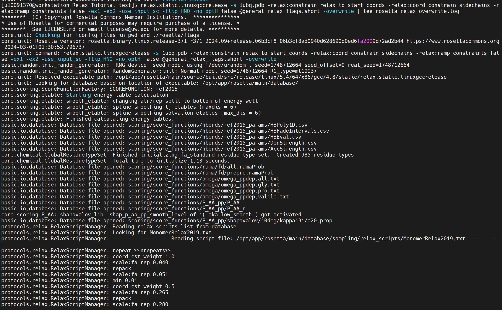

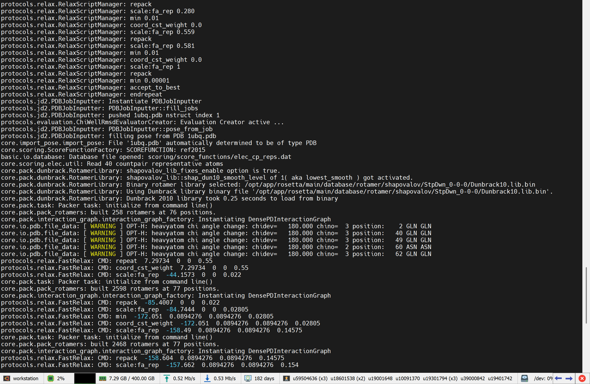

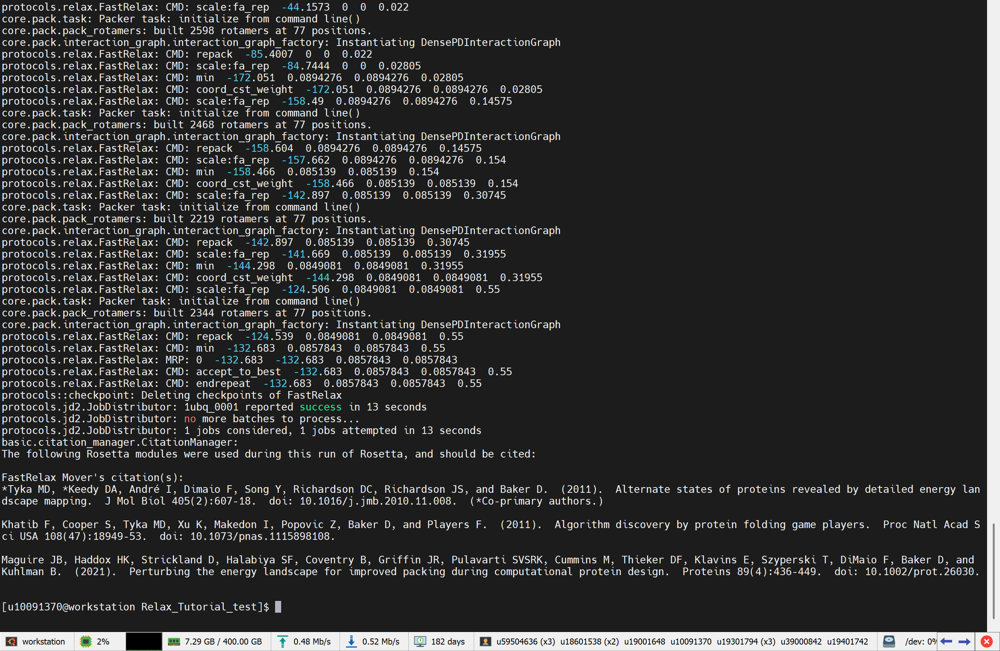

9、查看日志最后内容，确认任务是否成功完成。

.. code-block:: text
         :linenos:
         :emphasize-lines: 1

         tail -40 rosetta_relax_overwrite.log

证明：日志中出现 1ubq_0001 reported success 和 1 jobs considered, 1 jobs attempted，说明任务运行成功。

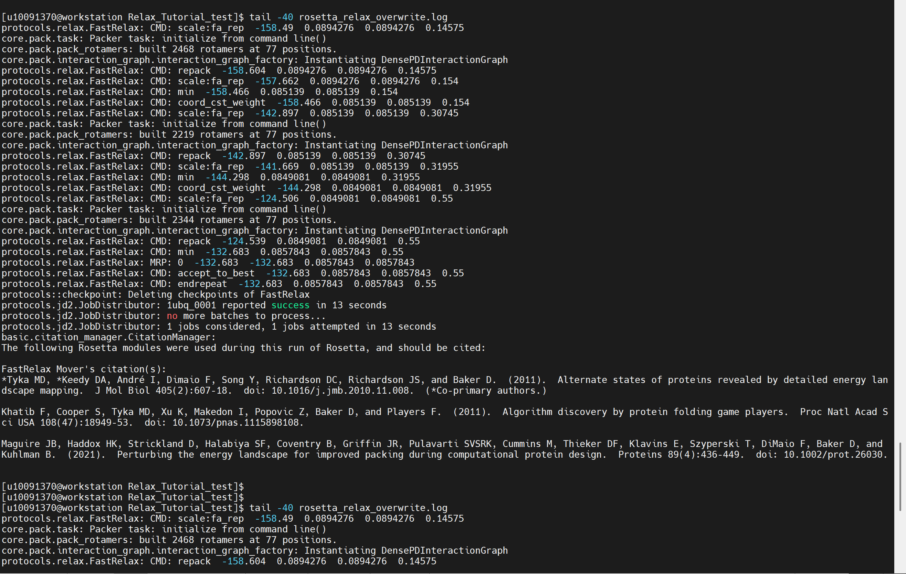

10、查找结果文件。

.. code-block:: text
         :linenos:
         :emphasize-lines: 1

         find . -maxdepth 3 -type f \( -name "1ubq_0001.pdb" -o -name "score.sc" -o -name "*.sc" \) -ls

证明：能够找到 tutorial_output/1ubq_0001.pdb，说明结构放松结果文件已生成。

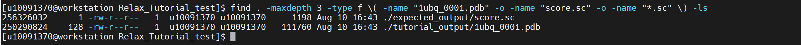
