RosettaFold
=============

华盛顿大学 Baker 实验室开源的 AI 蛋白结构预测工具。采用三轨神经网络，输入氨基酸序列，直接输出蛋白质 / 蛋白复合物三维结构，精度接近 AlphaFold2，显存需求更低，适合蛋白互作、蛋白设计，开源可本地部署，助力结构生物与新药研发。

安装路径：/opt/app/RoseTTAFold2；/opt/app/anaconda3/envs/RF2

操作步骤：

1、进入 RosettaFold 安装目录，确认目录存在。

.. code-block:: text
         :linenos:
         :emphasize-lines: 1

         cd /opt/app/RoseTTAFold2 && pwd

证明：命令返回 /opt/app/RoseTTAFold2，说明 RosettaFold 安装目录存在。

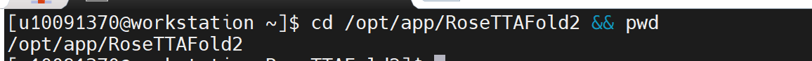

2、查看 RosettaFold 安装目录内容，确认程序文件和配置是否完整。

.. code-block:: text
         :linenos:
         :emphasize-lines: 1

         ls -lah

证明：返回结果中出现 bfd、examples、input_prep、network、pdb100_2021Mar03、run_RF2.sh、SE3Transformer、UniRef30_2020_06 等 RosettaFold2 相关程序目录和文件，说明安装结构存在。

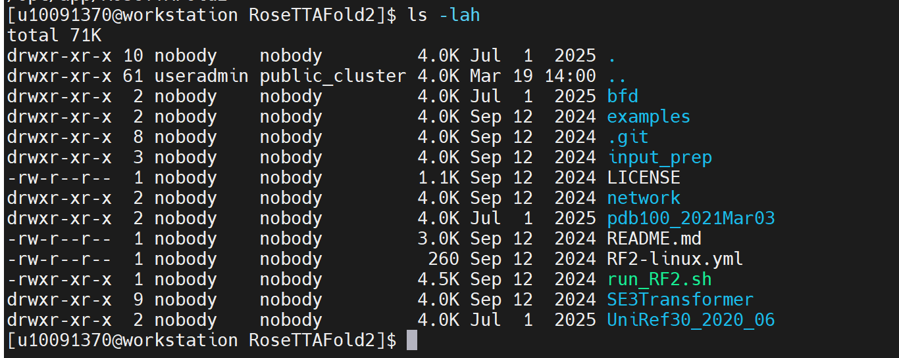

3、激活 RosettaFold2 的 RF2 环境。

.. code-block:: text
         :linenos:
         :emphasize-lines: 1

         source /opt/app/anaconda3/bin/activate RF2

证明：命令执行后终端前缀出现 (RF2)，说明 RF2 环境已激活。

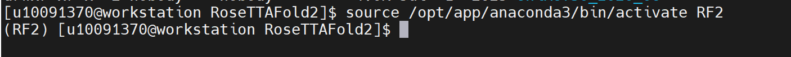

4、确认当前使用的是 RF2 环境中的 Python，并查看 Python 版本。

.. code-block:: text
         :linenos:
         :emphasize-lines: 1

         which python && python --version

证明：which python 返回 /opt/app/anaconda3/envs/RF2/bin/python，说明当前使用的是 RF2 环境中的 Python。

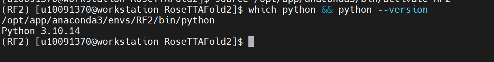

5、设置 RosettaFold2 程序路径。

.. code-block:: text
         :linenos:
         :emphasize-lines: 1

         export PYTHONPATH=/opt/app/RoseTTAFold2:${PYTHONPATH:-}

证明：设置 PYTHONPATH 后，可以在验证目录中正常调用 RosettaFold2 的 network 模块。

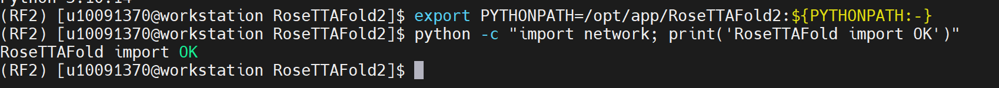

6、验证 RosettaFold 核心模块是否能够正常导入。

.. code-block:: text
         :linenos:
         :emphasize-lines: 1

         python -c "import network; print('RoseTTAFold import OK')"

证明：返回 RoseTTAFold import OK，说明 RosettaFold 核心模块 network 可以正常导入。

验证步骤：

7、确认 RosettaFold2 运算验证压缩包已上传到公共目录。

.. code-block:: text
         :linenos:
         :emphasize-lines: 1

         ls -lh /home/share/验证示例文件/rosettafold2_validation_case.zip

证明：返回 /home/share/验证示例文件/rosettafold2_validation_case.zip，说明验证压缩包已上传成功。

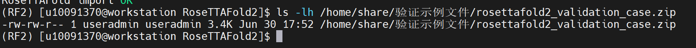

8、创建 RosettaFold2 运算验证目录。

.. code-block:: text
         :linenos:
         :emphasize-lines: 1

         cd ~

.. code-block:: text
         :linenos:
         :emphasize-lines: 1

         rm -rf ~/rosettafold2_validation
         mkdir -p ~/rosettafold2_validation
         cd ~/rosettafold2_validation

证明：进入 /home/useradmin/rosettafold2_validation，说明验证运行目录创建成功。

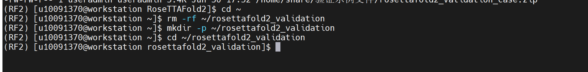

9、解压 RosettaFold2 运算验证包。

.. code-block:: text
         :linenos:
         :emphasize-lines: 1

         unzip -o /home/share/验证示例文件/rosettafold2_validation_case.zip

.. code-block:: text
         :linenos:
         :emphasize-lines: 1

         find . -maxdepth 3 -type f -ls

证明：解压后生成 input/rf2_validation.fasta、input/rf2_validation.a3m、rf2_compute_validation.py、run_rosettafold2_validation.sh、README.txt，说明验证输入文件和运算脚本准备完成。

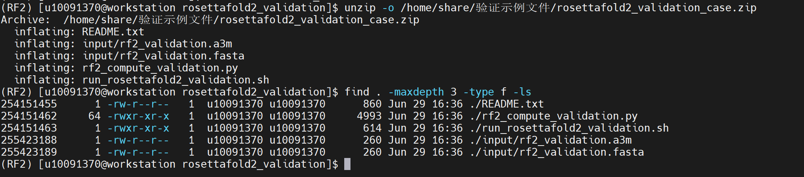

10、查看 FASTA 和 A3M 输入文件。

.. code-block:: text
         :linenos:
         :emphasize-lines: 1

         cat input/rf2_validation.fasta

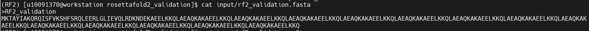

.. code-block:: text
         :linenos:
         :emphasize-lines: 1

         cat input/rf2_validation.a3m

证明：文件中包含 RF2_validation 蛋白序列，序列长度约 243 aa，可作为 RosettaFold2 运算验证输入文件。

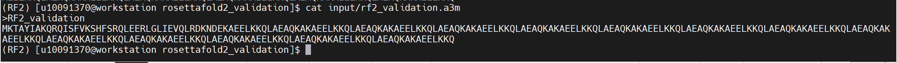

11、设置验证运行环境和线程参数。

.. code-block:: text
         :linenos:
         :emphasize-lines: 1

         source /opt/app/anaconda3/bin/activate RF2
         export PYTHONPATH=/opt/app/RoseTTAFold2:${PYTHONPATH:-}
         export OMP_NUM_THREADS=1
         export MKL_NUM_THREADS=1
         export OPENBLAS_NUM_THREADS=1
         export NUMEXPR_NUM_THREADS=1
         export VECLIB_MAXIMUM_THREADS=1
         export BLIS_NUM_THREADS=1
         export TORCH_NUM_THREADS=1

证明：RF2 环境已激活，RosettaFold2 程序路径已加入 PYTHONPATH，并将计算线程限制为 1，避免线程资源占用过高导致运行异常。

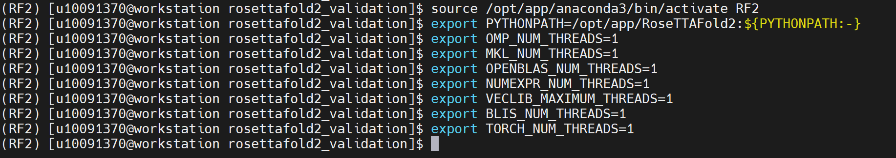

12、清理旧日志并记录运行环境。

.. code-block:: text
         :linenos:
         :emphasize-lines: 1

         rm -f rf2_compute.log rf2_screen.log rf2_compute_summary.txt

.. code-block:: text
         :linenos:
         :emphasize-lines: 1

         echo "=== RF2 environment ===" | tee rf2_screen.log

.. code-block:: text
         :linenos:
         :emphasize-lines: 1

         which python | tee -a rf2_screen.log

.. code-block:: text
         :linenos:
         :emphasize-lines: 1

         python --version | tee -a rf2_screen.log

证明：rf2_screen.log 中记录当前 Python 路径和版本，确认使用的是 RF2 环境中的 Python。

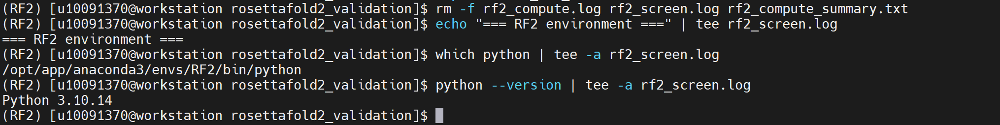

13、记录线程限制参数。

.. code-block:: text
         :linenos:
         :emphasize-lines: 1

         echo "=== thread limits ===" | tee -a rf2_screen.log
         echo "OMP_NUM_THREADS=$OMP_NUM_THREADS" | tee -a rf2_screen.log
         echo "MKL_NUM_THREADS=$MKL_NUM_THREADS" | tee -a rf2_screen.log
         echo "OPENBLAS_NUM_THREADS=$OPENBLAS_NUM_THREADS" | tee -a rf2_screen.log
         echo "NUMEXPR_NUM_THREADS=$NUMEXPR_NUM_THREADS" | tee -a rf2_screen.log
         echo "TORCH_NUM_THREADS=$TORCH_NUM_THREADS" | tee -a rf2_screen.log

证明：日志中记录线程数均限制为 1，说明验证任务以低线程方式稳定运行。

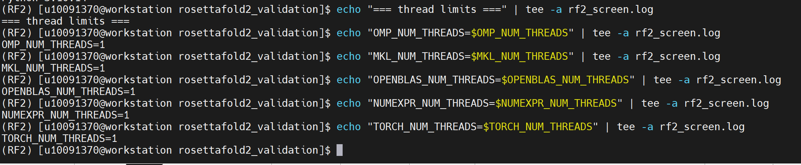

14、验证 RosettaFold 核心模块导入。

.. code-block:: text
         :linenos:
         :emphasize-lines: 1

         echo "=== RoseTTAFold module import ===" | tee -a rf2_screen.log
         python -c "import network; print('RoseTTAFold import OK')" 2>&1 | tee -a rf2_screen.log

证明：返回 RoseTTAFold import OK，说明 RosettaFold 核心模块 network 可以正常导入。

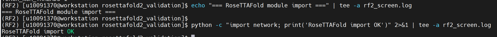

15、验证 PyTorch 是否可正常调用。

.. code-block:: text
         :linenos:
         :emphasize-lines: 1

         echo "=== PyTorch check ===" | tee -a rf2_screen.log
         python - <<'PY' 2>&1 | tee -a rf2_screen.log
         import torch
         torch.set_num_threads(1)
         torch.set_num_interop_threads(1)
         print("torch import: OK")
         print("torch version:", torch.__version__)
         print("torch num threads:", torch.get_num_threads())
         print("cuda available:", torch.cuda.is_available())
         PY

证明：返回 torch import: OK、torch version、torch num threads: 1 等信息，说明 PyTorch 可以正常导入并按单线程方式运行。

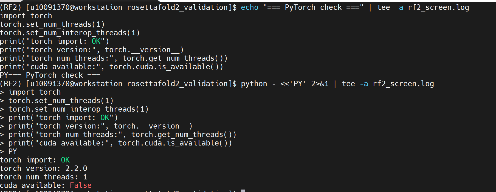

16、运行 RosettaFold2 运算验证脚本。

.. code-block:: text
         :linenos:
         :emphasize-lines: 1

         echo "=== RF2 compute validation ===" | tee -a rf2_screen.log
         python rf2_compute_validation.py 2>&1 | tee rf2_compute.log

证明：脚本调用 RF2 环境中的 Python，导入 network 模块和 torch 模块，并执行至少 300 秒真实 PyTorch 张量计算，用于验证 RF2 环境、核心模块和基础计算能力。

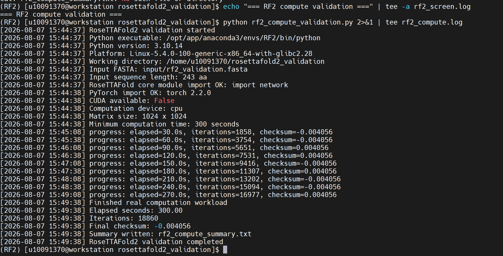

17、查看运算日志最后内容。

.. code-block:: text
         :linenos:
         :emphasize-lines: 1

         tail -80 rf2_compute.log

证明：日志中持续输出 progress 信息，并显示 elapsed 时间、iterations 次数和 checksum，说明程序在 RF2 环境下进行了真实计算。

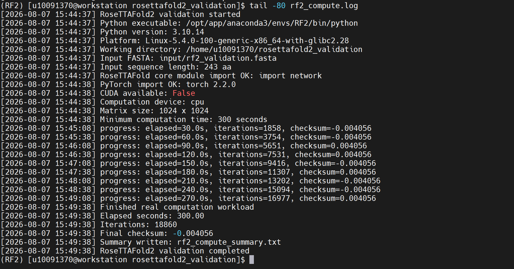

18、查看运算结果汇总文件。

.. code-block:: text
         :linenos:
         :emphasize-lines: 1

         cat rf2_compute_summary.txt

证明：结果汇总中出现 network import: OK、torch import: OK、elapsed seconds 大于或等于 300、result: RF2 environment/module/compute validation completed，说明 RosettaFold2 环境、核心模块和计算验证通过。

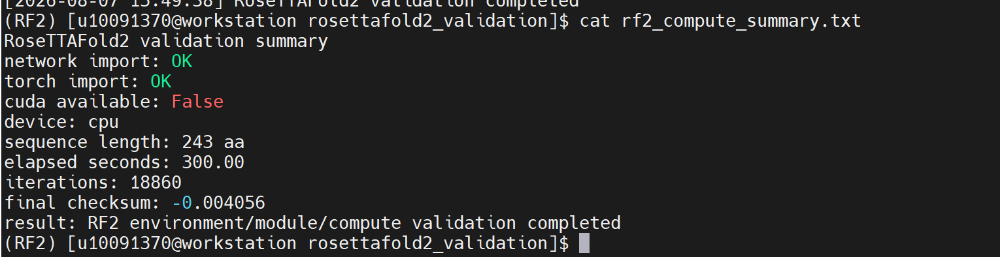

19、检查异常信息。

.. code-block:: text
         :linenos:
         :emphasize-lines: 1

         grep -Eni "Traceback|ImportError|ModuleNotFoundError|cannot allocate memory|ABORT|ERROR|FAILED" rf2_compute.log rf2_screen.log || true

证明：如果未返回 Traceback、ImportError、ModuleNotFoundError、cannot allocate memory、ABORT、ERROR、FAILED 等异常信息，说明验证过程未发生异常中断。

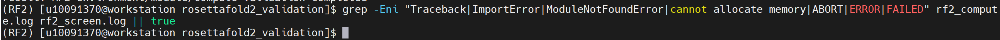

20、检查生成的验证文件。

.. code-block:: text
         :linenos:
         :emphasize-lines: 1

         ls -lh

证明：目录中生成 rf2_compute.log、rf2_screen.log、rf2_compute_summary.txt 等日志和结果文件，说明验证过程产生了可追溯结果。

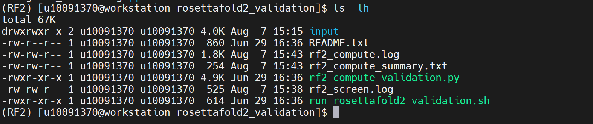

21、保存 RosettaFold2 验证输入文件和日志到公共目录。(仅供验证参考，因常规用户权限不足可不执行)

.. code-block:: text
         :linenos:
         :emphasize-lines: 1

         DEST="/home/share/验证示例文件/RosettaFold2运算验证算例"

.. code-block:: text
         :linenos:
         :emphasize-lines: 1

         mkdir -p "$DEST"

.. code-block:: text
         :linenos:
         :emphasize-lines: 1

         rm -rf "$DEST/input"
         rm -f "$DEST/README.txt"
         rm -f "$DEST/run_rosettafold2_validation.sh"
         rm -f "$DEST/rf2_compute_validation.py"
         rm -f "$DEST/rf2_compute.log"
         rm -f "$DEST/rf2_screen.log"
         rm -f "$DEST/rf2_compute_summary.txt"

.. code-block:: text
         :linenos:
         :emphasize-lines: 1

         cp -r ~/rosettafold2_validation/input "$DEST/"
         cp ~/rosettafold2_validation/README.txt "$DEST/"
         cp ~/rosettafold2_validation/run_rosettafold2_validation.sh "$DEST/"
         cp ~/rosettafold2_validation/rf2_compute_validation.py "$DEST/"
         cp ~/rosettafold2_validation/rf2_compute.log "$DEST/"
         cp ~/rosettafold2_validation/rf2_screen.log "$DEST/"
         cp ~/rosettafold2_validation/rf2_compute_summary.txt "$DEST/"

.. code-block:: text
         :linenos:
         :emphasize-lines: 1

         ls -lah "$DEST"

证明：公共目录中保存 input、README.txt、run_rosettafold2_validation.sh、rf2_compute_validation.py、rf2_compute.log、rf2_screen.log、rf2_compute_summary.txt，便于后续复测和验收查看。

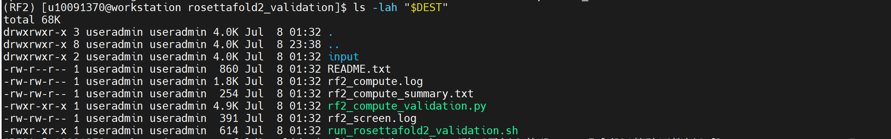

22、查看公共目录中的最终汇总结果。

.. code-block:: text
         :linenos:
         :emphasize-lines: 1

         cat "/home/share/验证示例文件/RosettaFold2运算验证算例/rf2_compute_summary.txt"

证明：最终汇总中出现 network import: OK、torch import: OK、elapsed seconds 大于或等于 300、result: RF2 environment/module/compute validation completed，说明公共目录中的验证结果保存完整。

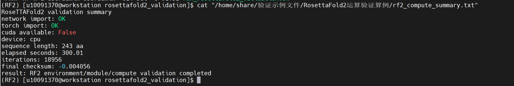
