vmd
=========

VMD 是开源分子可视化与轨迹分析软件，支持多种分子模拟格式，可完成分子体系建模、三维结构渲染、MD 轨迹分析，常搭配 NAMD、AMBER 等工具，用于生物大分子可视化及模拟后处理研究。

版本：1.9.3

安装路径：/opt/app/vmd

操作步骤：
1、进入 vmd 安装目录，确认目录存在。

.. code-block:: text
         :linenos:
         :emphasize-lines: 1

         cd /opt/app/vmd && pwd

证明：命令返回 /opt/app/vmd，说明 vmd 安装目录存在。

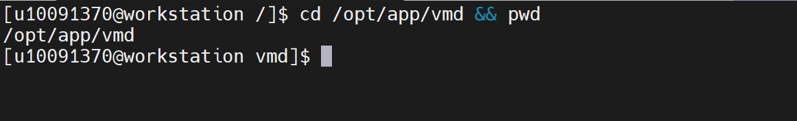

2、查看 vmd 安装目录内容，确认安装结构是否完整。

.. code-block:: text
         :linenos:
         :emphasize-lines: 1

         ls -lah

证明：返回结果中出现 bin 和 lib 目录，说明 vmd 主程序目录和依赖库目录存在，安装结构正常。

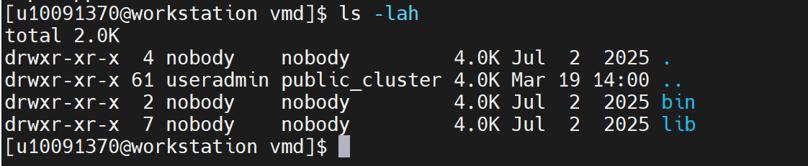

3、查看 vmd 可执行程序，确认主程序是否存在。

.. code-block:: text
         :linenos:
         :emphasize-lines: 1

         ls -l /opt/app/vmd/bin

证明：返回结果中出现 vmd 可执行文件，且具有可执行权限，说明 vmd 主程序存在。

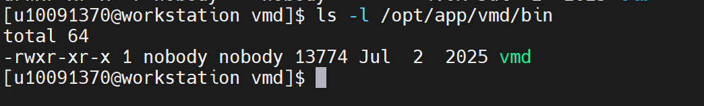

4、以文本模式启动 vmd，验证主程序是否能够正常启动。

.. code-block:: text
         :linenos:
         :emphasize-lines: 1

         /opt/app/vmd/bin/vmd -dispdev text

证明：返回 vmd for LINUXAMD64, version 1.9.3，同时显示 Multithreading available、Free system memory、Dynamically loaded plugins 等信息，说明 vmd 主程序启动正常。

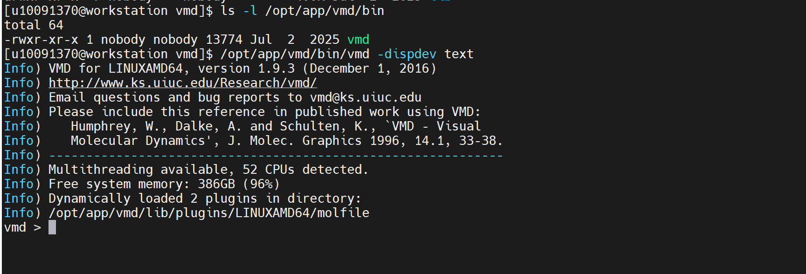

5、退出 vmd 交互界面，回到 Linux 终端。

.. code-block:: text
         :linenos:
         :emphasize-lines: 1

         quit

证明：终端返回 [useradmin@workstation ~]$ 或 [useradmin@workstation vmd]$，说明已退出 vmd 交互界面，后续 Linux 命令可以正常执行。

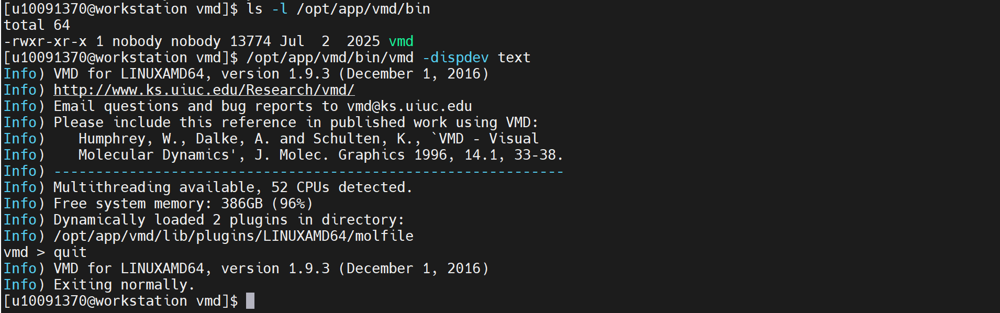

验证步骤：
6、创建 vmd 验证目录和公共归档目录。

.. code-block:: text
         :linenos:
         :emphasize-lines: 1

         SHARE="/home/share/验证示例文件"
         WORK="$HOME/vmd_validation_case"
         rm -rf "$WORK"
         mkdir -p "$WORK" "$SHARE"

证明：创建 /home/useradmin/vmd_validation_case 作为本次 vmd 验证运行目录，并确认 /home/share/验证示例文件 公共目录可用于保存验证文件。

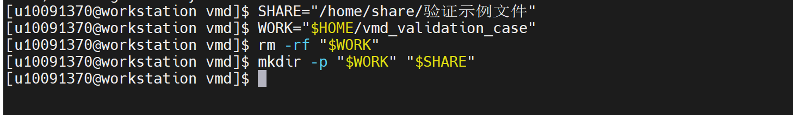

7、生成 vmd 验证用 PDB 结构文件。

.. code-block:: text
         :linenos:
         :emphasize-lines: 1

         cat > "$WORK/vmd_validation.pdb" <<'EOF'
         HEADER    vmd VALIDATION TEST STRUCTURE
         TITLE     SMALL ALANINE PDB FOR vmd TEXT MODE VALIDATION
         REMARK    Generated for vmd 1.9.3 validation
         ATOM      1  N   ALA A   1      11.104  13.207   9.447  1.00 20.00           N
         ATOM      2  CA  ALA A   1      12.560  13.257   9.447  1.00 20.00           C
         ATOM      3  C   ALA A   1      13.058  14.687   9.747  1.00 20.00           C
         ATOM      4  O   ALA A   1      12.327  15.632   9.507  1.00 20.00           O
         ATOM      5  CB  ALA A   1      13.100  12.310  10.520  1.00 20.00           C
         ATOM      6  H   ALA A   1      10.690  12.350   9.250  1.00 20.00           H
         ATOM      7  HA  ALA A   1      12.900  12.940   8.450  1.00 20.00           H
         ATOM      8  HB1 ALA A   1      14.190  12.350  10.520  1.00 20.00           H
         ATOM      9  HB2 ALA A   1      12.760  11.290  10.330  1.00 20.00           H
         ATOM     10  HB3 ALA A   1      12.720  12.620  11.490  1.00 20.00           H
         TER
         END
         EOF

证明：生成 vmd_validation.pdb 文件，文件内容包含 10 个原子和 1 个 ALA 残基，可用于 vmd 结构加载验证。

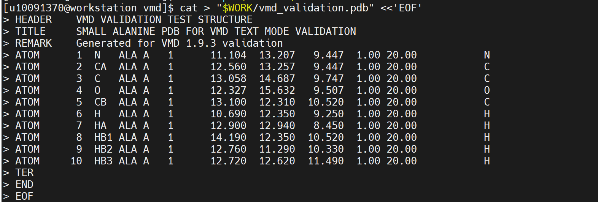

8、生成 vmd TCL 分析脚本。

.. code-block:: text
         :linenos:
         :emphasize-lines: 1

         cat > "$WORK/vmd_analysis_validation.tcl" <<'EOF'
         set pdb_file [file join $work_dir "vmd_validation.pdb"]
         set work_dir [file normalize "$env(HOME)/vmd_validation_case"]
         set out_pdb [file join $work_dir "vmd_validation_checked.pdb"]
         set report_file [file join $work_dir "vmd_validation_report.txt"]
         puts "vmd analysis validation started"
         if {![file exists $pdb_file]} {
         puts "validation_status = failed"
         puts "error = input PDB file not found"
         quit
         }
         set molid [mol new $pdb_file type pdb waitfor all]
         if {$molid < 0} {
         puts "validation_status = failed"
         puts "error = failed to load PDB file"
         quit
         }
         set all [atomselect $molid "all"]
         set protein [atomselect $molid "protein"]
         set num_atoms [$all num]
         set num_protein_atoms [$protein num]
         set residues [lsort -unique [$all get resid]]
         set residue_count [llength $residues]
         set center [measure center $all]
         set minmax [measure minmax $all]
         if {$num_atoms <= 0} {
         puts "validation_status = failed"
         puts "error = PDB file contains no atoms"
         quit
         }
         $all writepdb $out_pdb
         set fh [open $report_file w]
         puts $fh "vmd validation report"
         puts $fh "input_pdb = $pdb_file"
         puts $fh "output_pdb = $out_pdb"
         puts $fh "atom_count = $num_atoms"
         puts $fh "protein_atom_count = $num_protein_atoms"
         puts $fh "residue_count = $residue_count"
         puts $fh "center = $center"
         puts $fh "minmax = $minmax"
         puts $fh "validation_status = completed"
         close $fh
         puts "input_pdb = $pdb_file"
         puts "output_pdb = $out_pdb"
         puts "report_file = $report_file"
         puts "atom_count = $num_atoms"
         puts "protein_atom_count = $num_protein_atoms"
         puts "residue_count = $residue_count"
         puts "validation_status = completed"
         puts "vmd analysis validation finished"
         quit
         EOF

证明：生成 vmd_analysis_validation.tcl 分析脚本，用于加载 PDB 文件、统计原子数量、残基数量、计算结构中心和坐标范围，并输出检查后的 PDB 文件和验证报告。

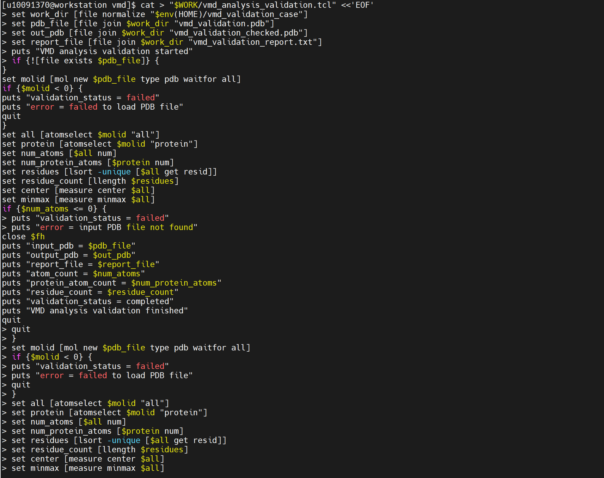

9、检查验证文件是否生成。

.. code-block:: text
         :linenos:
         :emphasize-lines: 1

         ls -lh "$WORK/vmd_validation.pdb"
         ls -lh "$WORK/vmd_analysis_validation.tcl"
         head -20 "$WORK/vmd_validation.pdb"

证明：返回结果中能够看到 vmd_validation.pdb 和 vmd_analysis_validation.tcl 文件，且 PDB 文件内容可正常查看，说明验证输入文件和分析脚本已准备完成。

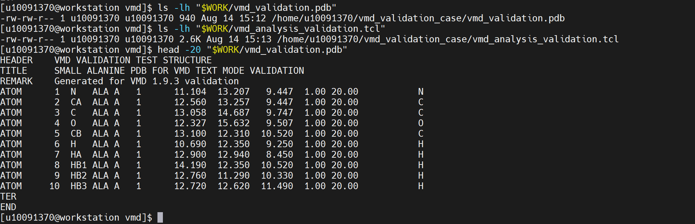

10、执行 vmd 文本模式分析验证。

.. code-block:: text
         :linenos:
         :emphasize-lines: 1

         /opt/app/vmd/bin/vmd -dispdev text -e "$WORK/vmd_analysis_validation.tcl" 2>&1 | tee "$WORK/vmd_validation_run.log"

证明：vmd 正常启动，返回 vmd for LINUXAMD64, version 1.9.3，并成功使用 pdb 插件加载 /home/useradmin/vmd_validation_case/vmd_validation.pdb 文件。日志中出现 Atoms: 10、Bonds: 9、Residues: 1、Protein: 1，说明 vmd 能够正常读取 PDB 结构文件并完成结构分析。

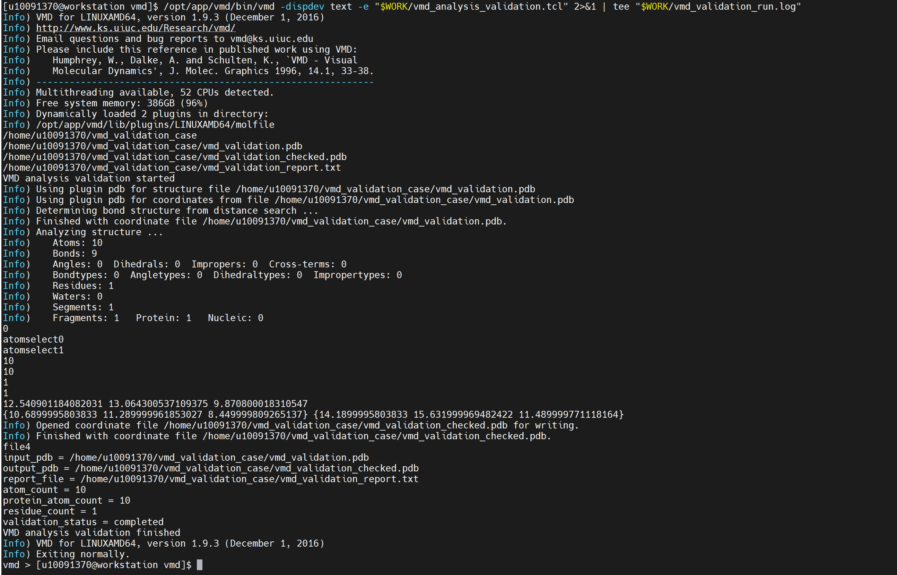

11、查看 vmd 分析报告。

.. code-block:: text
         :linenos:
         :emphasize-lines: 1

         cat "$WORK/vmd_validation_report.txt"

证明：报告中出现 atom_count = 10、protein_atom_count = 10、residue_count = 1、validation_status = completed，说明 vmd 成功完成 PDB 结构加载、原子选择、残基统计、结构分析和报告输出。

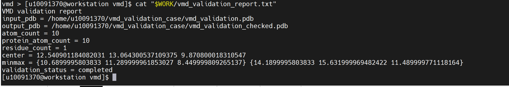

12、检查 vmd 输出结果文件。(需要管理员权限，操作可不执行步骤仅参考)

.. code-block:: text
         :linenos:
         :emphasize-lines: 1

         ls -lh "$WORK/vmd_validation_checked.pdb"
         ls -lh "$WORK/vmd_validation_report.txt"
         ls -lh "$WORK/vmd_validation_run.log"

证明：目录下生成 vmd_validation_checked.pdb、vmd_validation_report.txt、vmd_validation_run.log 文件，说明 vmd 分析脚本运行后成功输出检查后的 PDB 文件、验证报告和运行日志。

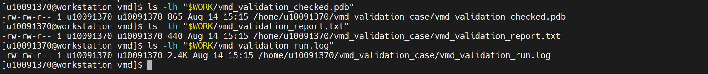

13、归档 vmd 验证文件到公共目录。

.. code-block:: text
         :linenos:
         :emphasize-lines: 1

         cp "$WORK/vmd_validation.pdb" "$SHARE/"
         cp "$WORK/vmd_analysis_validation.tcl" "$SHARE/"
         cp "$WORK/vmd_validation_checked.pdb" "$SHARE/"
         cp "$WORK/vmd_validation_report.txt" "$SHARE/"
         cp "$WORK/vmd_validation_run.log" "$SHARE/"

证明：vmd 验证输入文件、分析脚本、输出结构文件、验证报告和运行日志已保存到 /home/share/验证示例文件 目录，便于后续复测和验收查看。

14、查看公共目录中的验证结果文件。

.. code-block:: text
         :linenos:
         :emphasize-lines: 1

         ls -lh "$SHARE/vmd_validation.pdb"
         ls -lh "$SHARE/vmd_analysis_validation.tcl"
         ls -lh "$SHARE/vmd_validation_checked.pdb"
         ls -lh "$SHARE/vmd_validation_report.txt"
         ls -lh "$SHARE/vmd_validation_run.log"

证明：公共目录中存在 vmd_validation.pdb、vmd_analysis_validation.tcl、vmd_validation_checked.pdb、vmd_validation_report.txt、vmd_validation_run.log 等文件，说明 vmd 验证算例及结果已完成归档。

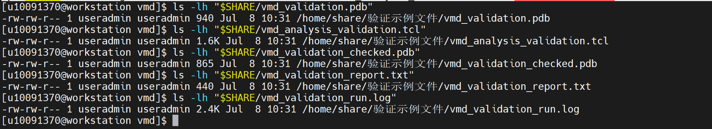

15、提取关键验证结果。

.. code-block:: text
         :linenos:
         :emphasize-lines: 1

         grep -En "vmd for LINUXAMD64|Atoms: 10|Residues: 1|Protein: 1|atom_count = 10|protein_atom_count = 10|residue_count = 1|validation_status = completed|vmd analysis validation finished|Exiting normally" "$SHARE/vmd_validation_run.log" "$SHARE/vmd_validation_report.txt"

证明：返回结果包含 vmd for LINUXAMD64, version 1.9.3、Atoms: 10、Residues: 1、Protein: 1、atom_count = 10、protein_atom_count = 10、residue_count = 1、validation_status = completed、vmd analysis validation finished、Exiting normally 等关键内容，说明 vmd 主程序启动、PDB 结构加载、TCL 脚本分析和结果输出均正常完成。

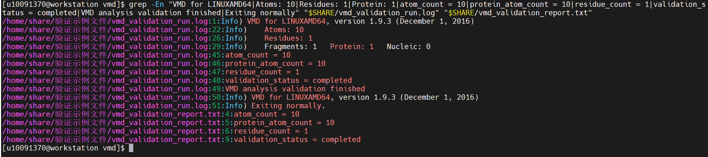
