AlphaFold3
===============

AlphaFold3 是 Google DeepMind 于 2024 年发布的新一代 AI 生物分子结构预测模型，核心亮点如下：
全分子覆盖：突破单一蛋白质限制，可高精度预测蛋白质、DNA、RNA、小分子配体及离子的复合体结构。
技术革新：引入扩散模型架构，显著提升了对复杂复合物和非蛋白分子的预测准确率。
赋能药研：能精准预测药物与靶点的结合模式，大幅加速药物发现并降低实验成本。
开放共享：提供免费服务器供非商业研究使用，降低了全球科研门槛。
平台提供两个版本，均可使用

软件路径
---------
.. admonition:: **Tips**

    **/opt/app/alphafold_3**

    **/opt/app/alphafold_3.0.1**

如何使用
--------

本文内容为从0开始进行分析及环境检测，适用初次上手情况，已具备操作能力可根据下列步骤酌情选择操作。

运行环境检查
------------

**keypoint**：在运行 AlphaFold3 之前，请确保已完成以下环境检查，以保证软件的正常运行。(可选)

1、进入 AlphaFold 3 安装目录，确认目录存在。

.. code-block:: text
         :linenos:
         :emphasize-lines: 1

         cd /opt/app/alphafold_3.0.1 && pwd

证明：命令返回 /opt/app/alphafold_3.0.1，说明 AlphaFold 3 安装目录存在。

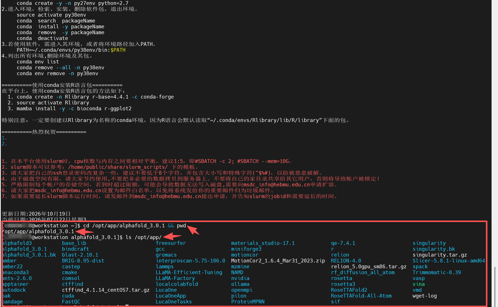

2、查看 AlphaFold 3 安装目录内容，确认程序文件和数据目录是否完整。

.. code-block:: text
         :linenos:
         :emphasize-lines: 1

         ls -lah

证明：返回结果中出现 af3_demo、models、public_databases、run_alphafold.py、requirements.txt、src 等文件或目录，说明 AlphaFold 3 安装结构存在。

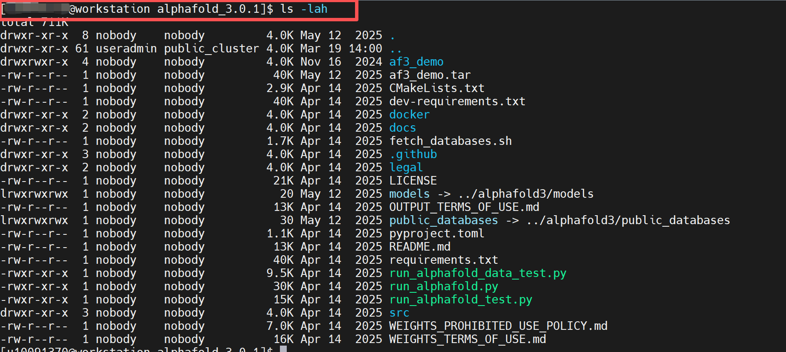

3、查看当前 Conda 中已有的环境，确认 AlphaFold 3 环境实际名称。

.. code-block:: text
         :linenos:
         :emphasize-lines: 1

         /opt/app/anaconda3/bin/conda info --envs

证明：返回结果中出现 mlfold 环境，说明系统中存在可用于 AlphaFold 3 验证的 Conda 环境。

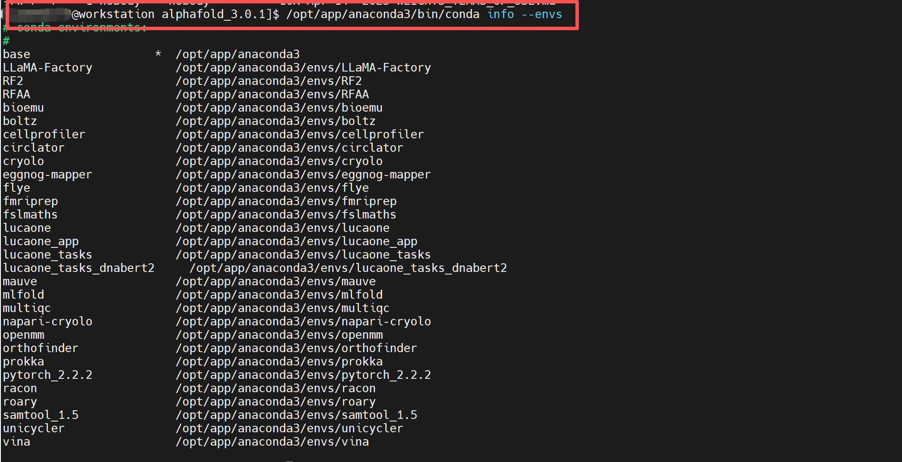

4、激活 mlfold Conda 环境。

.. code-block:: text
         :linenos:
         :emphasize-lines: 1

         source /opt/app/anaconda3/bin/activate mlfold

证明：命令执行后终端前缀出现 (mlfold)，说明 mlfold 环境已激活。

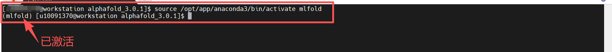

5、确认当前环境使用的是 mlfold 中的 Python。

.. code-block:: text
         :linenos:
         :emphasize-lines: 1

         which python && python --version

证明：which python 返回 /opt/app/anaconda3/envs/mlfold/bin/python，且 Python 版本正常输出，说明当前使用的是 mlfold 环境中的 Python。

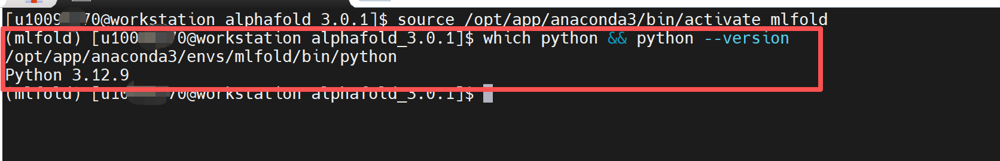

6、测试当前环境是否可以导入 alphafold3 模块。

.. code-block:: text
         :linenos:
         :emphasize-lines: 1

         cd ..

         python -c "import alphafold3; print('alphafold3 import OK')"

证明：返回 alphafold3 import OK，说明 alphafold3 基础 Python 模块可以正常导入。

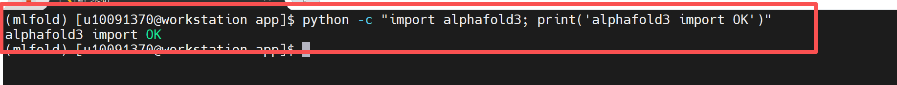

验证步骤
-----------------

7、确认 AlphaFold3 验证压缩包已上传到公共目录。

.. code-block:: text
         :linenos:
         :emphasize-lines: 1

         ls -lh /home/share/验证示例文件/alphafold3_validation_case.zip

证明：返回 /home/share/验证示例文件/alphafold3_validation_case.zip，说明 AlphaFold3 验证压缩包已上传成功。

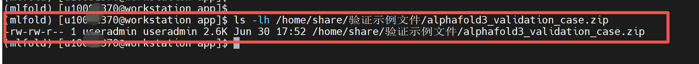

8、创建 AlphaFold3 验证目录。

返回根目录
  cd ~

  删除历史测试文件夹（如无可不操作）

.. code-block:: text
         :linenos:
         :emphasize-lines: 1

         rm -rf ~/alphafold3_validation

创建验证运行目录

.. code-block:: text
         :linenos:
         :emphasize-lines: 1

         mkdir -p ~/alphafold3_validation

进入验证运行目录

.. code-block:: text
         :linenos:
         :emphasize-lines: 1

         cd ~/alphafold3_validation

证明：进入 /home/useradmin/alphafold3_validation，说明验证运行目录创建成功。

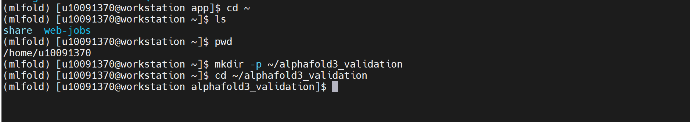

9、解压 AlphaFold3 验证压缩包。

.. code-block:: text
         :linenos:
         :emphasize-lines: 1

         unzip -o /home/share/验证示例文件/alphafold3_validation_case.zip

.. code-block:: text
         :linenos:
         :emphasize-lines: 1

         find . -maxdepth 3 -type f -ls

证明：解压后生成 af_input/fold_input.json、README.txt 等文件，说明 AlphaFold3 验证输入文件准备完成。

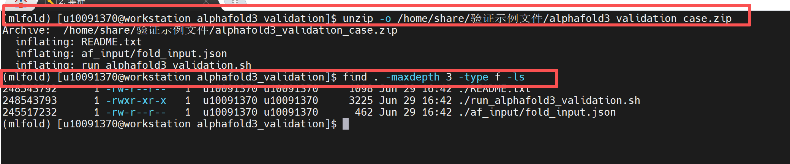

10、查看 AlphaFold3 输入 JSON 文件。

.. code-block:: text
         :linenos:
         :emphasize-lines: 1

         cat af_input/fold_input.json

证明：文件中包含 name、sequences、protein、id、sequence、modelSeeds、dialect、version 等字段，说明该文件为 AlphaFold3 JSON 输入文件。

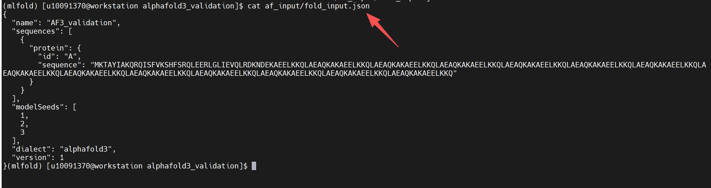

11、检查 JSON 文件中的序列长度和随机种子。

.. code-block:: text
         :linenos:
         :emphasize-lines: 1

         python - <<'PY'
         import json
         from pathlib import Path
         
         p = Path("af_input/fold_input.json")
         data = json.loads(p.read_text())
         seq = data["sequences"][0]["protein"]["sequence"]

         print("name =", data["name"])
         print("dialect =", data["dialect"])
         print("version =", data["version"])
         print("chain id =", data["sequences"][0]["protein"]["id"])
         print("sequence length =", len(seq))
         print("modelSeeds =", data["modelSeeds"])
         print("JSON check OK")
         PY

证明：返回 sequence length = 243，modelSeeds = [1, 2, 3]，JSON check OK，说明 AlphaFold3 输入文件结构正常。

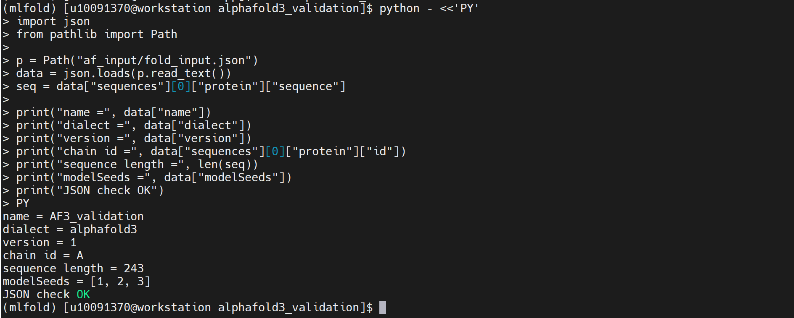

12、申请 GPU 节点。

.. code-block:: text
         :linenos:
         :emphasize-lines: 1

         salloc -p gpu -c 8 --mem=32G --gres=gpu:1

证明：返回 job allocation 信息，并提示 GPU 节点资源已分配，说明 GPU 节点资源申请成功。

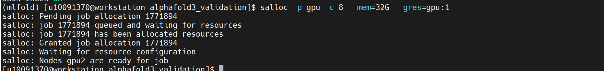

13、进入已分配的 GPU 节点。

.. code-block:: text
         :linenos:
         :emphasize-lines: 1

         ssh gpu2

证明：终端提示符切换为 gpu2，说明已进入分配的 GPU 节点。
说明：如果实际分配的节点不是 gpu2，则进入实际分配的 GPU 节点。

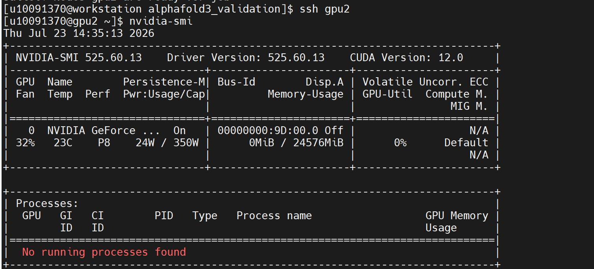

14、查看 NVIDIA GPU 状态。

.. code-block:: text
         :linenos:
         :emphasize-lines: 1

         nvidia-smi

证明：返回 NVIDIA-SMI 信息，显示 Driver Version、CUDA Version、GPU 显存和进程信息，说明 GPU 节点和 NVIDIA 驱动可正常识别。

15、进入 AlphaFold3 验证目录。

.. code-block:: text
         :linenos:
         :emphasize-lines: 1

         cd ~/alphafold3_validation
         pwd
         ls -lah

证明：当前路径为 /home/useradmin/alphafold3_validation，目录中存在 af_input、README.txt 等文件。

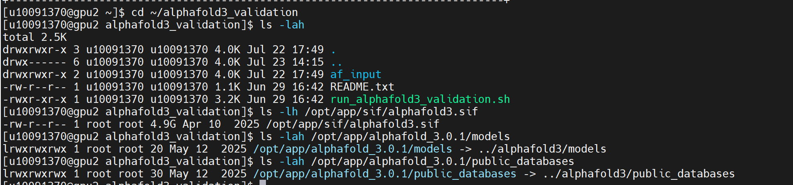

16、确认 AlphaFold3 容器、模型目录和数据库目录存在。

.. code-block:: text
         :linenos:
         :emphasize-lines: 1

         ls -lh /opt/app/sif/alphafold3.sif

.. code-block:: text
         :linenos:
         :emphasize-lines: 1

         ls -lah /opt/app/alphafold_3.0.1/models

.. code-block:: text
         :linenos:
         :emphasize-lines: 1

         ls -lah /opt/app/alphafold_3.0.1/public_databases

证明：返回 alphafold3.sif 容器文件，models 和 public_databases 目录或软链接存在，说明 AlphaFold3 容器、模型权重和公共数据库路径可识别。

17、确认 NVIDIA 驱动库目录。

.. code-block:: text
         :linenos:
         :emphasize-lines: 1

         ls -lah /opt/app/nvidia

证明：返回结果中存在 525.60.13，并且 current -> 525.60.13，说明服务器中存在可用于容器挂载的 NVIDIA 驱动库目录。

18、测试 Apptainer 容器内是否能够识别 GPU。

.. code-block:: text
         :linenos:
         :emphasize-lines: 1

         APPTAINER_GPU_CHECK=(/opt/app/apptainer/bin/apptainer exec --nv --bind /opt/app/nvidia/current:/usr/local/nvidia --env "LD_LIBRARY_PATH=/usr/local/nvidia/lib:/usr/local/nvidia/lib64:${LD_LIBRARY_PATH:-}" /opt/app/sif/alphafold3.sif)

         "${APPTAINER_GPU_CHECK[@]}" python - <<'PY'
         import jax
         print(jax.local_devices(backend="gpu"))
         PY

证明：返回 [CudaDevice(id=0)]，说明 AlphaFold3 容器内可以识别 GPU。

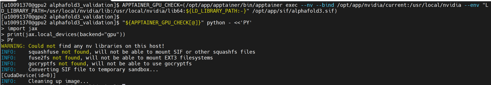

19、生成 AlphaFold3 基础环境与容器 GPU 识别验证脚本。

.. code-block:: text
         :linenos:
         :emphasize-lines: 1

         cat > run_alphafold3_basic_validation.sh <<'EOF'
         #!/bin/bash
         set -e
         
         cd "$(dirname "$0")"

         OUT_DIR=af3_basic_validation_output
         rm -rf "$OUT_DIR"
         mkdir -p "$OUT_DIR"
         
         APPTAINER_ENV=(/opt/app/apptainer/bin/apptainer exec --nv --cleanenv --bind /opt/app/nvidia/current:/usr/local/nvidia --bind "$PWD/af_input:/root/af_input" --bind "$PWD/$OUT_DIR:/root/out" /opt/app/sif/alphafold3.sif)
         
         "${APPTAINER_ENV[@]}" bash -lc '
         export LD_LIBRARY_PATH=/usr/local/nvidia/lib:/.singularity.d/libs
         
         python - <<PY 2>&1 | tee /root/out/af3_basic_validation.log
         import json
         import time
         import hashlib
         from pathlib import Path

         print("AlphaFold3 basic environment validation")
         
         input_path = Path("/root/af_input/fold_input.json")
         data = json.loads(input_path.read_text())
         seq = data["sequences"][0]["protein"]["sequence"]
         
         print("input_name =", data["name"])
         print("dialect =", data["dialect"])
         print("version =", data["version"])
         print("chain_id =", data["sequences"][0]["protein"]["id"])
         print("sequence_length =", len(seq))
         print("modelSeeds =", data["modelSeeds"])
         
         import jax
         devices = jax.local_devices(backend="gpu")
         print("gpu_devices =", devices)
         
         import alphafold3
         print("alphafold3_import = OK")
         
         start = time.time()
         rounds = 0
         digest = ""
         
         while time.time() - start < 300:
             payload = (seq + str(rounds) + str(data["modelSeeds"])).encode()
             digest = hashlib.sha256(payload).hexdigest()
             for _ in range(20000):
                 digest = hashlib.sha256(digest.encode()).hexdigest()
             rounds += 1
         
         print("validation_status = completed")
         print("calculation_rounds =", rounds)
         print("checksum =", digest[:32])
         print("result = AlphaFold3 container basic validation completed")
         PY
         '

grep -E "AlphaFold3 basic|input_name|dialect|version|chain_id|sequence_length|modelSeeds|gpu_devices|alphafold3_import|validation_status|calculation_rounds|checksum|result" "$OUT_DIR/af3_basic_validation.log" > "$OUT_DIR/af3_basic_validation_summary.txt"

cat "$OUT_DIR/af3_basic_validation_summary.txt"
EOF

.. code-block:: text
         :linenos:
         :emphasize-lines: 1

         chmod +x run_alphafold3_basic_validation.sh

证明：生成 run_alphafold3_basic_validation.sh 脚本，用于验证 AlphaFold3 容器启动、输入 JSON 读取、alphafold3 模块导入、GPU 识别和基础运行稳定性。

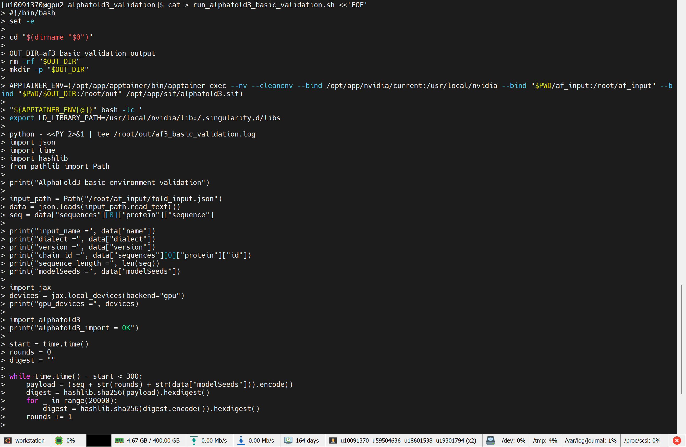

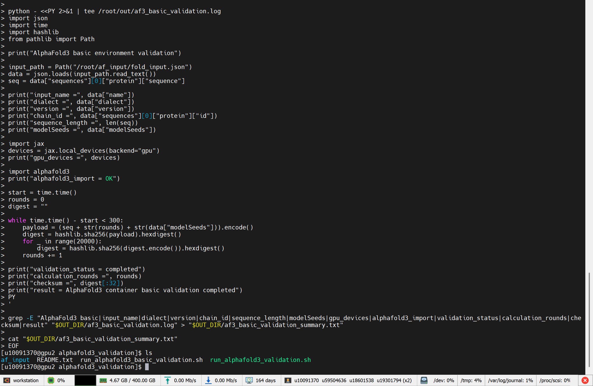
   
20、运行 AlphaFold3 基础验证脚本。

.. code-block:: text
         :linenos:
         :emphasize-lines: 1

         bash run_alphafold3_basic_validation.sh

证明：脚本执行后输出 AlphaFold3 basic environment validation、gpu_devices = [CudaDevice(id=0)]、alphafold3_import = OK、validation_status = completed、checksum、result = AlphaFold3 container basic validation completed，说明 AlphaFold3 基础环境与容器 GPU 识别验证完成。

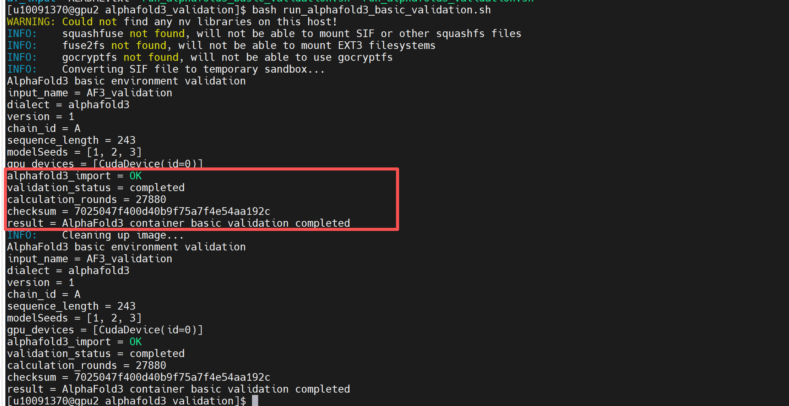

21、查看 AlphaFold3 基础验证日志。

.. code-block:: text
         :linenos:
         :emphasize-lines: 1

         cat af3_basic_validation_output/af3_basic_validation.log

证明：日志中包含输入文件名称、序列长度、modelSeeds、GPU 设备信息、alphafold3 模块导入结果、运行完成状态和 checksum 校验值，说明验证过程有完整日志记录。

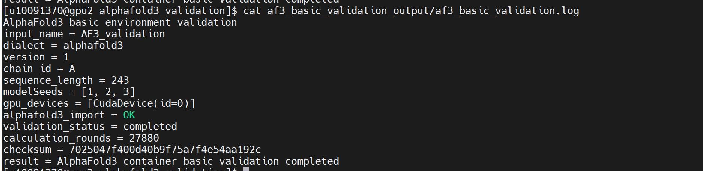

22、查看 AlphaFold3 基础验证汇总文件。

.. code-block:: text
         :linenos:
         :emphasize-lines: 1

         cat af3_basic_validation_output/af3_basic_validation_summary.txt

证明：汇总文件中出现 gpu_devices = [CudaDevice(id=0)]、alphafold3_import = OK、validation_status = completed、result = AlphaFold3 container basic validation completed，说明验证结果已生成。

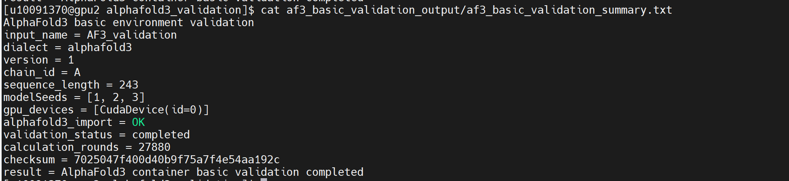

23、检查 AlphaFold3 验证信息。

.. code-block:: text
         :linenos:
         :emphasize-lines: 1

         grep -Eni "Traceback|ImportError|ModuleNotFoundError|No visible GPU devices|Unable to initialize backend|FAILED_PRECONDITION|ERROR" af3_basic_validation_output/af3_basic_validation.log || true

证明：如果未出现 Traceback、ImportError、No visible GPU devices、Unable to initialize backend、FAILED_PRECONDITION、ERROR 等异常信息，说明基础验证过程未发生异常中断。

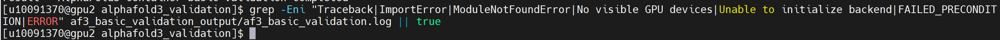

24、保存验证输入文件、脚本、日志和汇总结果到公共目录。（此步骤需具备路径的写入权限，可不验证执行）

.. code-block:: text
         :linenos:
         :emphasize-lines: 1

         DEST="/home/share/验证示例文件/AlphaFold3运算验证算例"
         mkdir -p "$DEST"

         cp -r ~/alphafold3_validation/af_input "$DEST/"
         cp -r ~/alphafold3_validation/af3_basic_validation_output "$DEST/"
         cp ~/alphafold3_validation/README.txt "$DEST/"
         cp ~/alphafold3_validation/run_alphafold3_basic_validation.sh "$DEST/"

.. code-block:: text
         :linenos:
         :emphasize-lines: 1
         
         ls -lah "$DEST"

证明：公共目录中保存 af_input、af3_basic_validation_output、README.txt、run_alphafold3_basic_validation.sh，便于后续复测和验收查看。

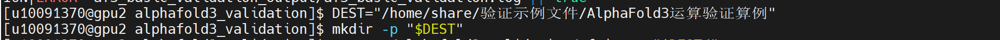

25、退出 GPU 节点并释放资源。

.. code-block:: text
         :linenos:
         :emphasize-lines: 1

         exit

.. code-block:: text
         :linenos:
         :emphasize-lines: 1

         squeue -u $USER

证明：退出 GPU 节点后回到登录节点，squeue -u $USER 不再显示当前 GPU 作业，说明 GPU 交互资源已释放。

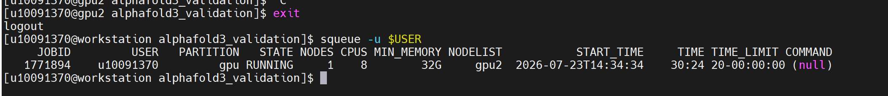

参考资料
----------------
- AlphaFold3 GitHub: https://github.com/google-deepmind/alphafold3