GROMACS
=========

GROMACS 是一款免费开源、高性能的分子动力学模拟软件。
核心用途： 模拟蛋白质、核酸、脂质膜等生物大分子及材料体系的结构与运动。
最大优势： 运算速度极快，对 GPU 和多核并行优化极佳；内置丰富的分析工具。
适用领域： 计算化学、结构生物学、药物设计、材料科学。
特点： 命令行操作为主，学习曲线较陡，但社区活跃、文档完善。

如何使用
--------

1、进入 GROMACS 安装目录，确认目录存在。

.. code-block:: text
         :linenos:
         :emphasize-lines: 1

         cd /opt/app/gromacs && pwd

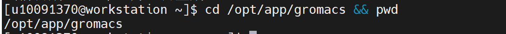

证明：命令返回 /opt/app/gromacs，说明 GROMACS 安装目录存在。

2、查看 GROMACS 安装目录中的版本目录。

.. code-block:: text
         :linenos:
         :emphasize-lines: 1

         ls -l | head

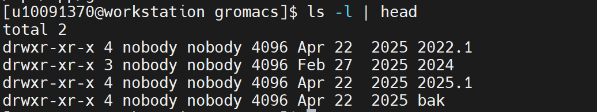

证明：返回结果中出现 2022.1、2024、2025.1 等版本目录，说明 GROMACS 平台安装目录结构存在。

3、查找 GROMACS 主程序。

.. code-block:: text
         :linenos:
         :emphasize-lines: 1

         find /opt/app/gromacs/2025.1 -name "gmx*" -type f 2>/dev/null | head -20

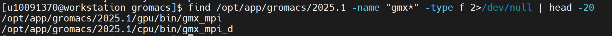

证明：返回 /opt/app/gromacs/2025.1/gpu/bin/gmx_mpi 和 /opt/app/gromacs/2025.1/cpu/bin/gmx_mpi_d，说明 GROMACS CPU 版和 GPU 版主程序均存在。

4、先直接查看 GROMACS CPU 版版本信息。

.. code-block:: text
         :linenos:
         :emphasize-lines: 1

         /opt/app/gromacs/2025.1/cpu/bin/gmx_mpi_d --version

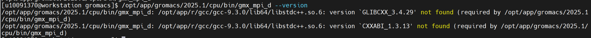

证明：返回 GLIBCXX_3.4.29 和 CXXABI_1.3.13 相关依赖库提示，说明当前环境缺少 GROMACS 2025.1 所需的 GCC 12.4.0 运行库，需要先加载对应动态库。

5、加载 GROMACS 2025.1 需要的 GCC 12.4.0 运行库。

.. code-block:: text
         :linenos:
         :emphasize-lines: 1

         export LD_LIBRARY_PATH=/opt/app/gcc/12.4.0_gcc4.8.5/lib64:$LD_LIBRARY_PATH

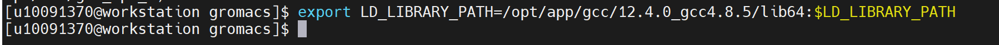

证明：GCC 12.4.0 动态库路径已加入 LD_LIBRARY_PATH，为 GROMACS 2025.1 CPU 版运行提供依赖环境。

6、重新查看 GROMACS CPU 版版本信息，确认是否已经正常启动。

.. code-block:: text
         :linenos:
         :emphasize-lines: 1

         /opt/app/gromacs/2025.1/cpu/bin/gmx_mpi_d --version

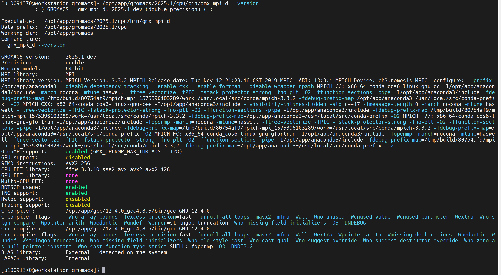

证明：返回 GROMACS - gmx_mpi_d, 2025.1-dev、Precision: double、GPU support: disabled、C compiler: GNU 12.4.0 等信息，说明 GROMACS 2025.1 CPU 双精度版主程序可以正常启动。

验证步骤：
7、创建 GROMACS 分子动力学验证算例存放目录和实际运行目录。

.. code-block:: text
         :linenos:
         :emphasize-lines: 1

         mkdir -p "/home/share/验证示例文件/GROMACS分子动力学验证算例"
         cd ~
         rm -rf ~/gromacs_validation
         mkdir -p ~/gromacs_validation
         cd ~/gromacs_validation
         pwd

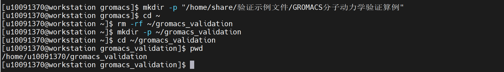

证明：pwd 返回 /home/useradmin/gromacs_validation，说明已创建干净的 GROMACS 验证运行目录。

8、加载 GROMACS CPU 版运行环境。

.. code-block:: text
         :linenos:
         :emphasize-lines: 1

         export LD_LIBRARY_PATH=/opt/app/gcc/12.4.0_gcc4.8.5/lib64:$LD_LIBRARY_PATH
         export PATH=/opt/app/gromacs/2025.1/cpu/bin:$PATH
         which gmx_mpi_d

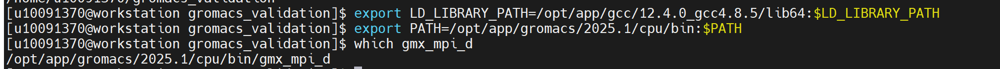

证明：which gmx_mpi_d 返回 /opt/app/gromacs/2025.1/cpu/bin/gmx_mpi_d，说明 GROMACS CPU 版主程序已加入环境变量。

9、创建 GROMACS 水分子最小化验证算例输入文件。

.. code-block:: text
         :linenos:
         :emphasize-lines: 1

         cd ~/gromacs_validation
         cp /opt/app/gromacs/2025.1/cpu/share/gromacs/top/spc216.gro conf.gro

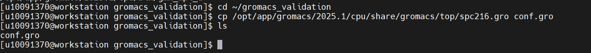

.. code-block:: text
         :linenos:
         :emphasize-lines: 1

         cat > topol.top <<'EOF'
         #include "oplsaa.ff/forcefield.itp"
         #include "oplsaa.ff/spc.itp"

         [ system ]
         GROMACS water minimization validation

         [ molecules ]
         SOL 216
         EOF

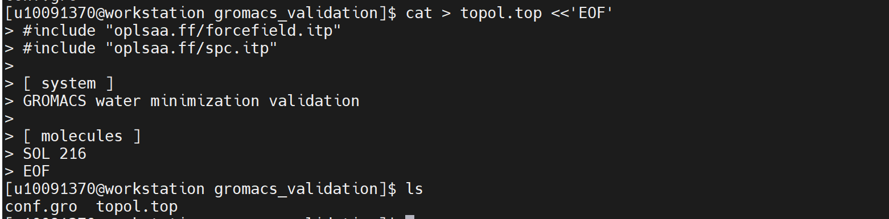

.. code-block:: text
         :linenos:
         :emphasize-lines: 1

         cat > min.mdp <<'EOF'
         integrator      = steep
         emtol           = 1000.0
         emstep          = 0.01
         nsteps          = 100

         nstlist         = 10
         cutoff-scheme   = Verlet
         rlist           = 0.8
         coulombtype     = PME
         rcoulomb        = 0.8
         rvdw            = 0.8
         pbc             = xyz
         EOF

.. code-block:: text
         :linenos:
         :emphasize-lines: 1

         ls -lh

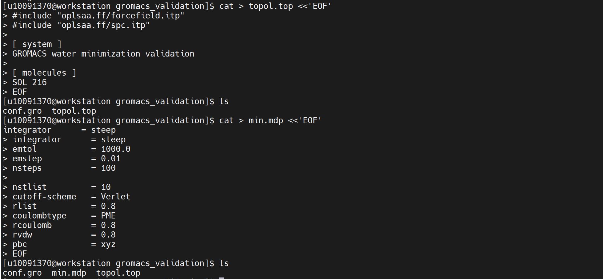

证明：目录中生成 conf.gro、topol.top、min.mdp 三个核心输入文件。其中 conf.gro 为水分子结构文件，topol.top 为拓扑文件，min.mdp 为能量最小化参数文件。

10、使用 grompp 生成 GROMACS 正式运行输入文件。

.. code-block:: text
         :linenos:
         :emphasize-lines: 1

         gmx_mpi_d grompp -f min.mdp -c conf.gro -p topol.top -o min.tpr 2>&1 | tee grompp.log

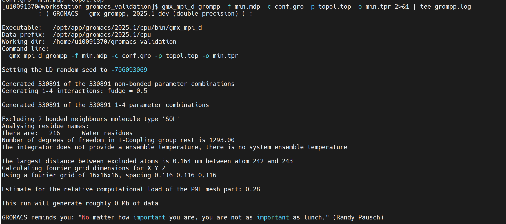

证明：grompp 能够读取 min.mdp、conf.gro、topol.top，并生成 min.tpr，说明 GROMACS 预处理阶段正常。

11、查看 grompp 预处理结果。

.. code-block:: text
         :linenos:
         :emphasize-lines: 1

         ls -lh min.tpr grompp.log
         tail -40 grompp.log

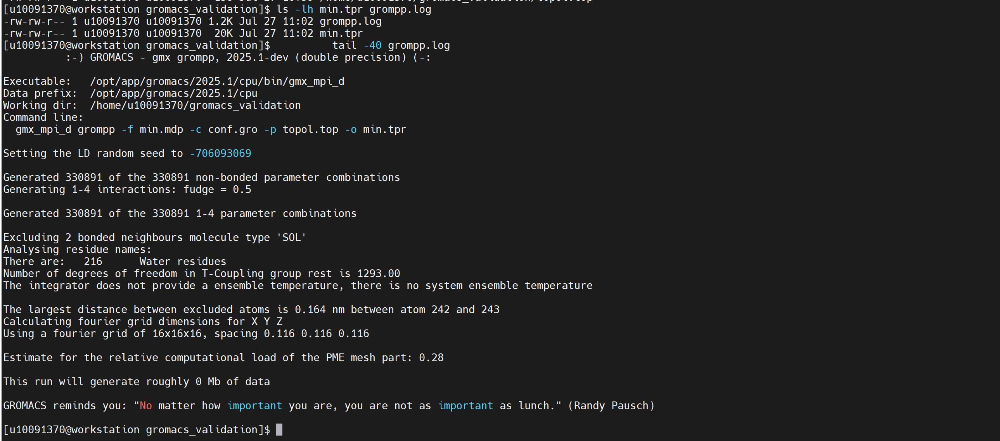

证明：返回结果中出现 min.tpr，文件大小约 20K；grompp.log 中出现 There are: 216 Water residues、This run will generate roughly 0 Mb of data 等信息，且未出现 Fatal error，说明 tpr 输入文件生成成功。

12、运行 GROMACS CPU 版能量最小化计算。

.. code-block:: text
         :linenos:
         :emphasize-lines: 1

         gmx_mpi_d mdrun -s min.tpr -deffnm gromacs_min_cpu 2>&1 | tee mdrun_cpu.log

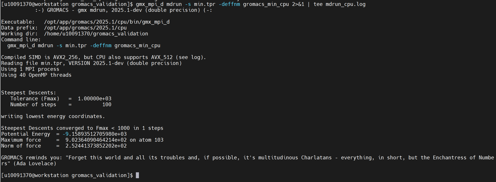

证明：程序能够读取 min.tpr 并启动 mdrun 计算任务，输出 Steepest Descents、Potential Energy 等信息，说明 GROMACS 已进入能量最小化计算流程。

13、查看 GROMACS 计算结果文件。

.. code-block:: text
         :linenos:
         :emphasize-lines: 1

         ls -lh gromacs_min_cpu*
         tail -80 gromacs_min_cpu.log

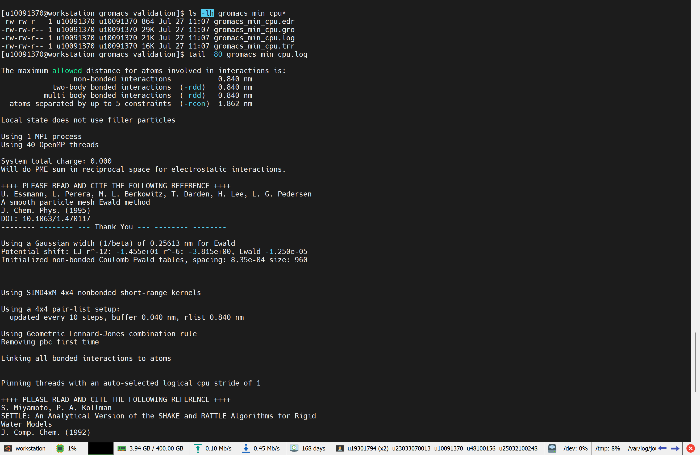

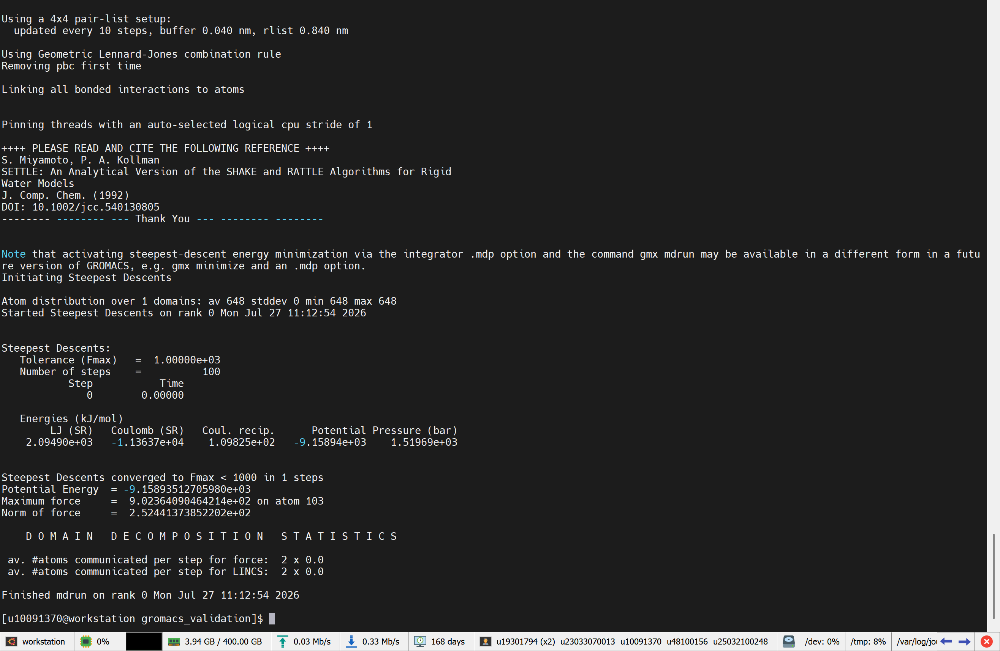

证明：返回结果中出现 gromacs_min_cpu.log、gromacs_min_cpu.gro、gromacs_min_cpu.edr、gromacs_min_cpu.trr 等文件，说明计算日志、最小化后坐标、能量文件和轨迹文件均已生成。

14、检查 GROMACS 计算完成标志。

.. code-block:: text
         :linenos:
         :emphasize-lines: 1

         grep -Eni "Finished mdrun|Steepest Descents converged|writing lowest energy coordinates|Potential Energy|Lowest energy" gromacs_min_cpu.log

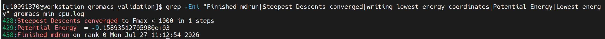

证明：日志中出现 Steepest Descents converged to Fmax < 1000 in 1 steps、Potential Energy = -9.15893512705980e+03、Finished mdrun on rank 0 等信息，说明 GROMACS 能量最小化计算正常完成。

15、检查是否存在异常中断信息。

.. code-block:: text
         :linenos:
         :emphasize-lines: 1

         grep -Eni "Fatal error|terminated|segmentation|abort" gromacs_min_cpu.log mdrun_cpu.log || echo "未发现异常中断信息"

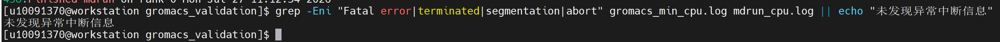

证明：命令返回“未发现异常中断信息”，说明计算过程中未出现 Fatal error、terminated、segmentation、abort 等异常中断。

16、将 GROMACS 验证算例和结果文件保存到公共验证目录，便于后续复测和验收查看。

.. code-block:: text
         :linenos:
         :emphasize-lines: 1

         cp -r ~/gromacs_validation/* "/home/share/验证示例文件/GROMACS分子动力学验证算例/"
         ls -lh "/home/share/验证示例文件/GROMACS分子动力学验证算例/"

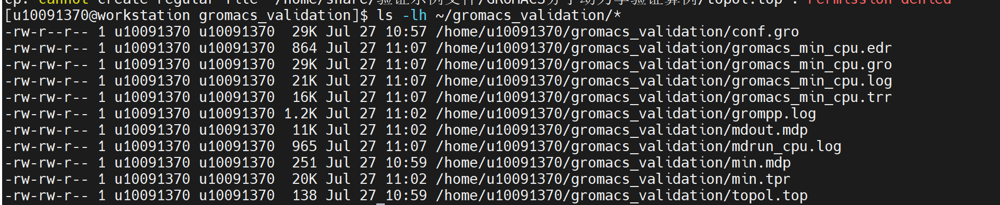

证明：公共目录中包含 conf.gro、topol.top、min.mdp、min.tpr、grompp.log、mdrun_cpu.log、gromacs_min_cpu.log、gromacs_min_cpu.gro、gromacs_min_cpu.edr、gromacs_min_cpu.trr 等文件，说明 GROMACS 验证算例及运行结果已保存。