LAMMPS
========

LAMMPS 是一款免费开源、高度通用的经典分子动力学模拟软件。
核心用途： 擅长材料科学、凝聚态物理及粗粒化模拟（如金属、合金、聚合物、纳米颗粒），对生物大分子支持弱于 GROMACS。
最大优势： 模块化极强，支持海量势函数与自定义扩展；并行扩展性极佳，适合超算大规模计算。
适用领域： 材料力学、缺陷演化、相变、非平衡态过程、多尺度耦合模拟。
特点： 脚本驱动、灵活性极高，但配置复杂、学习门槛高于 GROMACS。
简言之：它是材料科学与物理领域最灵活、扩展性最强的通用 MD 引擎。

如何使用
---------

1、进入 LAMMPS 安装目录，确认目录存在。

.. code-block:: text
         :linenos:
         :emphasize-lines: 1

         cd /opt/app/lammps && pwd

证明：命令返回 /opt/app/lammps，说明 LAMMPS 安装目录存在。

如下图：

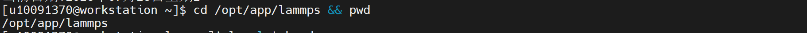

2、查看 LAMMPS 安装目录内容，确认安装结构。

.. code-block:: text
         :linenos:
         :emphasize-lines: 1

         ls -l | head

证明：返回结果中出现 19Nov2024_cpu、19Nov2024_gpu、29Oct20、29Sep2021、2Aug2023 等目录，说明 LAMMPS 安装目录结构存在。

如下图：

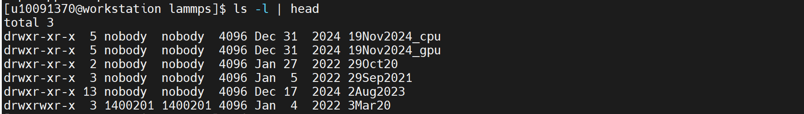
   
3、查找 LAMMPS CPU 版本主程序。

.. code-block:: text
         :linenos:
         :emphasize-lines: 1

         find /opt/app/lammps/19Nov2024_cpu -name "lmp*" -type f 2>/dev/null | head -20

证明：返回 /opt/app/lammps/19Nov2024_cpu/bin/lmp，说明 LAMMPS CPU 主程序存在。

如下图：

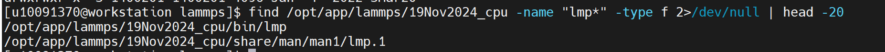
  
4、设置运行所需动态库路径。

.. code-block:: text
         :linenos:
         :emphasize-lines: 1

         export LD_LIBRARY_PATH=/opt/app/r/r4.2.2.1/x86_64-conda-linux-gnu/sysroot/usr/lib64:/opt/app/anaconda3/envs/RF2/lib:$LD_LIBRARY_PATH

证明：命令执行无报错，说明动态库环境变量设置完成。

如下图：

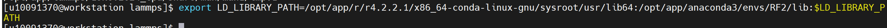
  
5、查看 LAMMPS 主程序帮助信息。

.. code-block:: text
         :linenos:
         :emphasize-lines: 1

         /opt/app/lammps/19Nov2024_cpu/bin/lmp -h > ~/lammps_help.txt 2>&1
         head -40 ~/lammps_help.txt

证明：返回 Large-scale Atomic/Molecular Massively Parallel Simulator - 19 Nov 2024，并显示 Usage example、command line options、-help、-in、-log 等参数说明，说明 LAMMPS 主程序可正常启动并输出帮助信息。

如下图：

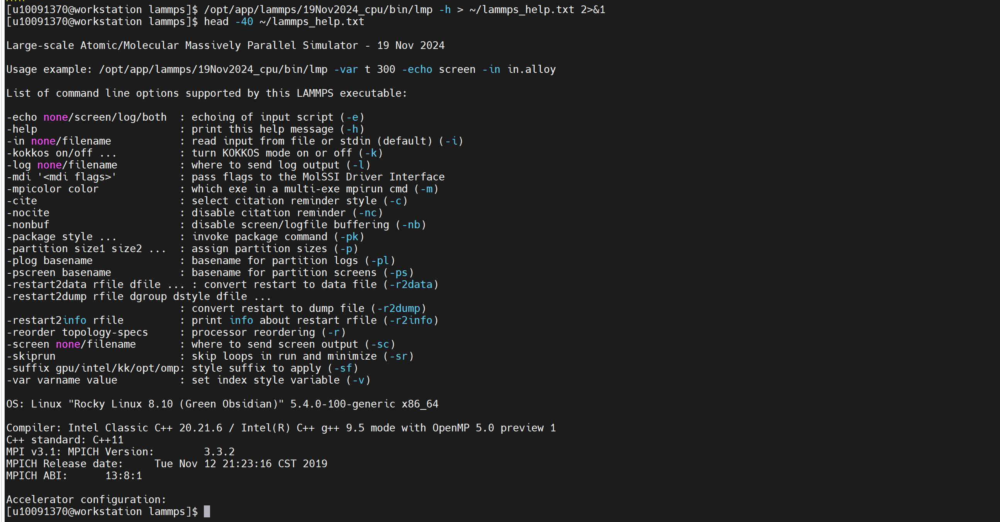
  
6、确认 LAMMPS 验证输入文件存在。

.. code-block:: text
         :linenos:
         :emphasize-lines: 1

         ls -lh /home/share/验证示例文件/in.lammps_validation

证明：返回 /home/share/验证示例文件/in.lammps_validation 文件信息，说明 LAMMPS 验证输入文件已创建成功。

如下图：

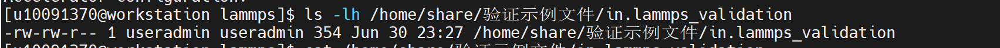
  
7、查看 LAMMPS 验证输入文件内容。

.. code-block:: text
         :linenos:
         :emphasize-lines: 1

         cat /home/share/验证示例文件/in.lammps_validation

证明：文件内容包含 units lj、atom_style atomic、lattice fcc 0.8442、region box、create_box、create_atoms、pair_style lj/cut、pair_coeff、fix nve、thermo、run 20、write_data 等命令，可作为 LAMMPS 基础分子动力学模拟验证输入文件。

如下图：

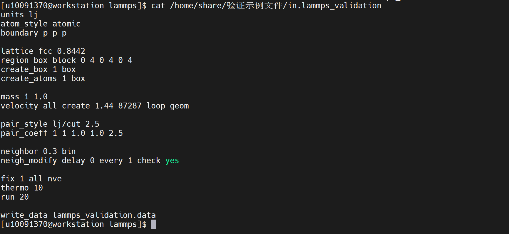
  
8、检查验证输入文件中的关键 LAMMPS 命令。

.. code-block:: text
         :linenos:
         :emphasize-lines: 1

         grep -E "units|atom_style|lattice|region|create_box|create_atoms|pair_style|pair_coeff|fix|run|write_data" /home/share/验证示例文件/in.lammps_validation
         mkdir ~/lammps_validation

证明：返回 units、atom_style、lattice、region、create_box、create_atoms、pair_style、pair_coeff、fix、run、write_data 等关键命令，说明输入文件内容完整。

如下图：

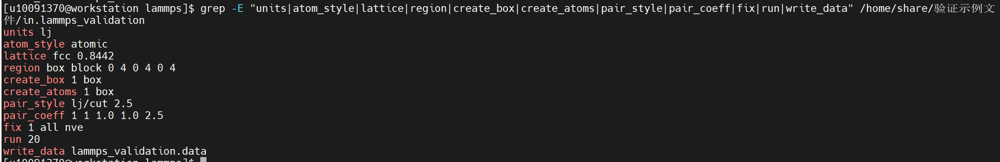
  
9、执行 LAMMPS 验证算例。

.. code-block:: text
         :linenos:
         :emphasize-lines: 1

         cd ~/lammps_validation

.. code-block:: text
         :linenos:
         :emphasize-lines: 1

         /opt/app/lammps/19Nov2024_cpu/bin/lmp -in /home/share/验证示例文件/in.lammps_validation -log ~/lammps_validation/log.lammps

证明：程序正常启动，返回 LAMMPS (19 Nov 2024)，创建模拟盒和 256 个原子，执行 20 steps 模拟计算，并输出 Step、Temp、E_pair、TotEng、Press 等运行信息，说明 LAMMPS 可以正常读取输入文件并完成基础分子动力学计算。

如下图：

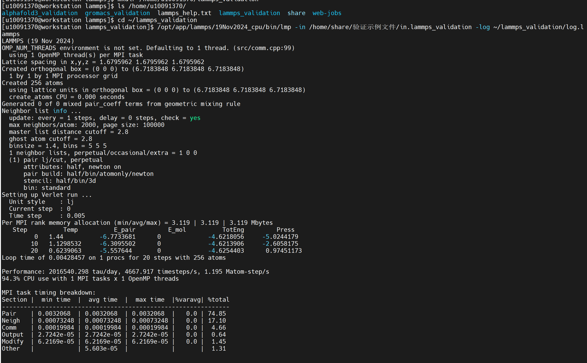
  
10、查看 LAMMPS 验证输出文件。

.. code-block:: text
         :linenos:
         :emphasize-lines: 1

         ls -lh ~/lammps_validation

证明：输出目录中生成 lammps_help.txt、lammps_validation.data、log.lammps 等文件，说明 LAMMPS 验证任务已产生日志文件和数据输出文件。

如下图：

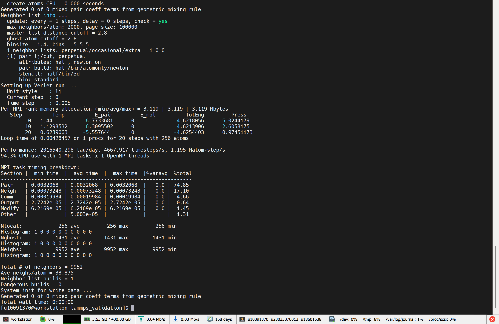
  
11、查看 LAMMPS 运行日志中的完成信息。

.. code-block:: text
         :linenos:
         :emphasize-lines: 1

         grep -E "Total wall time|Loop time|ERROR|WARNING" ~/lammps_validation/log.lammps

证明：返回 Loop time of 0.00455826 on 1 procs for 20 steps with 256 atoms 和 Total wall time: 0:00:00，说明 LAMMPS 验证算例运行完成。

如下图：

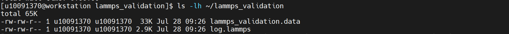
  
12、创建并执行 LAMMPS 环境汇总验证脚本。

.. code-block:: text
         :linenos:
         :emphasize-lines: 1

         cat > lammps_env_validation.sh <<'EOF'

         #!/bin/bash

         set -e

         LAMMPS_BIN=/opt/app/lammps/19Nov2024_cpu/bin/lmp
         LAMMPS_INPUT=/home/share/验证示例文件/in.lammps_validation
         WORKDIR=$HOME/lammps_validation

         mkdir -p "$WORKDIR"

         echo "=================================================="
         echo "LAMMPS Environment Validation"
         echo "=================================================="

         echo "[1] LAMMPS install path:"
         cd /opt/app/lammps && pwd

         echo
         echo "[2] LAMMPS directory content:"
         ls -l | head

         echo
         echo "[3] LAMMPS executable:"
         ls -lh "$LAMMPS_BIN"

         echo
         echo "[4] LAMMPS help:"
         "$LAMMPS_BIN" -h > "$WORKDIR/lammps_help.txt" 2>&1
         head -40 "$WORKDIR/lammps_help.txt"

         echo
         echo "[5] Validation input file:"
         ls -lh "$LAMMPS_INPUT"
         cat "$LAMMPS_INPUT"

         echo
         echo "[6] Check key LAMMPS commands in input:"
         grep -E "units|atom_style|lattice|region|create_box|create_atoms|pair_style|pair_coeff|fix|run|write_data" "$LAMMPS_INPUT"

         echo
         echo "[7] Run LAMMPS validation case:"
         cd "$WORKDIR"
         "$LAMMPS_BIN" -in "$LAMMPS_INPUT" -log "$WORKDIR/log.lammps"

         echo
         echo "[8] Check output files:"
         ls -lh "$WORKDIR"
         grep -E "Total wall time|Loop time|ERROR|WARNING" "$WORKDIR/log.lammps" || true

         echo
         echo "[9] Python summary validation:"
         python - <<'PY'
         import os
         from pathlib import Path

         lammps_bin = Path("/opt/app/lammps/19Nov2024_cpu/bin/lmp")
         input_file = Path("/home/share/验证示例文件/in.lammps_validation")
         workdir = Path.home() / "lammps_validation"
         log_file = workdir / "log.lammps"
         data_file = workdir / "lammps_validation.data"

         print("LAMMPS binary exists:", lammps_bin.exists())
         print("Validation input exists:", input_file.exists())
         print("Validation log exists:", log_file.exists())
         print("Validation data output exists:", data_file.exists())

         if not lammps_bin.exists():
             raise SystemExit("Validation: FAIL - LAMMPS binary not found")

         if not input_file.exists():
             raise SystemExit("Validation: FAIL - input file not found")

         if not log_file.exists():
             raise SystemExit("Validation: FAIL - log file not generated")

         if not data_file.exists():
             raise SystemExit("Validation: FAIL - output data file not generated")

         print("LAMMPS install path: /opt/app/lammps")
         print("LAMMPS CPU binary: /opt/app/lammps/19Nov2024_cpu/bin/lmp")
         print("Validation input: /home/share/验证示例文件/in.lammps_validation")
         print("Validation output directory:", workdir)
         print("Validation: PASS")
         PY

         echo
         echo "=================================================="
         echo "LAMMPS Environment Validation Finished"
         echo "=================================================="
         EOF

.. code-block:: text
         :linenos:
         :emphasize-lines: 1

         chmod +x lammps_env_validation.sh

.. code-block:: text
         :linenos:
         :emphasize-lines: 1

         bash ~/lammps_env_validation.sh

证明：脚本返回 LAMMPS binary exists: True、Validation input exists: True、Validation log exists: True、Validation data output exists: True 以及 Validation: PASS，说明 LAMMPS 主程序、验证输入文件、运行日志和输出数据文件均验证通过。

如下图：

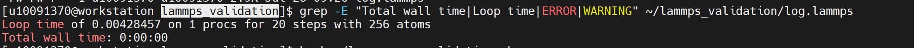
  